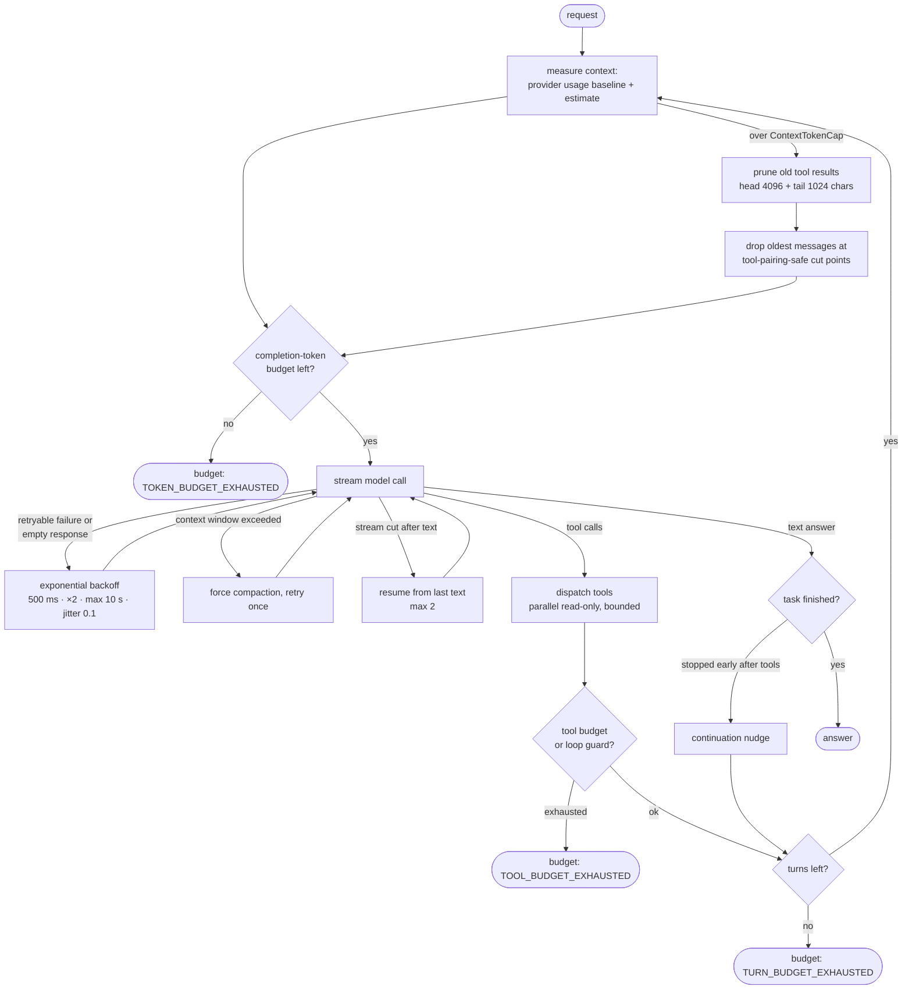
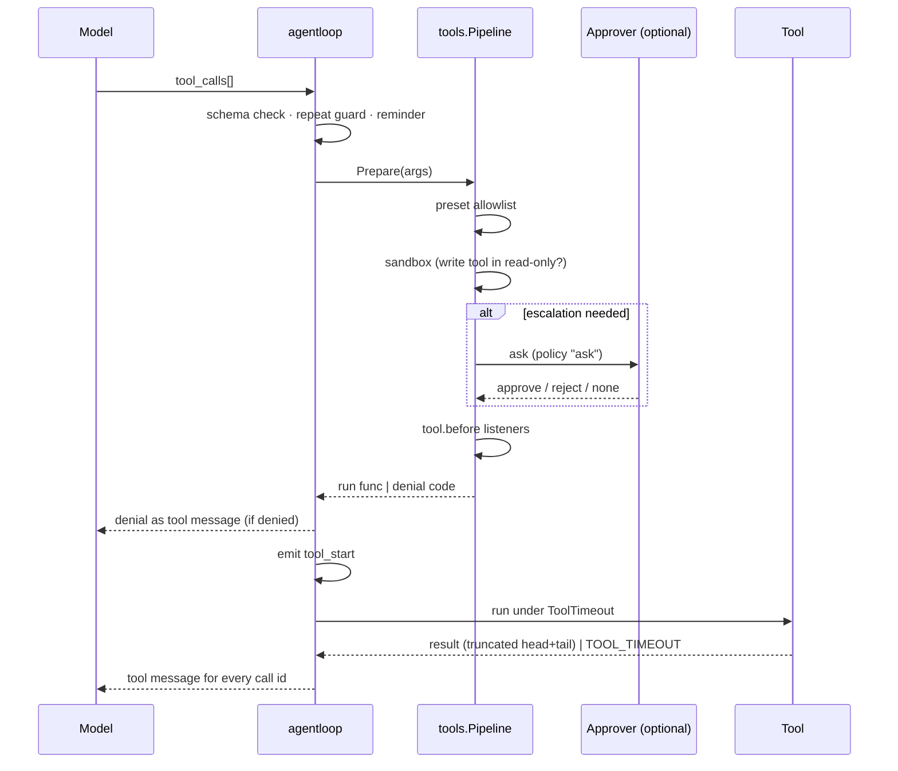

# HSG starter foundation

Ported from [govi-starter-kit](https://github.com/mahdyarief/govi-starter-kit)
at revision `9ec1944c9beddd4af9f33fb92a31622ddcaec52b`. Original copyright
and MIT licensing are retained in `LICENSE` and `server/LICENSE.md`.
This port establishes the starter foundation, tenant isolation and a limited
synthetic AI harness. It does not process claims or patient data.

A multi-tenant full-stack foundation: a Go API on Fiber v3 with PostgreSQL 18 and
[Authula](https://github.com/Authula/authula) embedded as a library, plus a
React 19 SPA on Vite and TanStack Router. The SPA is compiled into the API
binary, so production is one artifact with no separate asset server.

```
server/   Go API, migrations, seeders, Dockerfile
web/      React SPA (Vite, TanStack Router/Query/Form/Table, shadcn/ui)
```

## Agent harness

`server/internal/harness` is a tool-calling agent runtime written in Go. Its
core behaviour is ported from
[DeepSeek Harness](https://github.com/deepseek-ai/deepseek-harness) (DSH) at commit
`2e39e70496aa02986ca6a820c5d497e816b69d7e`. Each port names the DSH source
file in its doc comment, and each deliberate difference is written down with
its reason in `.trail/learnings/`. The production chat endpoint
(`handlers/chat.go`) runs on it.

This section separates what is **implemented and tested** from what is
**planned**. Only the first group should be cited as existing behaviour.

### Architecture

```mermaid
flowchart TB
    subgraph HTTP["HTTP layer (Fiber v3)"]
        H[handlers/chat.go<br/>SSE stream, billing, persistence]
    end
    subgraph HARNESS["server/internal/harness"]
        M[mount.go<br/>wires one scope per request]
        S[(scope<br/>typed DI: Key[T],<br/>Provide / Require, events)]
        L[agentloop<br/>turns · budgets · compaction<br/>retry · resume · nudges]
        D[dispatch<br/>prepare → tool_start → execute]
        P[tools.Pipeline<br/>allowlist → sandbox →<br/>approval → tool.before]
        G[guard<br/>repeat · reminder ·<br/>loop guards · timeout]
        A[llm adapter<br/>failure codes · backoff]
        C[core<br/>tool pairing · head+tail retention]
    end
    subgraph LIB["server/internal/lib"]
        GW[ai.Gateway<br/>single egress · host allowlist<br/>no provider body exposed]
        KB[kb + kbembed<br/>hybrid retrieval]
    end
    PROV[(OpenAI-compatible<br/>LLM provider)]
    PG[(PostgreSQL 18<br/>RLS per tenant)]

    H --> M --> S
    S --> L
    L --> A --> GW --> PROV
    L --> D --> P
    D --> G
    L --> C
    P --> T[tools: search_knowledge, web]
    T --> KB --> PG
```

### Agent loop

One run is a sequence of model turns, bounded by budgets that are checked
before every model call. Rounded boxes are terminal states, and each one is
reported to the client as an SSE event.



### Tool call pipeline

Every tool call passes the checks below before the client is told it started,
so a denied call is never shown as running. Every call gets an answer
message, including denied, skipped and timed-out calls, so the conversation
stays valid for OpenAI-compatible providers.



### Capability status

| Capability | Status | Where | DSH counterpart |
|---|---|---|---|
| Typed dependency scope with events | Implemented | `harness/scope` | Cordis plugin context |
| Turn, tool-call, duration and completion-token budgets | Implemented | `agentloop/loop.go`, `config.go` | `core/agent-loop` |
| LLM failure codes, retry set and exponential backoff | Implemented | `harness/llm`, `lib/ai/classify.go` | `llm/llm/src/retry-policy.ts`, `error.ts` |
| Empty-response retry (`EMPTY_RESPONSE`) | Implemented | `agentloop/loop.go` | retry policy |
| Stream-cut resume, billed across attempts | Implemented | `agentloop/loop.go` | interrupted `assistant/message` |
| Compaction: usage baseline, tool-result pruning, safe cuts | Implemented | `agentloop/compact.go`, `core` | `compaction-basic`, tool-result pruner |
| Tool pipeline: allowlist, sandbox, approval, listeners | Implemented | `harness/tools` | `core/tools/src/pipeline.ts` |
| Presets `read-only`, `workspace`, `strict` | Implemented | `harness/preset` | `interaction/permission-presets` |
| Parallel read-only tools, bounded concurrency, hard tool deadline | Implemented | `agentloop/dispatch.go` | `core/tools/src/batch.ts` |
| Repeat, reminder and repeated-error loop guards | Implemented | `harness/guard` | `guard/*` |
| Hybrid retrieval (BM25 + vector, weighted RRF) with citations | Implemented | `lib/kb`, `lib/kbembed` | — |
| Retrieval evaluation | Implemented | `lib/kbeval`, `cmd/kbeval` | — |
| Approval answerer and loop guards connected to the chat endpoint | Planned | — | `user-approval` |
| JSON Schema validation, structured (typed) results | Planned | foundation plan, Tasks 1–2 | `core/tools` |
| Agent profiles and parallel agent teams | Planned | foundation plan, Tasks 3–4 | `subagent-spawn-in-process`, `team` |
| Append-only run event log, grounded evidence | Planned | foundation plan, Tasks 5–6 | `session-persistence`, `session-projection` |
| Human review inbox | Planned | foundation plan, Task 7 | `interaction/user-questions` |
| Rule engine, HTTP service tool, retrieval validity filters | Planned | foundation plan, Tasks 8–10 | — |
| LLM record/replay, redaction, cost accounting, experiment runner | Planned | foundation plan, Tasks 11–14 | `test-support`, `session-stats`, `benchmarks` |

The foundation plan is
`docs/superpowers/plans/2026-11-22-harness-foundation-capabilities.md`.
Coding-agent features of DSH (computer use, browser, shell, SSH, sandbox
runners, workflow scripts, MCP, summarizer compaction) are intentionally
left out.

```mermaid
flowchart LR
    subgraph DONE["Implemented"]
        direction TB
        a1[single-agent loop]
        a2[budgets & guards]
        a3[retry & resume]
        a4[compaction]
        a5[tool pipeline & presets]
        a6[hybrid RAG + citations]
    end
    subgraph P1["Planned: composition"]
        direction TB
        b1[schema validation]
        b2[structured results]
        b3[agent profiles]
        b4[agent teams + reducers]
    end
    subgraph P2["Planned: provenance"]
        direction TB
        c1[run event log]
        c2[grounded evidence]
        c3[human review inbox]
    end
    subgraph P3["Planned: knowledge & measurement"]
        direction TB
        d1[rule engine]
        d2[HTTP service tool]
        d3[retrieval filters]
        d4[record/replay · redaction]
        d5[cost · experiment runner]
    end
    DONE --> P1 --> P2 --> P3
```



### Default limits

Defaults are applied by `agentloop.ResolveLoopConfig`. A value outside its
range is rejected rather than clamped.

| Setting | Default | Allowed range |
|---|---|---|
| `MaxTurns` | 6 | 1–8 |
| `MaxToolCalls` | 8 | 1–16 |
| `MaxDuration` | 90 s | 1 ms–2 min |
| `MaxTotalTokens` (completion) | 32,768 | 1–32,768 |
| `ContextTokenCap` | 12,288 | 1–32,768 |
| `KeepLastMessages` | 12 | 1–32 |
| `MaxToolConcurrency` | 4 | 1–8 |
| `ToolTimeout` | 15 s | 1 ms–30 s |
| `ToolResultBytes` | 8,192 | 1–32,768 |
| `MaxRetries` | 1 | 0–3 |
| `MaxPartialContinuations` | 2 | 1–8 |
| `MaxContinuationNudges` | 8 | 0–20 |

### Using it in research

- **Provenance.** The DSH revision ported from is pinned above. The parity
  plan (`docs/superpowers/plans/2026-11-21-dsh-core-parity.md`) lists every
  gap, the decision taken and the DSH file it maps to, and the git history
  has one commit per change.
- **Verification.** The harness packages have 98 test functions, and
  `lib/ai`, `lib/kb` and `lib/kbeval` have 147 more. Tests use fake models
  that fail the way the real gateway fails. Run them with
  `cd server && go test ./internal/harness/... ./internal/lib/...`.
- **Data handling.** The harness does not process claims or patient data.
  All provider traffic goes through `lib/ai`, which enforces a host allowlist
  and never returns provider body text to callers.
- **Limits of the current release.** It has no run event log, no structured
  results, no multi-agent orchestration and no LLM record/replay yet (see
  "Planned" above). Results that depend on those capabilities cannot be
  reproduced on this release.

## Requirements

- Go 1.27.3 or newer (the module declares `go 1.27.3`; `GOTOOLCHAIN=auto`
  fetches it if your local Go is older)
- Node 22 (see `.nvmrc`) and pnpm 11.10.0, pinned through
  `web/package.json#packageManager`. Run pnpm via `corepack pnpm` — pnpm is not
  assumed on your PATH.
- PostgreSQL 18 — the migrations use `uuidv7()`
- Docker, only if you want the bundled database

## Quick start

```sh
make install          # pnpm install + go mod download
make db-up            # PostgreSQL 18 in Docker on :5432
cp server/.env.example server/.env
cp web/.env.example web/.env
make dev              # API on :8080, web on :3000
```

Before `make dev`, set a unique `APP_SECRET` (at least 32 characters) in
`server/.env`. Siapkan pula role runtime tenant terpisah dan isi
`TENANT_DB_DSN`; role tersebut tidak boleh menjadi pemilik tabel, superuser,
memiliki `BYPASSRLS`, atau menjadi anggota role istimewa. Pool tenant tidak
boleh menggunakan credential migrasi atau Authula. Berikan hanya hak tabel
yang dibutuhkan setelah migrasi, bukan hak DDL. Startup menolak role tenant
yang tidak memenuhi pembatasan tersebut.

No default admin account is configured. To create one, set
`SUPER_USER=email:password` with a unique 12–128 character password and enable
`SEED_ON_BOOT=true` for one run. Then disable seeding; future seeded boots reset
that account's password to the configured value.

`make dev` runs both processes; Ctrl-C stops them together. Open
http://localhost:3000. The API applies migrations on boot because
`MIGRATE_ON_BOOT=true`.

The Compose database and example DSN use public **local-development-only**
credentials and bind PostgreSQL to loopback. Never use those credentials in
production; configure a separate database and secure credentials first.

## Layout

| Path | What lives there |
| --- | --- |
| `server/cmd/api` | HTTP entry point, routes, Authula wiring |
| `server/cmd/migrate` | Migration and seeder CLI |
| `server/internal` | Config, handlers, repositories, middlewares, models, DTOs |
| `server/migrations` | Versioned SQL migrations |
| `server/internal/web` | `go:embed` SPA bundle plus its fallback handler |
| `web/src/routes` | File-based TanStack Router routes |
| `web/src/components` | Layout, UI primitives, and feature blocks |
| `web/src/lib/api` | Models, DTOs, services, and TanStack Query options |

## API contract

Everything lives under `/api/v1`. Authula keeps its native response shapes
(no `{data}` envelope); the application's own endpoints answer with
`{data, metadata?, message?}`.

| Method | Path | Notes |
| --- | --- | --- |
| `POST` | `/api/v1/auth/email-password/sign-in` | Returns `{user, session, access_token, refresh_token, expires_at, expires_in}` |
| `POST` | `/api/v1/auth/token/refresh` | Returns `{access_token, refresh_token}` |
| `POST` | `/api/v1/auth/sign-out` | Ends the session |
| `GET` | `/api/v1/me` | `{data}` envelope; the app role lives here, not in Authula |
| `GET` | `/api/v1/categories` | Public list |
| `POST` `PUT` `DELETE` | `/api/v1/categories` | Super user only, idempotency guarded |

Roles are `super_user` and `user`, stored in the `users` mirror table. The
frontend reads them from `GET /api/v1/me`, because Authula does not know about
application roles.

## Commands

Root `Makefile`:

| Target | Does |
| --- | --- |
| `install` | Install web dependencies and download Go modules |
| `dev` | Run API and Vite dev server together |
| `dev-server` | Run only the API |
| `dev-web` | Run only the Vite dev server |
| `build` | Build the SPA and embed it into the API binary |
| `build-web` | Build the SPA only, into `web/dist` |
| `test` | Run the Go test suite |
| `lint` | `go vet` plus `tsc --noEmit` |
| `db-up`, `db-down`, `db-reset` | Manage the Dockerized PostgreSQL |
| `clean` | Remove build output |

`server/Makefile` keeps the migration targets (`db/migrations/up`,
`db/migrations/down`, `db/migrations/new name=...`) and the Go release builds.

## Fondasi SaaS dan AI

Platform admin (`super_user`) dapat membuat tenant dan mengelola konfigurasi LLM global. Role tersebut tidak otomatis memberikan akses ke tenant; akses tenant tetap memerlukan membership `tenant_admin` atau `reviewer`. Penetapan membership diperiksa server pada setiap transaksi. Pool tenant harus memakai role database terpisah, bukan pemilik tabel.

Konfigurasi LLM tersedia melalui `GET/PUT /api/v1/platform/llm-config`; `POST /api/v1/platform/llm-test` hanya menjalankan demo sintetis tetap. Isi endpoint chat completions lengkap, bukan URL dasar provider. Host endpoint harus tercantum persis dalam `LLM_ALLOWED_HOSTS`. Alamat privat, redirect, proxy environment, dan DNS yang mencampur alamat publik/privat ditolak.

Credential hanya dapat ditulis atau dihapus, tidak dibaca kembali melalui API. `LLM_ENCRYPTION_KEY` harus berisi base64 dari 32 byte acak dan disimpan di luar database; kehilangan kunci membutuhkan pengisian ulang credential. Mengubah endpoint membutuhkan credential baru atau penghapusan credential lama. LLM nonaktif secara default, tanpa fallback provider.

Harness belum memproses klaim atau data pasien. Demo memakai bukti fiktif server-side, satu tool read-only, dan validasi bukti/output. Kegagalan provider atau output tidak valid menghasilkan abstain, bukan keputusan klaim.

Batas output dikonfigurasi per panggilan (`max_tokens` pada `llm_config`) dengan nilai aktif **16.384** token (cek `1..16384`, default 16.384). Runner membatasi total token per run (`MaxTotalTokens`) hingga 32.768 agar multi-step tetap punya ruang, dengan pagar turn (default 6), tool-call (default 8), dan durasi (default 90 detik, maksimal 2 menit). Batas ini berlaku per run, bukan kuota biaya bulanan. Bila provider memutus stream SSE setelah mengeluarkan teks, runner melanjutkan jawaban dari titik terakhir (resume, maksimal 2 kali) sehingga turn berakhir lengkap, bukan parsial.

Sebelum deployment nyata, tetapkan persetujuan provider/region, kebijakan retensi dan pelatihan data, pengelolaan kunci, pembatasan egress jaringan, backup, serta audit operasional. Rate limiter dan idempotency starter masih in-memory; deployment multi-replica membutuhkan penyimpanan bersama.

## Basis Pengetahuan (Knowledge Base)

Fondasi menyertakan basis pengetahuan berbasis berkas yang memungkinkan model mencari dokumen internal dan mencantumkan kutipan. Lihat `server/README.md` untuk endpoint lengkap.

- **Unggah dokumen**: PDF, DOCX, XLSX, CSV, MD, TXT; maksimal 3 MiB per berkas. Super user mengelola pustaka global; pengguna tenant mengelola pustaka tenant-nya.
- **Ekstraksi & chunking**: worker latar memilah teks, memotong menjadi passage (default target 1 800 karakter, maksimum 3 200, overlap 200), dan menyimpan blob mentah terenkripsi.
- **Embedding mandiri**: BAAI/bge-m3 (dense 1024-dimensi, cosine, `normalization=l2`, `preprocessing=kb-chunk-v1`), terpaket di deploy (`deploy/embedding/`) dan disegel credential-nya saat `init-db.sh`.
- **Retrieval hibrida**: BM25 leksikal + pencarian vektor semantik, digabung dengan Reciprocal Rank Fusion (RRF) berbobot. Tanpa embedding aktif, jatuh ke leksikal saja. Tiap passage memiliki `locator` (mis. "halaman 3, paragraf 2") yang menjadi rujukan kutipan.
- **Tool `search_knowledge`**: dijalankan agent saat pertanyaan menyentuh dokumen yang diizinkan untuk sesi tersebut; passage, judul, dan locator yang dikembalikan diperlakukan sebagai data referensi yang tidak terpercaya.
- **Kutipan & pratinjau**: pesan asisten menyertakan `references[]` (`{title, locator, excerpt, score}`); locator dapat diklik untuk membuka pratinjau yang diarahkan ke passage yang dikutip.
- **Metrik penggunaan**: pelacakan seberapa sering tiap dokumen menyumbang hasil `search_knowledge` (leksikal vs semantik) untuk mengevaluasi efektivitas dokumen.
- **Bahasa LLM**: `llm-config` menerima `language` (default `"id"`) yang disuntikkan ke system prompt.

## Production build

```sh
make build
```

That runs the Vite build, copies `web/dist` into `server/internal/web/dist`,
and compiles `server/bin/api`. The binary serves the API and the SPA; unknown
`/api/*` paths still 404 instead of falling back to `index.html`.

For a container:

```sh
docker build -f server/Dockerfile -t hsg .
docker run --rm -p 8080:8080 --env-file server/.env hsg
```

The image is multi-stage (Node for the SPA, Go for the binary) and runs
distroless as a non-root user.

## Environment

`server/.env.example` documents every server setting; the important ones:

| Variable | Notes |
| --- | --- |
| `APP_SECRET` | At least 32 characters; signs Authula tokens |
| `DB_DSN` | PostgreSQL URL; `AUTHULA_DATABASE_URL` must not be set |
| `TENANT_DB_DSN` | Pool tenant terpisah, tanpa privilege owner atau bypass RLS |
| `LLM_ENCRYPTION_KEY` | Kunci credential platform, base64 dari 32 byte acak |
| `LLM_ALLOWED_HOSTS` | Host HTTPS persis dipisahkan koma, tanpa port atau wildcard |
| `EMBEDDING_WORKER_DB_DSN` | Opsional; kosong menonaktifkan worker. Gunakan role LOGIN terisolasi dengan membership `hsg_embedding_worker`, tanpa akses tabel langsung |
| `EMBEDDING_ALLOWED_HOSTS` | Izin host embedding persis, terpisah dari LLM; kosong menolak semua host |
| `EMBEDDING_ALLOW_PRIVATE` | Default `false`; hanya untuk endpoint self-hosted pada jaringan privat tepercaya |
| `ENV` | `development`, `staging`, or `production`; unset means production |
| `MIGRATE_ON_BOOT` | Apply embedded migrations at startup |
| `SEED_ON_BOOT` | Run idempotent seeders at startup (needs `SUPER_USER`) |
| `CORS_ALLOWED_ORIGINS` | Comma-separated browser origins |

`web/.env.example` has `VITE_APP_NAME` and `VITE_API_URL`. Leave
`VITE_API_URL` empty to use the same origin; the dev server proxies `/api` to
`VITE_API_PROXY_TARGET` (default `http://localhost:8080`).
