# Arsitektur HSG — Draf v0.6

- **Status**: `pending approval` (draf untuk diskusi). Fondasi platform sudah diimplementasikan; fitur klaim yang dirancang di dokumen ini belum.
- **Tanggal**: 2026-10-27 (catatan status implementasi ditambahkan 2026-11-02)
- **Konteks**: HSG — validasi berkas klaim (PDF gabungan per klaim)
- **Stack**: Go + `govi-starter-kit`; sidecar Python untuk parsing PDF
- **Dokumen berikutnya**: [PRD HSG](prd-hsg.md)

> **Status implementasi (2026-11-02).** Dokumen ini tetap rancangan untuk alur
> validasi klaim, yang belum dikodekan. Yang sudah berjalan adalah **fondasi
> platform**: autentikasi multi-tenant dengan RLS, konfigurasi LLM global,
> harness chat agent berstreaming (dengan resume stream terputus), basis
> pengetahuan berbasis berkas dengan retrieval hibrida (BM25 + pgvector),
> kutipan referensi, metrik penggunaan, dan chat pribadi platform untuk
> `super_user`. Rincian endpoint dan batas operasional ada di
> [`server/README.md`](../server/README.md) dan [`README.md`](../README.md);
> catatan deploy ada di [`deploy/README.md`](../deploy/README.md). Bagian §1–§12
> di bawah adalah desain target untuk fitur klaim, bukan deskripsi kode saat ini.

Dokumen ini adalah **arsitektur solusi** HSG: batas sistem, kapabilitas, alur data, komponen, kontrak data, keamanan, dan keputusan teknis beserta alasannya. Dokumen ini **bukan** PRD (ruang lingkup fitur per fase, aktor, dan kriteria penerimaan ada di dokumen terpisah), **bukan** spesifikasi kontrak API final (skema endpoint, payload, dan kode error ditetapkan pada dokumen API), **bukan** rencana uji lengkap (kasus uji rinci dan dataset acuan berada pada dokumen pengujian), dan **bukan** komitmen jadwal atau rilis. Bagian yang bernuansa kebijakan bisnis (§11.1–§11.2) dan matriks evaluasi (§12.2) disertakan hanya sebatas mengikat keputusan teknis, bukan sebagai keputusan produk atau jaminan mutu. Seluruh isi berstatus `pending approval`.

## 1. Ringkasan

HSG menerima berkas klaim sebagai **satu PDF gabungan per klaim**, mengekstrak teks per halaman sebelum menentukan batas dokumen penyusunnya, memvalidasi kelengkapan dan koding, lalu melaporkan hasil review per klaim. Tiga kategori bisnis berikut dipertahankan, tetapi hanya diterbitkan sesuai cakupan pemeriksaan dan aturan agregasi §9.1:

- **Lengkap** — seluruh pemeriksaan wajib yang berlaku berhasil dijalankan, dokumen wajib tersedia dan terbaca, serta tidak ada temuan yang menghalangi kategori ini. Bukan jaminan klaim akan dibayar.
- **Potensi tidak lengkap** — ada dokumen wajib yang terkonfirmasi tidak ditemukan atau tidak terbaca; alasan membedakan keduanya. Kegagalan worker/OCR bukan bukti bahwa dokumen hilang.
- **Potensi tidak layak** — ada temuan koding, angka, atau konsistensi yang didukung bukti dan relevan terhadap persyaratan klaim. Temuan ini tetap ditampilkan meskipun ada dokumen lain yang belum lengkap.

Setiap hasil disertai **alasan**, **bukti**, **status proses**, dan **cakupan pemeriksaan**. Bila pemeriksaan wajib belum dapat dinilai dan belum ada dasar untuk kategori bisnis, `status_review` bernilai `null`, dengan tampilan **Belum dapat disimpulkan**; ini bukan kategori kelayakan keempat. Tidak adanya temuan tidak sama dengan seluruh pemeriksaan lolos.

Hasil tersebut digunakan oleh **workspace Operasional Klaim** untuk antrean, penugasan dan tindak lanjut reviewer, serta oleh **Pustaka Aturan** untuk menelusuri sumber/versi dan mengevaluasi perubahan aturan (§5.1–§5.3). Workflow internal ini tidak menjadikan HSG sistem pengajuan atau pembayaran klaim.

## 2. Tujuan dan non-tujuan

Tujuan:

- Otomasi penilaian berkas klaim: kelengkapan, koding, kewajaran angka, konsistensi.
- Hasil berbasis bukti, konsisten dengan aturan berversi, dapat diaudit, dan memiliki batas reproducibility yang eksplisit (§12).
- API + dashboard untuk review dan drill-down oleh manusia, termasuk workspace operasional serta pustaka aturan (§5.1–§5.3).
- Pisahkan hasil mesin, tindak lanjut manusia di HSG, dan status administratif dari sistem sumber. Pencatatan tugas/anotasi internal tidak mengubah klaim sumber.

Kapabilitas review awal:

- **Kelengkapan berkas** — bandingkan dokumen yang terdeteksi dengan daftar dokumen wajib nasional dan penyesuaian penyedia; dokumen kondisional diperiksa hanya jika konteks klaim menunjukkan pemicunya.
- **Persyaratan klinis per diagnosis** — cocokkan diagnosis yang teridentifikasi dengan aturan nasional/domain pack untuk kriteria klinis, skor, dokumen penunjang, dan temuan yang perlu diperiksa. Temuan harus menunjuk bukti dokumen/halaman; bila bukti tidak terbaca atau tidak tersedia, nyatakan tidak dapat dinilai.
- **Kesesuaian diagnosis dan ICD-10** — bandingkan diagnosis yang dikoding pada metadata/berkas dengan diagnosis dan temuan klinis dalam dokumen; tandai kode yang tidak didukung bukti atau bukti klinis yang mungkin belum dikoding.
- **Kesesuaian tindakan dan ICD-9-CM** — bandingkan tindakan yang dikoding dengan laporan operasi/prosedur dan bukti tindakan lain; tandai kode yang tidak didukung atau tindakan terdokumentasi yang mungkin belum dikoding.
- **Koding terlewat** — cari tindakan/diagnosis yang jelas terdokumentasi tetapi tidak tampak pada daftar koding klaim, lalu tampilkan sebagai kandidat review dengan bukti sumber dan kode kandidat dari kamus terkelola. Jangan menyisipkan atau merekomendasikan kode tanpa bukti.
- **Aturan koding lintas diagnosis** — periksa aturan kombinasi, urutan diagnosis utama/sekunder, dan aturan koding klaim yang berlaku; setiap rule memiliki sumber, cakupan, dan versi yang dapat ditelusuri.
- **Pencarian dan guard ICD** — gunakan pencarian kandidat ICD-10/ICD-9-CM dari kamus terkelola; guard deterministik memeriksa format kode, sistem/peran kode, asal kandidat, dan memaksa abstain bila bukti atau kandidat tidak memadai. Pencarian kandidat bukan keputusan koding.
- **Konsistensi klaim** — bandingkan informasi antar dokumen, metadata klaim, hasil grouping/tarif yang tersedia, dan referensi aturan yang berlaku. Dashboard dapat merangkum pola temuan lintas klaim untuk pemantauan, tanpa menggantikan review per klaim.

Kapabilitas tersebut menghasilkan temuan kandidat yang menyertakan alasan, rujukan bukti, rule yang digunakan, dan status pemeriksaan (terpenuhi, temuan, atau tidak dapat dinilai). HSG tidak menetapkan diagnosis, mengubah kode klaim, atau menyatakan kepastian bahwa koding terlewat; keputusan tetap pada tenaga berwenang. Pemeriksaan tanpa bukti sumber yang dapat ditelusuri harus abstain, bukan menyimpulkan.

Batas portabilitas kapabilitas:

- **Langsung sesuai input PDF** — checklist dokumen kondisional, pemeriksaan persyaratan klinis dan aturan koding, pencarian ICD, serta guard atas kandidat dapat dijalankan dari teks PDF yang diekstrak dan domain pack terkelola.
- **Bergantung pada kelengkapan input** — kesesuaian kode dan deteksi koding terlewat memerlukan daftar diagnosis/prosedur yang diklaim di PDF atau metadata adapter. Tanpanya, tampilkan sebagai tidak dapat dinilai.
- **Bergantung pada data angka/grouping** — klasifikasi kesiapan klaim dan proyeksi nilai memerlukan status pengiriman, hasil grouping, tarif, serta nilai pengajuan/topup; lakukan hanya jika sumber PDF atau metadata adapter menyediakan seluruh field yang dibutuhkan. Tidak boleh menginferensikan field yang tidak ada.
- **Di luar review satu klaim PDF** — rekonsiliasi billing terhadap katalog tindakan dan analisis tren bulanan lintas episode memerlukan akses data terstruktur terpisah; bukan asumsi kapabilitas dari berkas PDF.

Non-tujuan (phase-1):

- Tidak mengirim, mengubah, atau menutup klaim di sumber (read-only).
- Tidak menyetujui pengajuan, menandatangani dokumen klinis, mengirim pesan ke DPJP, mengajukan dispute, atau mengeksekusi pembayaran. Menu mockup yang menyiratkan aksi tersebut dipetakan menjadi review/pencatatan internal atau ditunda sampai scope integrasi disetujui.
- Bukan pengganti sistem sumber, bukan billing system, bukan aplikasi koding penuh.
- Bukan diagnosis otomatis; "tidak layak" adalah dugaan, bukan keputusan.

## 3. Prinsip

1. **Read-only** — HSG hanya membaca; tidak menulis ke sumber data.
2. **Adaptif** — kontrak input generik; detail integrasi diadapter per penyedia.
3. **Deterministik dulu** — aturan eksplisit menjadi tulang punggung; AI (LLM-assisted) hanya untuk kasus samar.
4. **Kanonis** — satu taksonomi dokumen kanonis; setiap penyedia memetakan ke sini.
5. **Audit penuh** — setiap klaim tercatat: asal dokumen, versi aturan, hasil, dan korelasi.
6. **Pemisahan state** — read-only berlaku terhadap sistem sumber; HSG menyimpan input, hasil, workflow review, dan konfigurasi terotorisasi miliknya sendiri. Perubahan workflow tidak menimpa hasil mesin atau status eksternal.

## 4. Gambaran Input → Proses → Output

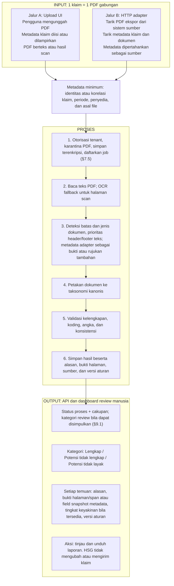

## 5. Arsitektur kapabilitas

Diagram ini memperlihatkan bagaimana masukan diubah menjadi kapabilitas review, dan bagaimana setiap temuan ditautkan kembali ke bukti serta aturan yang dipakai. Adapter memasok PDF dan metadata. Sumber fakta review adalah dokumen atau field snapshot metadata berprovenance; precedence per field dan penanganan konflik mengikuti §9.1. Referensi aturan berversi menentukan pemeriksaannya, bukan menggantikan fakta episode.

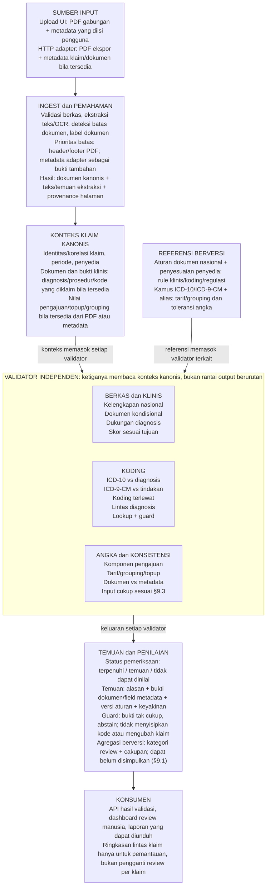

Kapabilitas rekonsiliasi billing terhadap katalog tindakan dan tren lintas episode tidak berada pada jalur PDF mandiri; keduanya memerlukan sumber data terstruktur yang disepakati dan tidak diasumsikan tersedia pada adapter.

### 5.1 Workspace Operasional Klaim

Workspace mengonsumsi hasil mesin, bukan menggantikan validator. Daftar klaim mendukung pencarian/filter, paging server-side, penugasan, prioritas yang dapat dijelaskan, serta drill-down ke bukti. Tampilan detail memisahkan temuan, rekomendasi koding, cakupan pemeriksaan, anotasi reviewer, dan snapshot status administratif. Riwayat memperlihatkan revisi input dan review yang benar-benar dipakai pada setiap keputusan.

Alur internal: input diterima → job review → hasil/abstain → tugas reviewer → konfirmasi temuan atau permintaan perbaikan → revisi input bila tersedia → review baru → penutupan tugas internal. Permintaan klarifikasi adalah catatan/tugas dalam HSG, bukan pengiriman ke dokter. Penerimaan rekomendasi kode dicatat sebagai pendapat reviewer; kode sumber tetap hanya berubah lewat workflow sistem sumber. Tingkat temuan Menghambat/Klarifikasi/Catatan dipetakan melalui policy berversi, bukan disamakan dengan tiga kategori hasil §9.1.

### 5.2 Workspace Pustaka Aturan

Pustaka menyediakan pencarian naskah/butir, tanya berbukti, penampil naskah asli pada locator yang benar, unduhan berizin, pengelolaan versi/persetujuan sumber, penyusunan draf rule, dan simulasi dampak perubahan. Alurnya: unggah/ambil sumber → karantina → verifikasi keaslian/masa berlaku/scope → persetujuan penerbitan → indeks sumber → penelaahan butir → draf rule → evaluasi/regression → persetujuan pack → aktivasi terkontrol. Pencarian historis menyatakan tanggal acuan; replay review lama memakai versi terikat manifest, bukan versi terbaru.

Aturan lokal seperti kesepakatan/PKS/rekomendasi yang disediakan tenant bukan otomatis kewajiban nasional. Setiap rule menyebut otoritas, scope, dasar dan prioritas; konflik sumber menghentikan check terkait sampai ditelaah. Draft membutuhkan pemilihan butir, kondisi applicability, input wajib, tingkat temuan, periode serta penyetuju independen. Logika dari teks bebas atau LLM tidak dieksekusi sebagai kode/SQL; bentuk rule terstruktur tervalidasi dan mekanisme authoring masih keputusan desain lanjutan. Penggantian sumber menandai rule turunannya untuk telaah, tidak mengganti rule aktif atau hasil lama secara otomatis.

### 5.3 Pemetaan mockup dan batas adopsi

Pemetaan menu dari mockup awal merupakan acuan cakupan arsitektur, bukan bukti bahwa API, persistensi, otorisasi, atau integrasi eksternal telah diimplementasikan. Rincian fase implementasi tetap `pending approval`.

Pemetaan ini berasal dari mockup awal HSG yang dipelajari sebagai bahan masukan, bukan dari artefak yang disimpan atau dirujuk oleh repo ini. Kolom sebelumnya merujuk Draf v0.5; seluruh penambahan berikut adalah rancangan, bukan hasil implementasi.

| Cluster/menu mockup | Cakupan sebelumnya | Adopsi pada arsitektur ini |
|---|---|---|
| Operasional Klaim / **Dashboard Klaim** (`s-dashboard`) | Dashboard generik tanpa definisi proyeksi operasional | Ringkasan volume, cakupan, antrean/tugas dan umur kasus; filter periode, jenis layanan, unit dan drill-down. KPI pengajuan/pending/pembayaran hanya bila snapshot sumber tersedia; as-of, denominator, nilai tidak tersedia dan jenis nominal wajib jelas (§9.3, §9.5) |
| Operasional Klaim / **Antrean Klaim** (`s-antrean`) | Input/review per klaim tersedia; assignment dan prioritas belum dikontrakkan | Upload PDF gabungan, pencarian/filter/paging, prioritas terjelaskan dan tugas reviewer. Status proses, kategori mesin, tugas manusia dan status sumber tidak digabung. Tenggat/prioritas hanya dihitung dari rule dan data yang disetujui (§5.1, §9.5) |
| Operasional Klaim / **Validasi & Koding** (`s-detail`) | Validator dan evidence telah tercakup; keputusan per temuan belum rinci | Detail bukti, tingkat temuan, kandidat ICD 2010, terima/tolak/usulan alternatif sebagai anotasi internal, dan riwayat revisi. Penyelesaian review bukan persetujuan pengajuan atau perubahan kode sumber (§9.1–§9.5) |
| Operasional Klaim / **Pending & Dispute** (`s-pending`) | Belum ada case workflow eksternal | Snapshot umpan balik/alasan berprovenance, timeline, penanggung jawab, tugas perbaikan/klarifikasi dan review ulang. Tenggat internal dipisahkan dari tenggat administratif berbasis aturan. Tombol Ajukan Dispute/pesan DPJP tidak diadopsi sebagai aksi eksternal; cukup catat tindak lanjut dan bukti dari sumber (§9.5) |
| Operasional Klaim / **Batch Pengajuan** (`s-batch`) | Belum ada kontrak kelompok | Adopsi terbatas sebagai **Kelompok Tinjauan**, berisi snapshot anggota/review, ringkasan dan konfirmasi internal. Tidak memakai label kiriman resmi. Kunci/kirim BPJS, persetujuan pengajuan dan acknowledgement eksternal di luar scope; state pengajuan yang ditampilkan harus berasal dari sumber (§9.5) |
| Pustaka Aturan / **Pustaka Aturan** (`s-pustaka`) | Domain pack dan sumber ada, belum ada fasilitas pencarian pengguna | Cari nomor/judul/butir, filter jenis/scope/periode/status, tanya berbukti, buka naskah pada locator asli dan unduh berizin. Draf dari butir masuk workflow authoring, tidak langsung aktif (§5.2, §9.6) |
| Pustaka Aturan / **Kelola Dokumen Sumber** (`s-dokumen`) | Versi pack ada, lifecycle naskah belum terpisah | Unggah/karantina, metadata dan masa berlaku, verifikasi, persetujuan orang kedua, relasi versi/pengganti dan riwayat. Naskah lokal privat dipisah dari sumber nasional/global; penerbitan sumber tidak otomatis menerbitkan rule (§9.6, §10.8) |
| Pustaka Aturan / **Dampak Aturan Berlaku Surut** (`s-surut`) | Re-run menghasilkan review baru, belum ada analisis kohort/delta | Simulasi baseline–candidate pada snapshot kohort, riwayat run, delta temuan/cakupan, ekspor berizin dan pembentukan tugas re-review setelah persetujuan. Pisahkan sudah diajukan/belum/tidak diketahui; tidak mengubah hasil lama atau menerapkan tanggal legal secara sepihak (§9.6) |

**Bagian demo yang tidak disalin sebagai fakta produk:** angka/KPI tetap, toast sukses, pergantian role di browser, logika waktu dengan tanggal demo, skor/confidence tetap, dan klaim adanya audit tanpa bukti persistensi. Pencarian tanggal tidak boleh sekadar menggambar ulang UI tanpa menerapkan applicability. Tanya pustaka harus memakai butir versi yang diotorisasi server, bukan mempercayai daftar dokumen dari browser. Citation harus menunjuk butir yang mendukung jawaban, bukan halaman pertama dokumen secara otomatis.

**Batas tambahan:** label Nilai Klaim pada mockup tidak diadopsi sebagai satu nominal campuran; billing, tarif grouping dan pengajuan tetap terpisah (§9.3). Tenggat enam bulan/pengecualian dispute dari demo tidak di-hardcode sebelum ditelaah terhadap sumber berlaku dan konteks episode. Indikasi duplikasi/upcoding/fragmentasi hanya hipotesis berbukti dengan cakupan eksplisit, bukan putusan kecurangan; pemeriksaan lintas episode memerlukan data tambahan, dan tidak ada temuan bukan bukti bebas kecurangan. Skor prediksi pending/penolakan bukan probabilitas terkalibrasi atau prasyarat default; memerlukan data outcome, evaluasi dan keputusan scope terpisah. Format TXT/CSV ekspor yang muncul di demo tidak memperluas kontrak input PDF saat ini. Menu Dokter & Mutu dan cluster lain di luar dua cluster ini tidak otomatis masuk scope.

## 6. Alur data terperinci

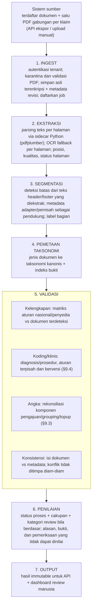

## 7. Arsitektur internal aplikasi

HSG menerapkan pola **AI Agent Harness yang dibatasi**. Harness adalah lapisan orkestrasi yang mengelola konteks klaim, pemilihan tool terdaftar, batas eksekusi, hasil, dan audit; bukan agent otonom yang bebas menentukan pemeriksaan atau menjalankan aksi. Validator deterministik tetap menjadi sumber keputusan pemeriksaan. LLM hanya membantu menafsirkan bagian narasi yang ambigu dan tidak pernah menjadi sumber fakta tanpa kutipan bukti.

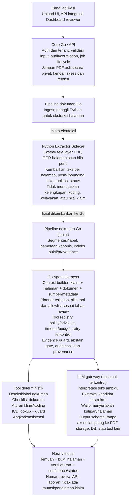

### 7.1 Batas tanggung jawab internal

- **Go Core** mengatur identitas, tenant, penerimaan berkas, alur kerja, batas ukuran/waktu, job lifecycle, penyimpanan hasil, audit, dan API. Go menjadi pemilik kontrak domain dan orkestrasi.
- **Python sidecar** menjalankan ekstraksi PDF dan OCR. Input/output-nya bertipe dan menyertakan nomor halaman, teks, posisi bila tersedia, kualitas OCR, serta kegagalan per halaman. Sidecar tidak mengakses database klaim atau memanggil LLM secara mandiri.
- **AI Agent Harness** menjalankan loop terbatas: membentuk konteks dari data klaim yang diizinkan, memilih tool yang telah diregistrasi, memvalidasi argumen/hasil, membatasi langkah dan ukuran output, lalu mencatat provenance. Tidak ada SQL bebas, tool write, atau pemanggilan tool di luar policy.
- **Tool deterministik** menjalankan pemeriksaan yang dapat dinyatakan sebagai aturan: daftar dokumen, syarat kondisional, rule klinis/koding berversi, pencarian kamus ICD, pemeriksaan angka, dan konsistensi lintas sumber. Hasilnya selalu menyebut versi rule dan bukti.
- **LLM** dipakai hanya bila pemetaan narasi atau interpretasi teks tidak cukup ditangani rule. LLM mengusulkan hasil terstruktur/kandidat, bukan memutuskan klaim; hasil yang tidak memiliki bukti kutipan dan halaman ditolak atau ditandai tidak dapat dinilai. Guard deterministik tetap memeriksa kandidat dan memaksa abstain bila bukti lemah.
- **Human reviewer** tetap berwenang mengonfirmasi atau menolak temuan. Harness tidak mengubah berkas sumber, diagnosis, kode, grouping, atau status klaim.

### 7.2 Pustaka Aturan sebagai sumber pengetahuan Harness

**Pustaka Aturan adalah sumber pengetahuan bersama untuk Harness AI**, bukan hanya menu pencarian pengguna. Naskah dan butir yang telah disetujui memasok konteks referensi kepada LLM melalui retrieval terkontrol (RAG); rule/pack yang diturunkan dan disetujui secara terpisah memasok pemeriksaan deterministik. Kedua jalur memakai provenance yang sama, tetapi teks sumber tidak otomatis menjadi rule executable.

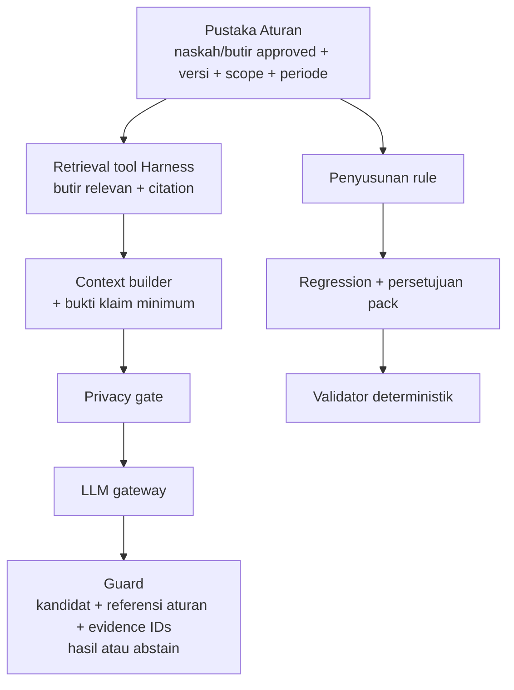

- Harness mengambil referensi melalui tool read-only terdaftar, dengan otorisasi tenant, scope global/lokal, periode episode, dan versi yang terikat pada run. LLM tidak mengakses indeks, database, atau dokumen privat secara langsung. Hanya butir relevan dalam budget konteks yang diberikan, bukan seluruh pustaka; ini penyediaan konteks saat inferensi, bukan training/fine-tuning model.
- Context builder memisahkan **referensi normatif** (`source_document_id`, versi/hash, `source_clause_id`, locator, serta relasi rule/pack bila ada) dari **bukti kasus** (§9.2). Aturan menjelaskan persyaratan; hanya bukti klaim yang dapat mendukung bahwa persyaratan itu terpenuhi pada pasien tersebut. Konflik atau sumber yang tidak memadai menghasilkan klarifikasi/abstain, bukan keputusan dari pengetahuan internal model.
- Manifest review (§12.1) merekam snapshot referensi yang benar-benar diberikan kepada LLM beserta versi konfigurasi retrieval dan konteks tersuntingnya sesuai retensi/otorisasi. Publikasi sumber baru tidak mengganti konteks run berjalan atau bukti review lama. Citation keluaran diperiksa terhadap butir yang diberikan; isi pustaka tetap data tidak tepercaya terhadap prompt injection, bukan instruksi yang dapat mengubah policy Harness.
- Gate privasi §10 mencakup query retrieval, embedding/reranking eksternal, kutipan sumber, dan konteks klaim. Jalur ini dipakai oleh review klaim berbantuan LLM maupun tanya pustaka (§9.6); akses draft hanya melalui sandbox evaluasi berizin dan tidak mencemari konteks produksi.

### 7.3 Siklus eksekusi review berbantuan agent

1. Buat `review_id` dan ikat ke `claim_id`, tenant, hash berkas, metadata sumber, serta versi pipeline.
2. Ekstrak PDF per halaman; tandai halaman kosong, hasil OCR berkeyakinan rendah, dan halaman yang gagal diproses.
3. Bentuk konteks klaim kanonis setelah segmentasi dokumen dari hasil ekstraksi; bangun indeks bukti dan pemetaan redaksi sesuai §9.2. Data tanpa asal tidak masuk konteks keputusan.
4. Jalankan pemeriksaan deterministik terlebih dahulu. Harness hanya mengaktifkan tool LLM-assisted pada item yang ambigu dan masih berada dalam scope policy; ambil butir Pustaka Aturan relevan melalui retrieval terotorisasi, ikat snapshot sumber, dan gabungkan dengan bukti klaim minimum melalui context builder serta gate privasi sebelum memanggil LLM.
5. Validasi keluaran kandidat terhadap schema, bukti, sumber rule, dan guard koding. Kandidat tanpa dukungan bukti menjadi abstain/tidak dapat dinilai.
6. Gabungkan temuan, deduplikasi tanpa menghilangkan jejak sumber, lalu hitung kategori review, status proses, dan cakupan dengan aturan §9.1; simpan hasil immutable dan audit trail.
7. Sajikan hasil kepada reviewer melalui API/dashboard; keputusan manusia tidak memicu write-back ke sumber.

Urutan interaksi komponen untuk satu run review:

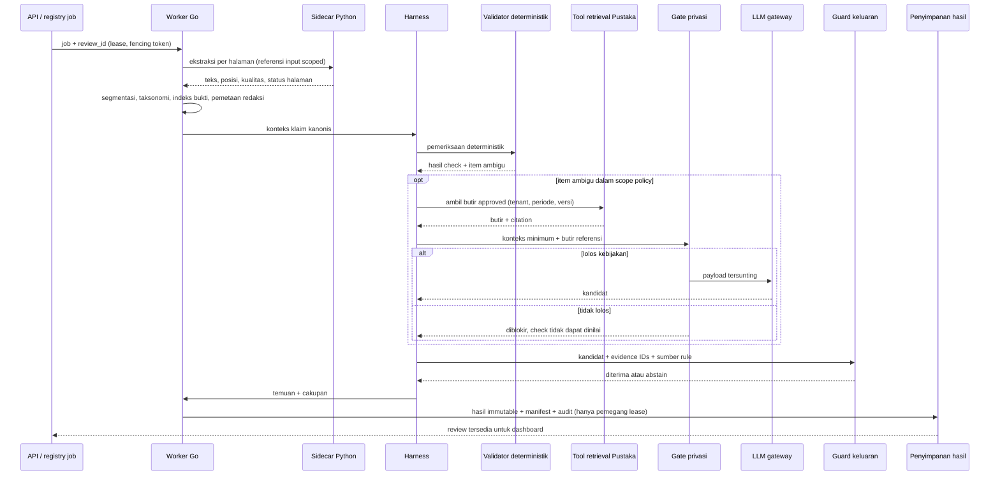

### 7.4 Kegagalan dan privasi

Kegagalan OCR atau LLM tidak boleh diubah menjadi temuan negatif: tandai check terkait `tidak dapat dinilai`, simpan kode kegagalan yang aman, dan lanjutkan hanya pada pemeriksaan yang inputnya lengkap. Ketidaktersediaan hasil teknis tidak membuktikan dokumen tidak ada. Cakupan/hasil parsial mengikuti §9.1; job dan retry mengikuti §7.5. Jalur LLM hanya memakai konteks minimum yang telah lolos kebijakan §10, bukan PHI mentah.

### 7.5 Job lifecycle, retry, dan kendali beban

Perpindahan status job (tahap internal seperti karantina file berada sebelum `antre` diproses dan tidak digambarkan sebagai status kontrak):

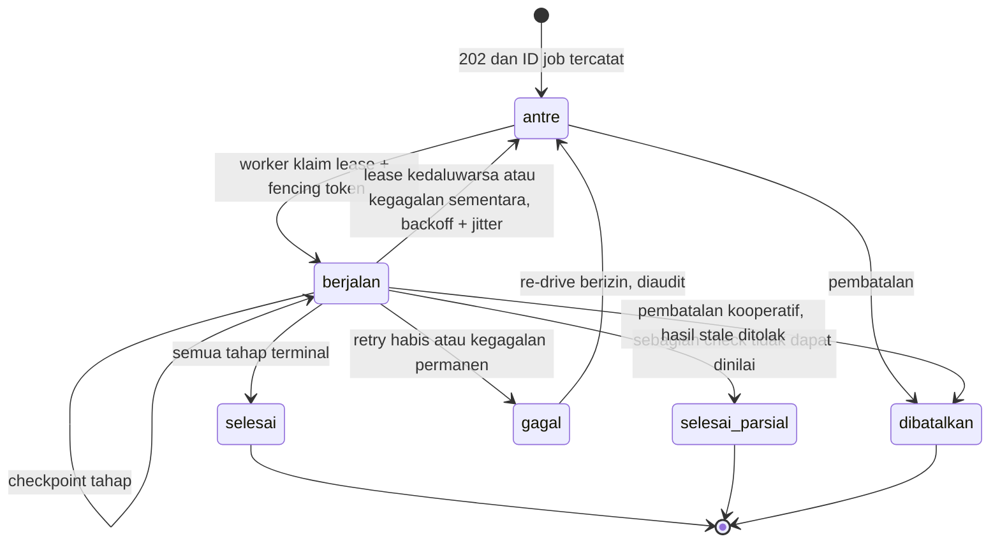

`selesai` berarti pipeline mencapai akhir, bukan semua pemeriksaan terbukti terpenuhi (§9.1). Apakah re-drive memakai job yang sama atau job baru menunggu keputusan teknis; yang pasti hasil lama tidak ditimpa.

- API mengotorisasi tenant, memvalidasi penerimaan, menyimpan PDF terenkripsi secara durable, lalu mempersistenkan revisi input dan job sebelum mengembalikan penerimaan (`202` dan ID job). Penerimaan bukan keberhasilan review; file baru dapat diproses setelah lolos karantina. Pada kegagalan di antara storage dan database, objek belum terpublikasi tidak diproses; rekonsiliasi orphan mengikuti retensi.
- Baseline pengiriman **at-least-once**: registry job persisten adalah source of truth. Bila queue terpisah dipilih, gunakan outbox/dispatcher agar commit job dan publikasi tidak kehilangan pekerjaan. Pilihan engine queue menunggu keputusan teknis; jangan mengasumsikan exactly-once dari broker.
- Idempotency key scoped ke tenant/operasi dan terikat pada fingerprint payload (PDF + metadata + konfigurasi review). Key sama dengan payload berbeda ditolak sebagai konflik. Re-run dengan revisi aturan/model berbeda membuat `review_id` baru yang mereferensikan review sebelumnya, bukan menimpa hasil.
- Worker mengklaim lease dengan fencing token/generation. Checkpoint tahap dan hasil akhir hanya boleh dipublikasikan worker yang masih memiliki lease; unique constraint/compare-and-set mencegah hasil ganda saat redelivery. Heartbeat, kedaluwarsa lease, dan pemulihan worker diuji bersama konkurensi.
- Retry hanya untuk kegagalan sementara, dengan backoff+jitter, batas percobaan/deadline dan budget. Kesalahan schema, payload, izin, redaksi, atau bukti tidak diulang sebagai retry sementara. Panggilan LLM yang timeout dapat tetap ditagih provider; deduplikasi hasil tidak menjamin deduplikasi biaya. Tidak ada retry write ke sistem sumber.
- Status terminal: `selesai`, `selesai_parsial`, `gagal`, `dibatalkan`. Cancellation kooperatif menghentikan tahap berikutnya dan menolak publikasi stale result; panggilan provider yang sudah berjalan belum tentu bisa dibatalkan. Job yang habis retry masuk daftar/antrean kegagalan untuk inspeksi dan re-drive berizin dengan audit.
- Queue hanya membawa ID internal, tenant scope, dan referensi objek, bukan PDF/OCR/prompt. Tiap perpindahan worker mengotorisasi ulang referensi; akses sidecar memakai referensi input scoped dan tidak memberi akses umum ke storage.
- Admission control, batas job aktif/ukuran PDF per tenant, batas CPU/memori OCR, concurrency provider, budget token/biaya, serta fair scheduling mencegah satu tenant menghabiskan kapasitas bersama. Nilai batas dipilih lewat load test (§12), bukan asumsi tick/timer tetap.

### 7.6 Jalur aplikasi operasional dan pustaka

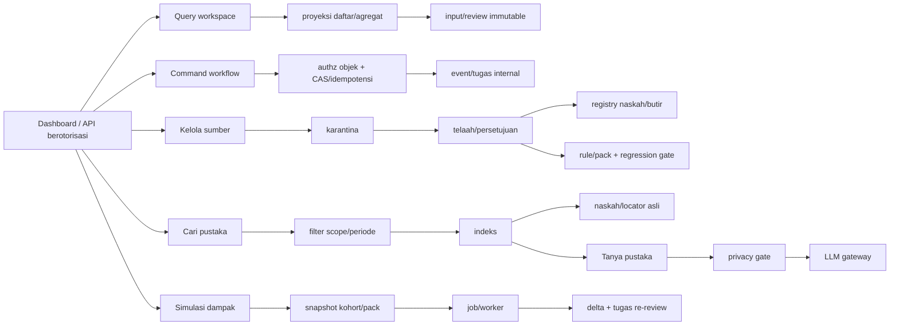

Layanan tersebut merupakan batas logis dalam core Go, bukan tuntutan microservice baru. Registry/proyeksi berada di PostgreSQL; PDF/snapshot besar di storage privat terenkripsi. Indeks pencarian adalah turunan registry, bukan source of truth. Satu run membaca versi pack tetap; publikasi rule saat run berlangsung tidak mengubah versinya di tengah proses. Query dan command tidak memberi LLM akses mutasi workflow/publikasi atau akses bebas ke data tenant. Proyeksi yang tertinggal menampilkan as-of/lag dan tidak boleh menjadi satu-satunya guard command; command memvalidasi state authoritative.

## 8. Komponen

| Komponen | Teknologi | Peran |
|---|---|---|
| Core API | Go/Fiber (`govi`) | Auth, tenant, audit, idempotency, envelope |
| Ingestor | Go + httpadapter | Terima PDF (upload / tarik API sistem sumber) |
| Segmenter | Go | Setelah ekstraksi: tentukan batas logis dokumen, pertahankan halaman asli |
| Extractor | Python sidecar (pdfplumber + OCR fallback) | Parsing PDF/scan → konten terstruktur |
| Pengetik Dokumen | Go | Label jenis dokumen per bagian PDF |
| Validator Kelengkapan | Go (engine deklaratif) | Checklist nasional + penyesuaian penyedia dan dokumen kondisional |
| Validator Klinis/Koding | Go (domain pack berversi) | Persyaratan klinis, ICD-10/ICD-9-CM, aturan lintas-koding, guard kandidat |
| Validator Angka/Konsistensi | Go | Bandingkan biaya, grouping, dan metadata bila tersedia |
| Analis Kasus Samar | Go + LLM-assisted | Interpretasi teks bebas; hasil disertai bukti atau abstain |
| Dashboard | React + TanStack + shadcn/ui | Workspace operasional klaim, review bukti, pustaka aturan, dan pemantauan sesuai §5.1–§5.3 |
| Layanan Workflow Review | Go, dalam core aplikasi | Penugasan, anotasi, kelompok tinjauan, serta proyeksi status internal terpisah dari klaim sumber |
| Registry Pustaka dan Rule | Go + PostgreSQL + object storage privat | Naskah sumber, butir/citation, versi rule/pack, persetujuan, serta indeks pencarian berotorisasi |
| Worker Dampak Aturan | Job persisten Go | Simulasi versi aturan dan pembentukan daftar re-review tanpa write-back |

### 8.1 Tampilan deployment

Baseline yang diusulkan adalah **SaaS multi-tenant terpusat**: satu platform HSG melayani banyak rumah sakit (tenant). Pilihan ini selaras dengan isolasi RLS (§10.7), KEK per tenant (§10.3), dan adapter HTTP (§10.6). Status `pending approval` (D-16).

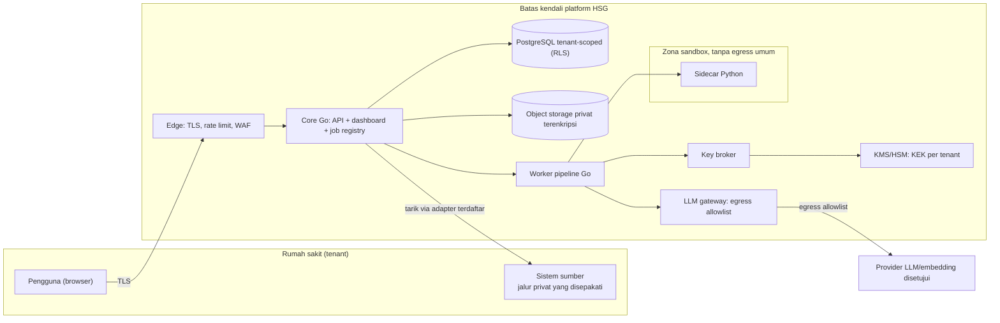

- **Zona terpisah**: edge/aplikasi, data (database + objek), sandbox ekstraksi, kunci, dan egress. Sidecar Python tidak memiliki credential database, KMS, maupun provider (§10.6); key broker tidak dipanggil lintas tenant oleh worker tanpa otorisasi (§10.3). Satu-satunya jalur keluar ke internet adalah adapter terdaftar dan LLM gateway, keduanya dengan allowlist.
- **Batas tenant bersifat logis** dalam infrastruktur bersama (RLS, namespace objek/cache/queue, KEK terpisah); bukan instalasi terpisah per rumah sakit. Core Go tetap satu unit aplikasi, bukan microservice (§7.6).
- **Sistem sumber** dijangkau platform lewat adapter ke endpoint terdaftar melalui jalur privat yang disepakati. HSG tidak meminta rumah sakit membuka port database ke internet dan tidak menulis balik ke sumber.
- **Lingkungan** produksi dan non-produksi dipisah; non-produksi hanya memakai data sintetis atau terdeidentifikasi (§12.2).
- **Konsekuensi yang harus diterima**: PDF dan data klinis pasien berada di infrastruktur platform, sehingga lokasi/region data, peran pengendali–pemroses, dan perjanjian pemroses menjadi gerbang sebelum data nyata (§10.5, §10.7, §12.3).
- **Belum diputuskan**: penyedia cloud/pusat data, region, orkestrator, topologi jaringan rinci, jumlah replika, dan strategi lintas zona ketersediaan. Nilai kapasitas dan RPO/RTO mengikuti §12.3.

## 9. Kontrak data

Diagram berikut merangkum relasi entitas utama; atribut dan aturan rinci ada di §9.1–§9.6. Ini gambaran konseptual, bukan skema database final.

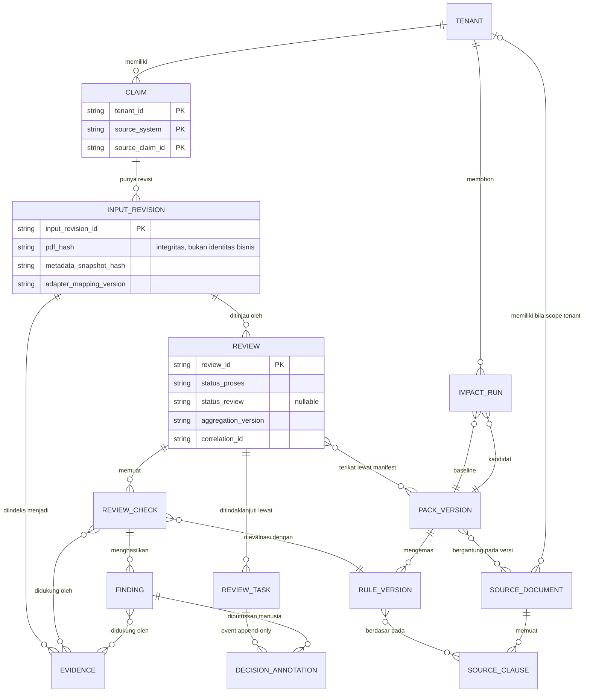

### 9.1 Identitas input dan hasil review

- **Kontrak ekspor sistem sumber**: satu PDF gabungan per klaim, metadata klaim, dan daftar dokumen bila tersedia. Metadata minimum mencakup identitas klaim pada namespace sumber, penyedia, periode/episode, asal file, versi/revisi ekspor, serta waktu pengambilan. Metadata administratif ini tetap internal, bukan konteks LLM.
- **Identitas kanonis**: `tenant_id + source_system + source_claim_id` mengikat klaim; input memakai `input_revision_id`, hash PDF, hash snapshot metadata, dan versi mapping adapter. Upload manual memperoleh ID internal dan menyimpan referensi eksternal bila ada. Hash file dipakai untuk integritas/deduplikasi, bukan pengganti identitas bisnis klaim.
- **Konflik sumber**: setiap nilai mempertahankan asal, waktu, dan lokasi bukti. Jika PDF dan metadata berbeda, tandai konflik; precedence ditetapkan per field oleh mapping berversi, bukan dipilih oleh LLM atau ditimpa diam-diam. Field tanpa sumber tetap tidak tersedia.
- **Hasil immutable**: `review_id`, `input_revision_id`, `status_proses`, `cakupan_pemeriksaan`, `status_review` nullable, `alasan[]`, `pemeriksaan[]`, `temuan[]`, `bukti[]`, snapshot versi (§12.1), `aggregation_version`, dan `correlation_id`. Tenant diturunkan dari konteks autentikasi, bukan dipercaya dari body request.
- **Pemeriksaan**: `check_id`, `rule_id/version`, applicability dan dasar pemicunya, status `terpenuhi | temuan | tidak dapat dinilai`, alasan terstruktur, input yang hilang, serta evidence IDs. Pemeriksaan yang terbukti tidak berlaku dicatat sebagai applicability `tidak_berlaku`, bukan dianggap lolos; pemicu yang tidak diketahui menghasilkan `tidak dapat dinilai`.
- **Review manusia**: keputusan menerima/menolak temuan beserta alasan, peran pengguna, waktu, dan referensi review disimpan sebagai anotasi append-only. Tidak menimpa hasil mesin atau memicu write-back ke sumber.

Status proses adalah `antre | berjalan | selesai | selesai_parsial | gagal | dibatalkan`. Cakupan memuat daftar pemeriksaan wajib yang berlaku, yang selesai, dan yang belum dapat dinilai; bukan sekadar persentase. Proses `selesai` tidak otomatis berarti semua pemeriksaan dapat disimpulkan.

Aturan agregasi berikut adalah **usulan baseline pending approval**, dengan prioritas dari atas ke bawah:

| Kondisi berbukti | `status_review` | Perlakuan |
|---|---|---|
| Ada temuan koding/angka/konsistensi yang memenuhi ambang rule untuk potensi masalah klaim | Potensi tidak layak | Tetap tampilkan kekurangan berkas dan cakupan parsial bila ada |
| Tidak ada kondisi di atas; dokumen wajib terkonfirmasi tidak ditemukan atau kontennya tidak terbaca | Potensi tidak lengkap | Bedakan `dokumen_tidak_ditemukan` dari `konten_tidak_terbaca`; kegagalan teknis tidak membuktikan keduanya |
| Seluruh applicability pemeriksaan wajib/kondisional telah ditentukan; seluruh pemeriksaan wajib yang berlaku selesai dan terpenuhi; tidak ada konflik penghalang | Lengkap | Tidak menyatakan persetujuan pembayaran BPJS |
| Bukti belum cukup, applicability belum diketahui, dependency gagal, atau hasil belum terminal tanpa dasar kategori di atas | `null` | Tampilkan Belum dapat disimpulkan + alasan/cakupan; jangan mengubah abstain menjadi lolos |

Kategori berbukti boleh tersedia pada hasil parsial, tetapi tidak boleh menyamarkan `status_proses` atau cakupan. Sebuah check hanya boleh disebut wajib/berpengaruh pada kategori jika matriks aturan yang disetujui menetapkannya. Temuan informasional tidak otomatis menjadi Potensi tidak layak. Bukti ketidakadaan dokumen memakai manifest pemeriksaan seluruh halaman dan versi aturan, bukan kutipan yang dibuat-buat; jika segmentasi belum memadai, abstain.

### 9.2 Taksonomi dan indeks bukti

Taksonomi awal: surat pengantar, resume medis, pengkajian, laporan individual, laporan operasi, hasil laboratorium, hasil radiologi, resep, rincian tagihan, dan dokumen pendukung. Ini klasifikasi dokumen, **bukan daftar yang wajib ada pada semua klaim**; kewajiban mengikuti matriks §11.2.

- **Extractor contract**: referensi input scoped dengan masa berlaku terbatas, `extraction_version`, halaman asli 1-based, teks, bounding box bila tersedia beserta satuan/orientasi/ukuran halaman, kualitas, metode text-layer/OCR, dan status/kode kegagalan per halaman. OCR confidence bukan probabilitas kebenaran klinis atau koding.
- **Segmentation contract**: `document_id`, jenis dokumen, rentang/daftar halaman asli, dasar deteksi, konflik, dan status keyakinan. Label ambigu tetap tidak diketahui; tidak dipaksakan agar checklist lolos. Pemecahan logis tidak mengubah hash atau nomor halaman sumber.
- **Evidence contract** [R13]: bukti dokumen memuat `evidence_id`, hash sumber dan representasi ekstraksi, halaman asli, `document_id`, span teks/offset dan bounding box bila tersedia, versi extractor, serta relasi span asli ↔ span hasil redaksi/normalisasi. Bukti metadata memuat ID/hash snapshot, field path, nilai bertipe, identitas sumber/aktor pemasok, waktu pengambilan, metode autentikasi sumber bila tersedia, dan versi mapping. Input manual mempertahankan asal sebagai pernyataan pengguna, bukan otomatis fakta terverifikasi. Bukti metadata tidak diberi nomor halaman fiktif. Kutipan diverifikasi terhadap representasi yang tepat; pencarian fuzzy saja tidak cukup untuk menempelkan bukti.
- **Konteks LLM**: gunakan evidence IDs lokal per request dan kutipan minimum hasil transformasi. Backend memvalidasi ID, kutipan, dan hubungan dengan input review, lalu memetakan kembali ke bukti asli. Peta asli ↔ tersunting tetap internal, terenkripsi, dan tenant-scoped; tidak dikirim ke provider.
- Evidence mendukung keterlacakan, bukan otomatis membuktikan interpretasi medis benar. Keluaran yang lolos schema/kutipan tetap melewati guard domain dan review manusia.

### 9.3 Referensi data untuk validasi angka

Rekonsiliasi menggunakan komponen yang berbeda, bukan persamaan universal `billing = tarif + topup` [R1]:

- **`billing_rs`** — total/rincian biaya internal rumah sakit dari billing PDF atau metadata billing. Tidak boleh menggantikan nilai pengajuan yang tidak tersedia.
- **`nilai_pengajuan_klaim`** — nominal yang secara eksplisit dinyatakan diajukan pada dokumen pengajuan atau metadata berlabel dan bersumber jelas.
- **`tarif_paket_grouping`** — nilai paket sesuai hasil grouping yang dipasok sumber dan referensi tarif berversi; HSG bukan pengganti grouper resmi.
- **`topup_special_cmg`** — tambahan pembayaran Special CMG dengan kode/jenis, kriteria eligibility, bukti, dan dasar tarif; bukan residual pengajuan/billing dikurangi tarif dasar. Catat apakah sudah termasuk dalam total hasil grouping agar tidak dihitung dua kali.
- **`komponen_non_inacbg`** — komponen yang diklaim terpisah sesuai aturan; jangan dicampur dengan topup Special CMG.

Lookup tarif menyertakan kode/versi grouping, jenis pelayanan, wilayah tarif, kelompok/kelas rumah sakit, kelas perawatan dan kondisi fasilitas yang disyaratkan, tanggal pelayanan/acuan periode, serta versi/masa berlaku referensi. Mata uang, satuan, basis bruto/neto, pembulatan, dan toleransi ditetapkan per rule; gunakan representasi desimal/fixed-point, bukan floating point untuk uang.

Perbandingan hanya aktif jika semua input, konteks tarif, dan arti komponen tersedia serta konsisten. Tidak ada topup yang diinferensikan dari selisih; komponen tidak tersedia berbeda dari nol. Rumus rekonsiliasi menyatakan komponen yang sudah/ belum termasuk, sumber setiap nominal, dan toleransi yang disetujui. Selisih menjadi kandidat review dengan bukti halaman atau metadata terautentikasi dan referensi tarif, bukan keputusan penolakan pembayaran.

### 9.4 Domain pack klinis dan koding

- Baseline pedoman INA-CBG pada Permenkes 26/2021 memakai **ICD-10 versi 2010** untuk diagnosis dan **ICD-9-CM versi 2010** untuk prosedur [R2]. Kamus harus memuat sistem, edisi, peran, provenance/lisensi, dan versi mapping. Pembaruan edisi tidak otomatis mengikuti rilis internasional terbaru; perubahan memerlukan dasar aturan yang berlaku untuk episode tersebut.
- Pisahkan rule **dukungan diagnosis**, **keparahan/indikasi rawat**, **persyaratan koding**, dan **persyaratan pembayaran**. CURB-65/PSI, misalnya, tidak boleh dipakai sendiri untuk membatalkan diagnosis pneumonia; bedakan populasi/jenis pneumonia dan tujuan skornya [R3]. HSG menilai dokumentasi, tidak menegakkan diagnosis baru.
- Rule menyatakan populasi, konteks pelayanan, jendela observasi, satuan, input wajib, pengecualian, tanggal efektif, dan sumber/pasal/halaman. Data skor hilang menghasilkan `tidak dapat dinilai`, bukan skor nol. Confidence model tidak menggantikan kriteria.
- Pedoman koding Indonesia yang berlaku untuk klaim menjadi acuan sesuai scope-nya; aturan umum WHO tidak otomatis menimpanya. Rule precedence dan konflik, termasuk diagnosis suspek, kombinasi, urutan utama/sekunder, dan kebutuhan klarifikasi dokter harus eksplisit serta disetujui pemilik domain.
- Pack menyimpan `pack_id/version`, hash sumber, periode berlaku, reviewer domain, tanggal persetujuan, dan dependensi. Pilih berdasarkan tanggal/acuan episode yang ditentukan rule, bukan tanggal review semata. Pack belum disetujui/tidak cocok periode memblokir check operasional terkait, bukan diganti diam-diam dengan versi terbaru; sandbox simulasi non-operasional mengikuti §9.6.
- Promosi pack memerlukan regression suite; pencabutan/rollback memengaruhi review baru. Review lama tetap menyimpan snapshot versi, ditandai bila perlu ditinjau ulang, dan tidak ditimpa. Konten PDF atau LLM tidak boleh menjadi sumber pembaruan rule otomatis.

### 9.5 State operasional dan tindak lanjut

Kontrak workspace memisahkan state berikut; tidak boleh digabung dalam satu kolom `status`:

| State | Source of truth | Aturan |
|---|---|---|
| Proses mesin | Job registry dan hasil review §9.1 | `status_proses`, cakupan, dan kategori mesin mengikuti versi review |
| Review manusia | Event/anotasi HSG | Penugasan, keputusan temuan, alasan, aktor, waktu, dan versi objek; bukan perubahan hasil mesin |
| Administrasi klaim eksternal | Snapshot sumber atau pernyataan manual berprovenance | Status pengajuan, pending/dispute, pembayaran bila tersedia; simpan waktu/as-of, jangan dianggap real-time |
| Kelompok kerja internal | Snapshot keanggotaan di HSG | Referensi klaim, input/review terpilih, kriteria, serta versi; bukan batch pengajuan resmi |

- `review_task_id` mengikat tenant, klaim, `input_revision_id`, dan `review_id` yang ditinjau; simpan assignee/peran, jenis tugas, dasar prioritas, target waktu dan sumbernya, state `terbuka | dikerjakan | selesai | dibatalkan`, serta event append-only. Tugas selesai tidak berarti klaim dibayar atau semua check lolos. Input/review baru menandai tugas/keputusan terdahulu perlu ditinjau ulang, tidak memindahkannya otomatis ke bukti baru.
- Assignment dan transisi memakai otorisasi objek, expected version/CAS, serta idempotency key untuk command mutasi. Dua reviewer tidak boleh saling menimpa keputusan; konflik mengharuskan refresh/rekonsiliasi. Kebijakan siapa boleh mengambil, mengalihkan, atau menutup tugas ditetapkan dalam matriks privilege, bukan nama peran demo.
- Anotasi keputusan mengacu ke `finding_id`/`check_id`, alasan, evidence IDs, serta keputusan terdahulu yang disupersede bila ada. Koreksi adalah event baru; catatan bebas tetap data sensitif, tidak masuk log umum atau provider tanpa gate privasi.
- Kelompok tinjauan menyimpan snapshot anggota dan fingerprint input/review pada saat dibentuk/dikonfirmasi. Perubahan revision, keputusan, atau aturan yang relevan menandai anggota stale dan memerlukan validasi ulang; konfirmasi kelompok bukan otorisasi pengiriman. Operasi bulk melaporkan hasil per item, tidak mengklaim semua berhasil jika ada konflik/gagal.
- Status eksternal menyimpan `source_status`, nilai kanonis bila mapping disetujui, waktu kejadian/as-of, waktu impor, metode pemasokan, sumber bukti, dan freshness. Tidak ada status eksternal bukan berarti belum diajukan/belum dibayar. Pernyataan manual ditandai belum terverifikasi; event yang tiba terlambat tidak menurunkan snapshot terbaru secara diam-diam.
- Daftar dan agregat menyebut filter, periode, as-of, versi definisi, denominator, serta jumlah data tidak tersedia/stale. Tenggat, umur kasus, prioritas dan nilai hanya dihitung bila basisnya ada; skor prediksi atau risiko finansial tidak diaktifkan tanpa sumber, definisi, dan evaluasi terpisah.

### 9.6 Naskah sumber, butir pustaka, dan simulasi perubahan

Hubungan siklus publikasi sumber dengan aktivasi pack, termasuk gerbang dependensi:

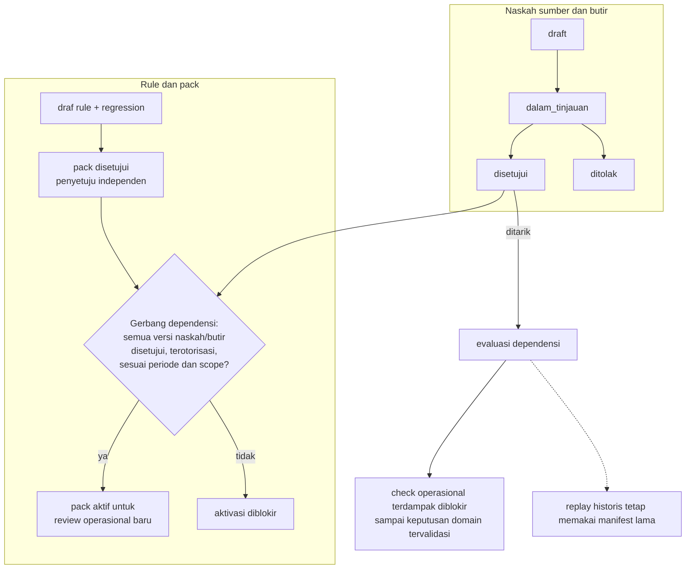

- **Naskah sumber**: `source_document_id`, pemilik/scope `global | tenant`, penerbit, nomor/judul, jenis, yurisdiksi, URL/asal terverifikasi, hash file immutable, versi, waktu diperoleh/dikenalkan, tanggal mulai/akhir berlaku, hubungan perubahan/pengganti, serta catatan penelaahan dan persetujuan. Tanggal unggah, tanggal pengesahan, mulai berlaku, dan aktivasi pemeriksaan adalah hal berbeda. Naskah nasional diterbitkan oleh pengelola global yang berwenang; tenant tidak boleh mengubah referensi global.
- **Lifecycle publikasi**: `draft → dalam_tinjauan → disetujui`, atau `ditolak`; aktivasi dan penarikan dicatat terpisah. Label Berlaku/Kedaluwarsa/Sudah diganti berasal dari masa berlaku dan relasi versi, bukan dari persetujuan teknis semata. Materi lama tetap dapat diambil lewat manifest review lama sesuai izin/retensi, tetapi bukan otomatis sumber untuk episode baru. Maker-checker dan kewenangan penerbitan ditetapkan sebelum aktivasi; unggahan tidak langsung dipercaya oleh pencarian produksi atau validator. Aktivasi pack memvalidasi seluruh versi naskah/butir dependensinya telah disetujui, terotorisasi, dan sesuai periode/scope; persetujuan pack tidak melewati gate sumber. Penarikan sumber memicu evaluasi dependensi dan memblokir check operasional terdampak sampai ada keputusan domain tervalidasi; replay historis tetap mempertahankan manifest lama.
- **Butir sumber**: `source_clause_id`, versi naskah, locator pasal/bagian/halaman asli, teks sumber dan hash, metode ekstraksi, hasil verifikasi, serta relasi ke `rule_id/version`. Kutipan sumber, ringkasan manusia/AI, dan ekspresi rule yang dapat dieksekusi disimpan sebagai artefak berbeda. Satu rule dapat memakai beberapa butir; sumber terbit tidak otomatis menjadi rule aktif.
- **Indeks dan pencarian**: indeks turunan mempertahankan source/versi/scope/locator dan dapat dibangun ulang. Otorisasi tenant dan filter applicability dilakukan sebelum retrieval/rerank, termasuk cache dan unduhan sumber. Sumber global boleh dibaca lintas tenant sesuai kebijakan, sedangkan dokumen lokal dan query pengguna tidak boleh bocor lintas tenant. Pencarian kata kunci tetap tersedia saat LLM gagal; teknologi indeks belum dipilih. Gate privasi yang mencakup query, kutipan, embedding, dan reranking didefinisikan pada §7 dan §10, tidak diulang di sini. Sumber privat tenant tetap rahasia meskipun bukan dokumen pasien; data yang tidak lolos kebijakan diproses lokal atau jalur eksternalnya diblokir, tanpa fallback payload mentah.
- **Tanya pustaka**: jawaban berbasis butir yang terotorisasi dengan citation tervalidasi server ke versi/halaman yang benar; bila bukti tidak mendukung, jawab tidak ditemukan/abstain. Query diperlakukan berpotensi memuat data pasien dan tunduk pada gate privasi yang sama (§7, §10). Naskah sumber juga input tidak tepercaya terhadap prompt injection. Jawaban tidak menerbitkan rule dan tidak menyatakan kepatuhan klaim.
- **Simulasi dampak**: `impact_run_id`, tenant, pemohon, baseline pack dan candidate pack immutable, alasan/dasar applicability periode, snapshot kohort serta input/review tiap anggota, rentang episode, waktu run, manifest engine, status proses, dan hasil per item. Bandingkan rule/temuan/kategori/cakupan lama–kandidat; pisahkan terdampak, tidak terdampak, gagal, dan tidak dapat dinilai. Perubahan input setelah snapshot tidak ikut diam-diam; laporkan stale. Simulasi memakai job lifecycle §7.5, otorisasi, kuota, dan retensi yang sama dengan review.
- **Berlaku surut bukan asumsi**: aturan yang baru diaktifkan dapat telah berlaku pada periode lama, tetapi tanggal penerapan legal tidak boleh ditentukan operator atau LLM tanpa dasar tervalidasi. Candidate pack yang belum disetujui hanya boleh berjalan di sandbox evaluasi dengan label non-operasional dan izin khusus, tidak menghasilkan kategori produksi. Semua hasil simulasi, termasuk dengan pack approved, disimpan pada namespace/proyeksi simulasi terpisah dan tidak masuk KPI produksi, hasil review operasional terbaru, atau transisi workflow otomatis; hasil hanya dapat menjadi dasar usulan tugas re-review berizin. Simulasi tidak mengubah manifest/hasil lama atau status klaim sumber. Setelah persetujuan tindak lanjut, buat tugas re-review; review operasional baru tetap mensyaratkan pack approved dan menghasilkan `review_id` baru. Klaim yang telah diajukan ditandai untuk tindak lanjut manusia, bukan otomatis ditarik/dikirim ulang.

## 10. Keamanan dan privasi data

### 10.1 Prinsip batas data

- **Identitas pasien dan isi klinis dipisahkan secara logis.** Pengenal langsung yang diekstrak (nama, NIK, nomor rekam medis, kontak, alamat) dan pemetaan token berada pada identity vault dengan hak akses terpisah. **PDF asli, OCR lengkap, thumbnail, bukti, dan turunannya tetap dapat memuat identitas sekaligus data klinis**; klasifikasikan sebagai raw PHI/data kesehatan beridentitas, termasuk ekspor dan backup. Pemisahan vault bukan penghapusan identitas dari sumber. Semua record tetap memiliki `tenant_id`; akses lintas tenant ditolak di setiap lapisan.
- **Enkripsi bukan de-identifikasi.** Ciphertext identitas yang disimpan HSG tetap merupakan data yang dapat dipulihkan oleh pihak berwenang. Pseudonim/token yang dapat dipetakan kembali juga tetap diperlakukan sebagai data sensitif; jangan menganggapnya anonim hanya karena tidak terlihat seperti nama.
- **LLM mendapat minimumnya, bukan identitas.** Sebelum request keluar dari batas kontrol HSG, buat konteks khusus tugas yang hanya berisi kutipan klinis minimum, label dokumen/halaman, dan fakta yang dibutuhkan. Hilangkan nama, NIK, nomor rekam medis, kontak, alamat, nomor klaim, serta metadata yang tidak relevan. Jangan mengirim PDF utuh, OCR mentah, atau identitas langsung ke provider LLM.
- **Fail closed dengan kriteria terukur.** Setiap tugas memiliki allowlist atribut, transformasi quasi-identifier (tanggal, umur, lokasi, kondisi langka, riwayat), dan kondisi blokir. Kegagalan redactor, OCR meragukan, atau risiko identifikasi ulang di luar kebijakan memblokir pemanggilan LLM; lanjutkan validator deterministik atau `tidak dapat dinilai`, tanpa fallback ke payload asli. Lolos detektor bukan bukti anonim dan tidak menjamin nol kebocoran [R6]. Jika transformasi yang diperlukan merusak fakta klinis penting, abstain atau proses di deployment yang disetujui tanpa melonggarkan gerbang.
- **Pengecualian perlu keputusan eksplisit.** Bila suatu tugas benar-benar memerlukan pengenal langsung, itu bukan jalur default: perlu dasar pemrosesan, persetujuan tata kelola, provider/deployment yang disetujui, kontrol kontraktual dan retensi, serta pencatatan keputusan. Enkripsi identitas tersimpan tidak membuat pengiriman identitas ke LLM aman atau otomatis diperbolehkan.

### 10.2 Pseudonimisasi dan pemrosesan identitas

- Saat ingest, ekstrak pengenal yang diperlukan untuk korelasi ke kompartemen identitas. Berikan review sebuah `subject_token` acak yang tidak diturunkan dari NIK/nama, dibatasi per tenant dan lingkup penggunaan. Jangan gunakan hash biasa atas NIK atau nomor rekam medis sebagai token stabil karena ruang nilainya dapat ditebak dan di-brute-force.
- Simpan tabel pemetaan token ↔ identitas pada identity vault yang terpisah dan lebih ketat hak aksesnya. Jangan sertakan tabel pemetaan, token lintas sistem, atau `claim_id` eksternal dalam prompt LLM. Token internal tetap dianggap sensitif dan tidak dibutuhkan model kecuali ada alasan fungsional yang disetujui.
- Lakukan redaksi/transformasi pada teks per halaman sebelum membuat konteks LLM. Gabungkan pola terstruktur dan deteksi entitas domain, lalu validasi terhadap kebijakan atribut per tugas. Uji nama/NIK rusak OCR, pengenal implisit, serta kombinasi quasi-identifier dengan data sintetis/terdeidentifikasi yang disetujui. Pemilik privasi menyetujui risiko residual dan bukti evaluasi sebelum jalur eksternal aktif. Pseudonimisasi tidak otomatis menghilangkan status data pribadi.
- Simpan pemetaan span asli ↔ hasil redaksi sesuai §9.2; validasi kutipan pada teks yang dilihat model sebelum memetakan ke sumber. Akses konteks tersunting, PDF/OCR asli, dan identity mapping merupakan privilege berbeda.
- Simpan bukti lengkap untuk reviewer di penyimpanan terkendali. Hasil yang dikirim model dibatasi pada kutipan yang sudah diminimalkan; setiap temuan tetap membawa referensi halaman/bagian internal, bukan isi identitas.

### 10.3 Enkripsi dan kunci per tenant

Rekomendasi baseline adalah **envelope encryption** dengan isolasi tenant, bukan menyimpan satu kunci aplikasi bersama atau membuat kunci dari data tenant:

1. Gunakan algoritma AEAD yang didukung library terpelihara (mis. AES-256-GCM atau ChaCha20-Poly1305). Nonce harus unik sesuai persyaratan algoritma; gunakan library tepercaya, bukan kriptografi buatan sendiri.
2. Buat DEK acak untuk mengenkripsi objek/record sensitif; gunakan DEK terpisah per objek atau unit data yang sesuai. Enkripsi mencakup file PDF, ekstraksi OCR yang sensitif, pemetaan identitas, dan backup/ekspor yang memuatnya.
3. Bungkus DEK dengan KEK khusus tenant yang dikelola KMS/HSM atau vault terpisah. Kunci tenant dibuat acak oleh pengelola kunci, tidak disimpan plaintext di database aplikasi, tidak diturunkan dari `tenant_id`, password, atau secret statis.
4. Simpan envelope berversi secara atomik atau melalui publikasi referensi yang konsisten dengan ciphertext: `envelope_version`, `wrapped_dek` (atau referensi persisten yang dipulihkan bersama objek), referensi/versi KEK, algoritma, nonce/tag, `aad_schema_version`, serta konteks tenant/objek. `key_id` saja tidak cukup untuk memulihkan DEK acak [R4]. KEK hanya berada di KMS/HSM. AAD dibentuk secara kanonis oleh backend dari tenant dan identitas objek yang tepercaya; bukan dipercaya dari request/envelope tanpa pencocokan.
5. Otorisasi tenant, objek, dan tujuan dilakukan sebelum unwrap. **Usulan baseline pending approval: key broker** dengan interface sempit, terpisah dari worker, yang memvalidasi principal terautentikasi, scope tenant/objek, serta pemetaan tenant → KEK dari registry tepercaya. Worker tidak menerima KEK atau credential KMS lintas tenant. Broker memakai identity/grant terbatasi; jika KMS yang dipilih mendukungnya, policy turut membatasi konteks tenant/tujuan. Identitas, policy, dan trust boundary broker harus diputuskan sebelum implementasi; broker yang mempercayai `tenant_id` dari caller tanpa otorisasi tidak memenuhi desain.
6. Bedakan AAD objek dari konteks wrap/unwrap KMS dan otorisasi principal [R5]. AAD bukan izin akses; service identity yang dapat memakai semua KEK tetap memiliki blast radius lintas tenant. Jangan memasukkan PHI atau secret ke encryption context KMS karena dapat tercatat di audit layanan. Log akses kunci hanya memakai pengenal internal yang diperlukan.
7. Sediakan rotasi, pencabutan, pemulihan, backup, dan penghancuran kunci sebelum produksi. Rotasi KEK dapat dilakukan dengan rewrap DEK melalui prosedur terverifikasi; penggantian DEK memerlukan enkripsi ulang data. Gunakan versi envelope agar perubahan algoritma/AAD bisa dimigrasikan. Uji restart, restore lintas versi, rewrap, pencabutan akses, dan kehilangan kunci; jangan mengklaim data dapat dipulihkan setelah kunci terakhir sengaja dihancurkan.

Kunci per tenant memberi batas kriptografis tambahan, tetapi tidak menggantikan isolasi akses, kontrol storage, atau pencegahan bug otorisasi. KEK dan kunci pemetaan token harus memiliki fungsi terpisah; tokenisasi deterministik berbasis HMAC, bila benar-benar diperlukan untuk pencocokan, menggunakan kunci terpisah per tenant dan tetap tidak dikirim ke LLM.

**Diagram alur enkripsi dan pemisahan identitas:**

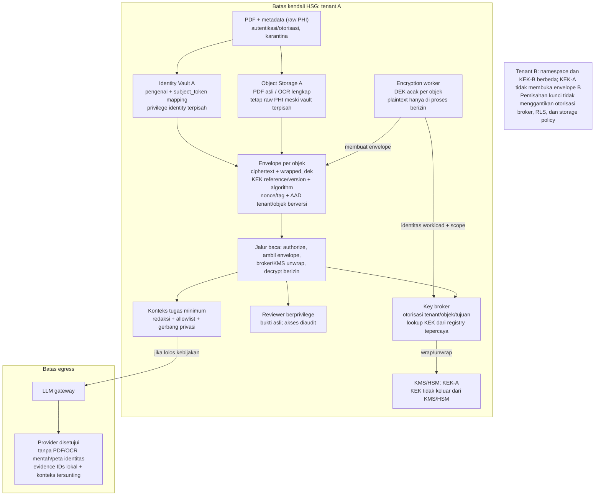

Pada pembacaan, aplikasi mengotorisasi tenant dan objek terlebih dahulu, mengambil ciphertext **beserta wrapped DEK**, lalu broker memvalidasi scope dan meminta KMS unwrap dengan referensi KEK tepercaya. Worker berizin menggunakan DEK sementara untuk mendekripsi di memori dan membersihkan material setelah dipakai. AAD dicocokkan dengan konteks tenant/objek yang diharapkan, bukan sekadar metadata pada envelope. Plaintext tidak ditulis ke log/temp file umum; scratch OCR yang benar-benar diperlukan memakai volume sementara terisolasi, akses minimum, enkripsi at rest, dan pembersihan terukur. KEK tidak dikirim ke worker. Envelope identitas dan dokumen mengikuti kontrak yang sama, dengan hak akses berbeda.

### 10.4 Alur data dan kontrol LLM

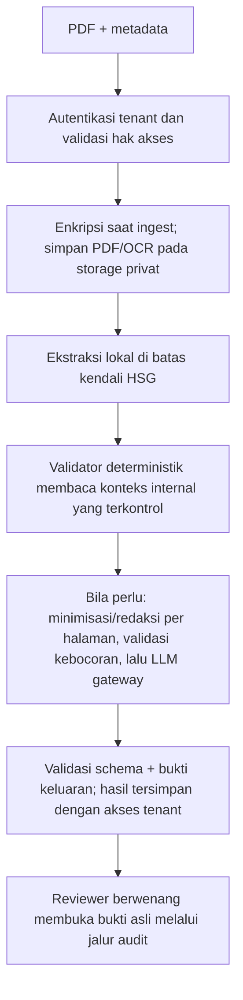

LLM gateway hanya mengaktifkan kombinasi **provider–model–endpoint–fitur–region** dalam matriks persetujuan. Matriks menyatakan dasar pemrosesan, kontrak pemroses/subprocessor, no-training, retensi konten/abuse monitoring/application state, transfer lintas batas, dan kontrol akun yang benar-benar aktif [R7]. No-training tidak sama dengan no-retention; flag request bukan bukti kontrol akun. Jika syarat organisasi tidak didukung atau kombinasi belum disetujui, gateway memblokir request tanpa fallback diam-diam ke endpoint/model/region lain. TLS, kuota, batas request, timeout, dan budget tetap berlaku.

Log aplikasi, tracing, error, dan telemetri tidak menyimpan prompt, OCR, PDF, identitas, atau kutipan klinis secara default. Catat metadata minimum seperti ID review internal, tenant terkontrol, provider/model, tujuan, versi redactor, ukuran/token, status, waktu, dan correlation ID. Cegah payload masuk ke log proxy, crash dump, observability vendor, atau dataset evaluasi tanpa kontrol dan dasar yang sama. Replay audit memakai artefak terenkripsi dengan privilege khusus dan retensi eksplisit (§12.1), bukan log bebas PHI.

#### Dokumen tidak tepercaya dan prompt injection

- PDF, hidden text layer, OCR, nama berkas, metadata adapter, dan retrieved excerpts adalah **data tidak tepercaya**, bukan instruksi/policy. Instruksi yang tertanam tidak boleh mengubah scope review, tenant, daftar tool, atau aturan nasional [R8].
- Pemeriksaan wajib ditentukan scheduler/rule engine di luar model. LLM tidak boleh menghilangkan check, memilih hak akses, membuka URL dari dokumen, mengubah rule pack, atau menentukan status akhir secara bebas. Tool registry memvalidasi principal, parameter, budget, dan scope objek pada setiap call.
- Pemisahan instruksi/data dan detector adalah pertahanan berlapis, bukan jaminan. Schema valid serta kutipan nyata tidak membuktikan interpretasi bebas manipulasi. Guard domain dan evaluasi adversarial tetap diperlukan.
- Semua output model dianggap tidak tepercaya: validasi schema, evidence IDs/kutipan, kode dan applicability; encode/sanitasi HTML/Markdown saat render, tolak URL/protokol tidak diizinkan, jangan auto-fetch/auto-execute konten output. Tidak ada tool write atau SQL bebas.
- Uji instruksi tersembunyi untuk memalsukan kelengkapan, menyembunyikan temuan, mengganti aturan, memanggil tool di luar scope, mengungkap prompt/konteks, dan menautkan payload keluar. Kegagalan guard memblokir kandidat dan dicatat tanpa menyalin payload berbahaya ke log.

### 10.5 Isolasi, retensi, dan respons insiden

- Terapkan tenant scope pada API, database, object storage, cache, queue, worker, ekspor, backup, dan akses KMS. Validasi akses ke objek tertentu sebelum membuat signed URL; URL harus berumur singkat dan scope-nya satu objek/operasi.
- Gunakan hak akses minimum dan pemisahan peran: operator aplikasi tidak otomatis dapat membaca identitas; akses break-glass memerlukan alasan, otorisasi tambahan, dan audit.
- Tetapkan retensi per kategori (PDF asli, OCR, konteks LLM sementara, hasil review, audit, backup). Hapus atau minimalkan konteks sementara setelah tugas selesai sesuai kebijakan; penghancuran kunci tenant hanya setelah seluruh data/backup yang bergantung padanya boleh dihapus.
- Rancang prosedur insiden untuk pencabutan kunci/credential, isolasi tenant, penilaian paparan, pemulihan kunci/data, notifikasi, dan preservasi audit sesuai kewajiban hukum yang berlaku.
- Sebelum implementasi, lakukan threat modeling dan tinjauan hukum/tata kelola terhadap pemrosesan data kesehatan, lokasi/provider pemrosesan, dasar pemrosesan, perjanjian pemroses, retensi, serta transfer lintas batas. Enkripsi dan redaksi teknis bukan bukti kepatuhan dengan sendirinya.

### 10.6 Ingress PDF, sandbox, dan egress

- Kedua jalur input melewati karantina yang sama. Allowlist PDF, cek extension/MIME sebagai sinyal dan signature/parser sebagai verifikasi tambahan; jangan percaya `Content-Type` atau nama file. Gunakan nama objek internal, storage privat di luar webroot, serta pemeriksaan ukuran saat streaming, jumlah halaman, dimensi render/dekompresi, CPU, memori, dan waktu [R9]. Tidak ada satu pemeriksaan yang menjamin file aman.
- Scan dengan antivirus/sandbox lokal atau layanan privat yang disetujui; jangan kirim dokumen pasien ke pemindai publik. Kebijakan awal menolak/menahan PDF berpassword, attachment, script/active content, dan file rusak sampai penanganannya disetujui. Status karantina bukan temuan kelayakan klaim.
- Parser/OCR berjalan non-root di sandbox tanpa egress umum, filesystem minimum dan scratch terisolasi, dengan dependency terpatch serta batas sumber daya. Hanya akses referensi input/output scoped yang diizinkan; Python tidak memiliki credential database, KMS umum, atau provider LLM.
- Jika CDR/render sanitization dipakai, hasilnya adalah turunan dengan hash dan lineage baru; simpan sumber asli sebagai bukti. Jangan menganggap tanda tangan digital tetap valid pada turunan. CDR tidak menggantikan isolasi parser maupun pemeriksaan prompt injection.
- HTTP adapter hanya mengakses profil endpoint terdaftar dan credential scoped. Validasi scheme/host/port/path, hasil resolusi DNS, serta setiap redirect; cegah DNS rebinding dan akses metadata cloud/loopback/jaringan selain tujuan yang disetujui. Endpoint privat hanya melalui jalur privat yang disepakati, bukan arbitrary URL dari pengguna/PDF/model. Allowlist egress juga berlaku pada LLM gateway; sertifikat TLS tidak boleh diabaikan [R10].

### 10.7 Isolasi data dan tata kelola akses

- **Usulan baseline pending approval:** tabel tenant-scoped memakai PostgreSQL RLS dengan role runtime non-owner tanpa `BYPASSRLS`; policy/`FORCE ROW LEVEL SECURITY` mengikuti kebutuhan tabel. Tenant berasal dari membership principal dan diset transaction-local untuk mencegah kebocoran connection pool. RLS adalah lapisan tambahan, bukan pengganti otorisasi API/objek. Tabel global referensi dibedakan eksplisit dan tidak menyimpan PHI tenant.
- Cache, job/checkpoint, signed URL, export, dan evidence mapping memakai namespace tenant. Deduplikasi tidak boleh mengungkap apakah tenant lain memiliki dokumen/hash yang sama. Uji akses silang dengan ID valid milik tenant lain, bukan hanya ID acak yang tidak ada.
- **Dashboard** — workspace operasional dan pustaka aturan memakai kontrak API yang sama dengan hasil review; status workflow manusia, hasil mesin, serta status klaim dari sumber tetap terpisah. Semua daftar memakai filter/paging server-side dan otorisasi tenant/objek; badge atau penyembunyian menu bukan kontrol keamanan.
- **Sumber pustaka** memakai karantina dan verifikasi file §10.6 yang sama dengan PDF klaim; scope global tidak membuat unggahan otomatis aman. Dokumen lokal dapat mengandung informasi rahasia atau data pasien dan tetap diperlakukan sensitif. Unduhan/ekspor berizin, audit, batas masa akses, serta mitigasi formula injection pada format spreadsheet berlaku pada seluruh workspace; menghapus nama tidak menjadikan ekspor anonim karena ID klaim dapat ditautkan kembali.
- **Autentikasi pengguna/workload, membership tenant, dan role dipisahkan** mengikuti baseline sederhana §10.8. Izin identitas, ekspor, authoring/persetujuan rule, dan audit bukan role jabatan tersendiri. Administrator platform/tenant tidak otomatis membaca raw PHI; perubahan policy/rule/provider dan break-glass diaudit serta memerlukan persetujuan sesuai risiko. Nilai klaim tidak boleh memengaruhi hak akses.
- Audit append-only mencatat aktor/workload, tenant, aksi, objek internal, tujuan, hasil, waktu, dan correlation ID. Kontrol integritas/akses serta deteksi perubahan audit harus diuji; tidak memuat kutipan pasien atau material kunci.
- Tetapkan peran pengendali/pemroses, dasar pemrosesan, asesmen dampak pelindungan data, lokasi/transfer data, dan tata cara permintaan subjek data sesuai UU PDP serta aturan rekam medis yang relevan [R12]. Persetujuan bukan diasumsikan satu-satunya dasar yang selalu sesuai. Retensi salinan HSG tidak otomatis sama dengan retensi rekam medis sumber; keputusan hukum menetapkan jadwal per kategori, legal hold, penghapusan turunan, dan berakhirnya backup. Restore menerapkan ulang tombstone/retensi agar data yang sudah dihapus tidak kembali aktif.

### 10.8 Role minimal platform dan tenant

Mockup awal memiliki sembilan role berbasis jabatan rumah sakit. Baseline HSG menyederhanakannya menjadi **dua role platform dan tiga role tenant**. Jabatan Koder, Verifikator, Koordinator Klaim, Direktur, Auditor, DPJP, Komite Medik, dan Tim Anti-Fraud tidak otomatis menjadi role aplikasi; jabatan dapat disimpan sebagai atribut profil. Workflow dokumentasi dokter/komite di luar scope tidak memerlukan role khusus phase-1.

| Level | Role | Kewenangan default | Batas |
|---|---|---|---|
| Platform | **Admin Platform** | Provisioning tenant, konfigurasi layanan/provider yang telah disetujui, kuota, health/telemetri aman dan administrasi akses platform | Tidak membaca data pasien, hasil klaim, dokumen privat tenant, atau menerbitkan rule global secara default |
| Platform | **Kurator Aturan** | Mengelola naskah/butir nasional/global, menyusun/menguji pack dan menjalankan workflow persetujuan/publikasi global | Tidak membaca klaim tenant; pengujian global memakai data sintetis/terdeidentifikasi, bukan akses terselubung ke data tenant |
| Tenant | **Admin Tenant** | Mengelola membership tenant sendiri, konfigurasi adapter/retensi dalam batas kebijakan platform, serta penetapan akses pengguna | Tidak otomatis membaca raw PHI, mereview klaim, mengubah aturan nasional, atau mengakses tenant lain |
| Tenant | **Reviewer Klaim** | Upload/review klaim, baca bukti terotorisasi, anotasi, tugas/penugasan internal, kelompok tinjauan, pencarian pustaka dan simulasi approved sesuai scope | Tidak mengubah data sumber atau menerbitkan aturan; akses terbatas pada tenant dan objek/unit yang diberikan |
| Tenant | **Pembaca** | Dashboard/agregat dan pustaka approved read-only | Default tanpa PDF mentah, identitas, keputusan reviewer, atau ekspor rincian; drill-down teredaksi/audit diberikan hanya bila dibutuhkan |

Role adalah paket izin awal, bukan pengganti scope/otorisasi objek. Pengguna dapat memiliki membership berbeda di beberapa tenant; role platform tidak diwariskan ke tenant. Service account adapter/worker adalah principal workload scoped, bukan role pengguna keenam. Tidak ada superadmin yang otomatis membuka semua data.

Hanya kebutuhan sensitif berikut menjadi **izin tambahan bernama**, bukan role baru: `identity.read` untuk membuka identitas, `export.detail` untuk ekspor rincian, `rules.manage` untuk authoring sumber/rule lokal, `rules.approve` untuk persetujuan/publikasi pada scope yang diizinkan, dan `audit.read` untuk audit teredaksi. Reviewer tetap boleh melihat bukti klinis yang diperlukan, tetapi identitas langsung dimasking secara default; akses PDF asli/full OCR yang masih mengandung identitas juga memerlukan `identity.read`, bukan hanya membuka panel Identity Vault. Pemisahan indeks bukti dan tampilan teredaksi mengikuti §9.2 dan §10.1. Izin tambahan tidak dapat memperluas tenant/unit pengguna. Pembaca tidak dapat memperoleh command mutasi hanya lewat izin baca tambahan.

**Maker-checker berbasis orang/aksi, bukan penambahan role:** pembuat/perubah naskah, rule atau pack tidak boleh menyetujui revisinya sendiri, meskipun memiliki `rules.approve` atau beberapa role. Dua akun berbeda milik orang yang sama tidak memenuhi pemisahan. Untuk global, kedua pihak adalah Kurator Aturan terotorisasi; untuk lokal, dua anggota tenant dengan izin terkait. Jika belum tersedia penyetuju kedua, revisi tetap draft dan pack approved terakhir tetap digunakan. Rule lokal tidak dapat mengesampingkan kewajiban nasional tanpa precedence yang disetujui.

Pemberian izin sensitif/membership bisnis memerlukan approver berwenang yang berbeda dari penerima/pemohon; Admin Tenant tidak boleh menaikkan akses klinis/identitas/approval miliknya sendiri. Penunjukan approver pertama saat onboarding harus tercatat dan diverifikasi melalui prosedur pemilik tenant, bukan jalan pintas superadmin. Break-glass akses tenant bersifat berbatas waktu/objek/tujuan, memerlukan persetujuan, dan diaudit; bukan hak tetap Admin Platform. Ekspor sensitif memakai persetujuan orang kedua sesuai policy risiko sebelum unduhan. Matriks aksi rinci, unit scope, dan pihak pemberi izin ditetapkan sebelum rilis tanpa menambah role jabatan secara otomatis.

## 11. Keputusan (dihasilkan dari diskusi arsitektur)

### 11.1 Deteksi batas dokumen dalam PDF gabungan

Prioritas utama: **deteksi dari header/footer teks** pada tiap halaman PDF gabungan. Ini berlaku baik input yang datang melalui upload UI maupun hasil ekspor API sistem sumber.

Sumber pendukung (urutan prioritas):

1. Header/footer teks per halaman — prioritas utama untuk semua masukan PDF.
2. Metadata sistem sumber — digunakan saat httpadapter mengekspor dokumen beserta metadata (mis. daftar dokumen dan nomor halaman per dokumen).
3. Laporan terpisah / pemisah visual — pendukung bila keduanya tidak tersedia.

Fokus review awal adalah **data input**: bentuk PDF yang diterima (upload UI vs ekspor API), dan ketersediaan metadata melalui httpadapter.

### 11.2 Daftar dokumen wajib

Daftar dokumen wajib memiliki **aturan default/nasional yang berlaku untuk semua rumah sakit sesuai jenis klaim dan kondisi pemicunya**. Daftar nasional menjadi baseline bersama; konfigurasi penyedia hanya menambah kebutuhan yang sah, tidak mengurangi kewajiban nasional yang berlaku. Taksonomi §9.2 tidak otomatis menjadi daftar wajib [R2].

Sebelum validator kelengkapan diaktifkan, pemilik domain harus menyetujui matriks berversi dengan kolom: `document_type`, jenis pelayanan/klaim, kondisi pemicu dan input penentunya, dasar hukum/teknis beserta pasal/halaman, masa berlaku, tingkat kewajiban, serta reviewer/persetujuan. Pisahkan berkas per episode dari dokumen administrasi pengajuan kolektif. Dasar kewajiban atau pemicu yang belum terverifikasi menghasilkan `tidak dapat dinilai`, bukan temuan dokumen wajib hilang. Daftar operasional belum diisi pada draf ini; validasi sumber dan persetujuannya adalah gerbang sebelum check dipakai.

### 11.3 Decision log dan keputusan terbuka

Seluruh baseline di bawah tetap `pending approval`; revisi dokumen bukan persetujuan implementasi.

| ID | Perubahan/keputusan | Alasan dan status |
|---|---|---|
| D-01 | Ekstraksi halaman mendahului segmentasi semantik | Menyelaraskan semua diagram dengan deteksi header/footer; pemecahan mekanis halaman bukan penentuan jenis dokumen |
| D-02 | Billing, pengajuan, grouping, topup Special CMG, non-INA-CBG dipisah | Koreksi definisi berdasar R1; rumus per komponen menunggu rule pack disetujui |
| D-03 | Status proses/cakupan dipisah dari kategori bisnis; review nullable | Mencegah kegagalan teknis menjadi temuan negatif atau Lengkap palsu; prioritas agregasi §9.1 perlu persetujuan domain |
| D-04 | Envelope wajib membawa wrapped DEK; key broker sebagai usulan baseline | Memungkinkan restore dan memperjelas otorisasi tenant; provider KMS, identity/grant, trust boundary, dan policy final belum dipilih |
| D-05 | Provenance asli ↔ tersunting dan fail-closed berbasis kebijakan tugas | Menjaga keterlacakan tanpa mengirim identitas; allowlist atribut dan batas risiko residual perlu persetujuan privasi |
| D-06 | Matriks provider/model/endpoint/fitur/region sebagai gate | Tidak ada provider eksternal otomatis disetujui; kontrak, region, retensi, dan dasar pemrosesan masih terbuka |
| D-07 | Job persisten at-least-once, lease/fencing, hasil immutable | Ketahanan redelivery/restart; engine queue, deadline, quota, dan kapasitas menunggu uji dan keputusan teknis |
| D-08 | Rule klinis/koding/pembayaran dipisah dan dipilih berdasarkan periode | Edisi ICD, precedence, matriks dokumen, serta rule klinis harus divalidasi reviewer domain sebelum aktivasi |
| D-09 | RLS + object authorization sebagai usulan pertahanan berlapis | Role database, membership, peran akses, dan policy pool/worker harus diverifikasi sebelum pemrosesan tenant nyata |
| D-10 | Evaluasi dan readiness gate §12 sebelum rilis | Pemilik metrik, ambang penerimaan, SLO, RPO/RTO, retensi, serta tata kelola klinis/hukum belum disetujui |
| D-11 | Menu mockup dipetakan ke workspace operasional dan pustaka §5.1–§5.3 | Mockup adalah referensi kapabilitas, bukan bukti integrasi; cakupan fase dan sumber status eksternal perlu persetujuan |
| D-12 | Hasil mesin, keputusan reviewer, dan status eksternal terpisah | Assignment, anotasi dan kelompok tinjauan hanya mutasi internal; matriks privilege, SLA/prioritas, serta mapping status sumber belum ditetapkan |
| D-13 | Naskah/butir/rule terpisah dan publikasi terkelola | Pengelola nasional/global dan tenant dipisah; otoritas maker-checker, lisensi serta precedence sumber masih perlu penetapan |
| D-14 | Dampak perubahan aturan melalui simulasi snapshot dan re-review baru | Tanggal berlaku surut memerlukan dasar tervalidasi; simulasi bukan aktivasi/pengiriman ulang, policy kohort dan kapasitas masih terbuka |
| D-15 | Role disederhanakan menjadi 2 platform + 3 tenant (§10.8) | Jabatan rumah sakit bukan role aplikasi; akses PHI/ekspor/rule/audit melalui izin tambahan, maker-checker tetap beda orang dan admin tidak otomatis membaca klaim |
| D-16 | Baseline deployment SaaS multi-tenant terpusat (§8.1) | Selaras dengan RLS, KEK per tenant, dan adapter; PDF/data klinis berada di infrastruktur platform. On-premise dan hybrid (ekstraksi lokal) tidak dipilih untuk baseline; penyedia cloud, region, topologi jaringan, dan tinjauan hukum lokasi data masih terbuka |

### 11.4 Alternatif yang dipertimbangkan

Tabel ini mencatat pembanding utama untuk tiap keputusan di §11.3 agar alasan pilihan dapat ditinjau ulang. Alternatif disusun dari diskusi arsitektur dan pertimbangan desain, bukan dari evaluasi formal atau prototipe; seluruhnya tetap `pending approval`.

| Untuk | Alternatif yang tidak dipilih | Alasan tidak dipilih |
|---|---|---|
| D-01 | Memecah PDF menjadi dokumen secara mekanis lebih dulu, baru mengekstrak | Batas dokumen ditentukan dari header/footer teks; pemecahan mekanis tidak mengetahui jenis dokumen dan dapat memotong dokumen di tengah |
| D-02 | Satu label nilai klaim tunggal pada antrean dan detail, seperti pada mockup | Mockup sudah membedakan nilai perkiraan dari tagihan dan nilai resmi hasil grouping, tetapi tetap menampilkan satu kolom "Nilai". Billing, pengajuan, grouping, topup, dan non-INA-CBG berbeda definisi; satu nominal tanpa komponen menyembunyikan selisih yang justru diperiksa |
| D-03 | Satu status tunggal yang mencampur hasil teknis dan kategori bisnis | Kegagalan OCR atau worker dapat tampil sebagai temuan negatif, atau tidak adanya temuan tampil sebagai Lengkap |
| D-04 | KEK tunggal global; atau enkripsi tanpa wrapped DEK per objek | KEK global memperluas blast radius lintas tenant; tanpa wrapped DEK, restore dan rewrap tidak dapat diverifikasi per objek |
| D-05 | Mengirim data tanpa pseudonimisasi; atau fallback payload mentah bila redaksi gagal | Melanggar batas data §10.1; fail-closed menahan pemrosesan eksternal alih-alih membocorkan identitas |
| D-06 | Menyetujui satu provider LLM secara default | Region, retensi, dan dasar pemrosesan berbeda per provider, model, dan fitur; persetujuan harus eksplisit per kombinasi |
| D-07 | Antrean dalam memori; atau klaim pengiriman exactly-once | Antrean memori hilang saat restart; exactly-once tidak dapat dijamin sehingga at-least-once dengan lease/fencing dan hasil immutable lebih jujur |
| D-08 | Satu rule pack gabungan untuk klinis, koding, dan pembayaran | Siklus perubahan dan pemilik domain berbeda; rule gabungan menyulitkan seleksi per periode dan regression |
| D-09 | Database terpisah per tenant; atau hanya otorisasi di lapisan API | Database per tenant membebani operasi pada baseline; otorisasi API saja tidak menahan bug query, sehingga RLS ditambahkan sebagai lapisan kedua |
| D-10 | Rilis lebih dulu, evaluasi menyusul | Akurasi dan kebocoran data lintas tenant tidak dapat diperbaiki diam-diam setelah hasil dipakai reviewer |
| D-11 | Mengadopsi seluruh menu mockup sebagai scope | Mockup adalah referensi kapabilitas, bukan bukti integrasi; menu di luar dua cluster tidak otomatis masuk scope |
| D-12 | Reviewer menimpa hasil mesin atau menulis balik status ke sistem sumber | Menghilangkan jejak audit dan melanggar batas read-only terhadap sistem sumber |
| D-13 | Naskah, butir, dan rule dikelola sebagai satu entitas | Perubahan naskah sumber tidak boleh mengaktifkan rule tanpa telaah dan regression; pemisahan juga memungkinkan penarikan sumber dievaluasi dampaknya |
| D-14 | Mengaktifkan versi aturan baru langsung pada klaim yang sudah selesai | Mengubah hasil lama secara diam-diam; simulasi snapshot dan re-review baru mempertahankan manifest versi asli untuk replay |
| D-15 | Role per jabatan rumah sakit (kasir, casemix, dan sebagainya) | Jabatan berbeda antar rumah sakit; akses PHI, ekspor, rule, dan audit dikendalikan lewat izin tambahan dan maker-checker, bukan nama jabatan |
| D-16 | On-premise per rumah sakit; atau hybrid dengan ekstraksi lokal | On-premise melipatgandakan operasi dan rilis per tenant; hybrid menambah komponen di jaringan rumah sakit. Keduanya dapat ditinjau ulang bila tinjauan hukum lokasi data mengharuskan |

## 12. Evaluasi, observabilitas, dan kesiapan operasional

### 12.1 Reproducibility dan replay audit

- Simpan manifest setiap review: hash PDF dan snapshot metadata, mapping adapter, extractor/OCR, segmenter, redactor/kebijakan atribut, rule/domain pack, kamus ICD, aggregation version, tool schema/runtime, prompt template, model/provider/version yang tersedia, parameter generasi, dan waktu/acuan aturan.
- Validator deterministik harus menghasilkan keluaran yang sama untuk input kanonis dan konfigurasi identik. OCR/LLM dapat berubah antarversi atau eksekusi; jangan menjanjikan jawaban LLM identik walau temperature nol. Audit merekonstruksi alasan hasil, bukan bergantung pada pemanggilan ulang provider.
- Jika diperlukan untuk replay audit, simpan snapshot konteks tersunting yang benar-benar dikirim, respons terstruktur, tool trace, dan bukti guard sebagai artefak sensitif terenkripsi dengan akses/retensi khusus. Ini bukan log prompt umum; jangan menyimpan chain-of-thought tersembunyi. Provider request ID dan hash saja tidak cukup untuk merekonstruksi konten.
- Re-run membentuk review baru dengan relasi ke input/review lama dan diff hasil. Perubahan pack, prompt/model, redactor, atau extractor melewati evaluasi yang relevan; rollback memilih konfigurasi sebelumnya tanpa menimpa riwayat.

### 12.2 Dataset dan evaluasi berlapis

Gunakan golden dataset sintetis atau terdeidentifikasi dengan dasar penggunaan dan kontrol akses yang disetujui; tidak ada PHI nyata di repository, fixture, log, atau layanan uji eksternal. Reviewer koding/casemix dan klinisi yang kompeten menetapkan label serta menyelesaikan perbedaan penilaian; pemilik privasi menilai risiko payload. Dataset pengembangan dipisah dari holdout, dan episode/duplikat berkerabat tidak bocor antar-split.

Mengikuti pembedaan capability dan regression evaluations [R11], suite mencakup:

| Lapisan | Skenario dan bukti penerimaan yang diperlukan |
|---|---|
| Ingest/ekstraksi/segmentasi | PDF teks, scan, campuran, halaman rotasi, duplikat, dokumen multi-halaman, teks tersembunyi, kosong/rusak, batas tidak jelas, konflik metadata; ukur akurasi segmentasi, kualitas field, dan abstention |
| Domain deterministik | Happy path, input hilang, referensi salah, applicability tidak diketahui, konflik, edisi/periode tarif/kamus, topup sudah termasuk, non-INA-CBG, pembulatan; expected results diverifikasi reviewer |
| LLM dan bukti | Ketepatan evidence ID/kutipan/lokasi, dukungan interpretasi, rekomendasi kode, abstention/calibration, variasi beberapa trial, prompt injection, provider outage; bukan hanya JSON valid |
| Hasil agregat | Semua baris tabel §9.1; khusus Lengkap ketika mandatory check abstain, kelengkapan kurang bersamaan temuan koding, serta kegagalan teknis yang tidak boleh menjadi dokumen hilang |
| Keamanan/privasi | Tenant A/B pada API/RLS/pool/cache/queue/storage/export/URL/KMS; substitusi envelope/kunci/AAD; pengenal rusak OCR/quasi-identifier; SSRF, sandbox/oversize PDF, output HTML/URL; periksa payload aktual, bukan log yang telah disaring |
| Ketahanan dan pemulihan | Duplicate delivery, lease usang, worker crash setiap batas tahap, timeout/retry budget, pembatalan, poison job/re-drive, KMS/provider gagal, restart/restore/rewrap, rotasi/revokasi, penghapusan dan restore tombstone |
| Workflow operasional | Assignment/transisi tanpa privilege, race dua reviewer, idempotensi command, revisi input setelah keputusan, kelompok stale, bulk gagal sebagian, status eksternal hilang/terlambat; buktikan tidak ada write-back atau pengiriman BPJS |
| Role dan izin tambahan | Admin Platform tidak mewarisi akses tenant; Admin Tenant tidak membaca klaim tanpa membership bisnis; Reviewer tanpa `identity.read` tidak dapat mengambil PDF asli/full OCR; Pembaca tidak dapat mutasi; lintas tenant/unit ditolak; maker tidak menyetujui revisi sendiri meski multi-role; self-escalation dan ekspor tanpa approval ditolak |
| Workspace/API | Normal, loading, empty, error, izin ditolak, data stale, delayed load dan perpindahan filter/halaman; query lambat tidak boleh mengganti hasil klaim lain yang baru dibuka. Filter/paging/agregat server-side konsisten; ekspor scope dan masking sesuai izin, bukan hanya tampilan layar |
| Pustaka dan simulasi | Sumber draft/ditolak tidak masuk retrieval produksi, pack dengan dependensi sumber belum disetujui tidak dapat diaktifkan, penarikan sumber memblokir check terdampak, beda tanggal berlaku/aktivasi, sumber diganti tetap dapat direplay, lokal A tidak terbaca B, citation tidak valid ditolak, LLM gagal dengan pencarian kata kunci tetap hidup; periksa payload embedding/reranking eksternal terhadap gate privasi; retrieval Harness memakai butir approved sesuai tenant/periode, snapshot referensi tetap saat sumber diperbarui, citation di luar konteks ditolak, dan kutipan aturan tidak diperlakukan sebagai bukti klinis pasien; perubahan aturan menghasilkan delta/scope/denominator yang benar tanpa menimpa hasil lama, memasukkan simulasi ke KPI/review terbaru produksi, atau memicu transisi workflow otomatis |
| Performa dan isolasi beban | Distribusi PDF/halaman/status representatif, concurrency lintas tenant, queue saturation, fair scheduling, memory/CPU OCR, latency dan biaya per tahap; tidak menggunakan layanan eksternal asli pada suite otomatis |

Metrik minimal: precision/recall per jenis temuan dan kelas input, false negative yang berisiko memberi Lengkap palsu, tingkat abstain/cakupan, validitas bukti, kebocoran atribut/tenant, latensi antre/proses, dan biaya. Laporkan denominator, distribusi/slice, serta variasi trial; satu skor agregat dapat menyembunyikan kegagalan berisiko. Nilai confidence bukan klaim probabilitas sampai dikalibrasi.

Ambang penerimaan numerik dan aturan promosi/rollback ditetapkan pemilik domain, privasi, dan operasi **sebelum** uji rilis. Tidak ada klaim “aman/akurat” hanya karena golden set lulus atau tidak ditemukan kebocoran pada sampel. Pilot memakai review manusia; tidak ada keputusan pembayaran otomatis.

### 12.3 Observabilitas, pemulihan, dan gerbang rilis

- Metric dan trace tanpa konten pasien: queue age/depth, durasi p50/p95/p99 per tahap, halaman/check gagal, cakupan/abstain, guard/privacy block, tool/provider error, retry, budget token/biaya, dan akses KMS ditolak. Hindari label metric ber-cardinality tinggi seperti claim/review ID; korelasi detail berada di audit berakses terbatas.
- Tetapkan SLO per ukuran/jenis PDF dan kapasitas terukur; alert untuk antrean tertahan, kegagalan meluas, privacy block, akses lintas tenant, kegagalan kunci, serta biaya abnormal. Nilai SLO, RPO, RTO dan pemilik/on-call adalah keputusan terbuka, bukan target yang sudah tercapai.
- Backup terenkripsi meliputi database, objek, envelope/wrapped DEK, mapping, rule/version registry, dan konfigurasi pemulihan kunci. Uji restore terpadu dengan akses tenant yang sama, konsistensi referensi, serta penerapan retensi. Backup tanpa jalur pemulihan kunci tidak memenuhi readiness.
- Gate sebelum data nyata: threat model, matriks dokumen/rule disetujui, kebijakan payload/provider disetujui, bukti evaluasi/reviewer, isolasi tenant dan sandbox teruji, restore berhasil, retensi/legal hold ditetapkan, serta runbook insiden dan monitoring tersedia. Telaah apakah intended use menimbulkan kewajiban regulasi tambahan; jangan menganggap label “asisten” otomatis mengecualikannya.
- Rilis bertahap dengan reviewer manusia dan feature/config gate per capability; rollback menonaktifkan capability atau memilih pack/pipeline tervalidasi sebelumnya. Tidak ada perubahan otomatis pada berkas, kode, grouping, atau pengajuan sumber. Catat dampak pada review terdahulu dan tawarkan re-review berizin; rollback aplikasi tidak menghapus audit atau membatalkan penghapusan data yang sah.

## 13. Referensi dan batas penafsiran

Sumber berikut menjadi dasar review/revisi pada 2026-10-27. Referensi teknis adalah panduan desain, bukan bukti kepatuhan atau pengganti interpretasi hukum/klinis. Sebelum aktivasi rule, verifikasi status aturan, perubahan, scope, dan masa berlakunya untuk episode yang diperiksa; tidak semua panduan internasional berlaku sebagai aturan pembayaran Indonesia.

- **[R1]** [Permenkes 3/2023 — Standar Tarif Pelayanan Kesehatan JKN](https://jdih.kemkes.go.id/storage/documents/pdfs/2023permenkes0003.pdf), khususnya Pasal 1 dan 27–31: perbedaan paket/nonpaket, Special CMG, dan konteks tarif.
- **[R2]** [Permenkes 26/2021 — Pedoman INA-CBG](https://jdih.kemkes.go.id/storage/documents/pdfs/2021permenkes026.pdf): edisi ICD dan pedoman koding nasional; tidak otomatis menjadikan seluruh taksonomi dokumen wajib untuk setiap klaim.
- **[R3]** [KMK HK.01.07/MENKES/1168/2025 — PNPK Tata Laksana Pneumonia pada Dewasa](https://keslan.kemkes.go.id/unduhan/fileunduhan1785740675_310402.pdf): contoh pemisahan diagnosis, skor keparahan, populasi, dan pembaruan pedoman; bukan rule pembayaran otomatis.
- **[R4]** [Google Cloud KMS — Envelope encryption](https://docs.cloud.google.com/kms/docs/envelope-encryption): DEK, wrapped DEK, dan KEK.
- **[R5]** [AWS KMS — Encryption context](https://docs.aws.amazon.com/kms/latest/developerguide/encrypt_context.html): konteks kriptografi, policy, dan sifat audit-logged; bukan pemilihan vendor KMS.
- **[R6]** [HHS — De-identification guidance](https://www.hhs.gov/hipaa/for-professionals/special-topics/de-identification/index.html): pengenal langsung/tidak langsung dan risiko identifikasi ulang; referensi metodologis, bukan dasar kepatuhan Indonesia.
- **[R7]** [OpenAI — Data controls](https://developers.openai.com/api/docs/guides/your-data): perbedaan training, retention, dan dukungan fitur/endpoint; contoh verifikasi konfigurasi, bukan persetujuan provider.
- **[R8]** [OWASP — LLM Prompt Injection Prevention](https://cheatsheetseries.owasp.org/cheatsheets/LLM_Prompt_Injection_Prevention_Cheat_Sheet.html): dokumen tidak tepercaya dan pertahanan berlapis.
- **[R9]** [OWASP — File Upload](https://cheatsheetseries.owasp.org/cheatsheets/File_Upload_Cheat_Sheet.html): validasi, karantina, sandbox, pemindaian, dan CDR.
- **[R10]** [OWASP — SSRF Prevention](https://cheatsheetseries.owasp.org/cheatsheets/Server_Side_Request_Forgery_Prevention_Cheat_Sheet.html): validasi tujuan/redirect/DNS dan allowlist egress.
- **[R11]** [Anthropic — Demystifying evals for AI agents](https://www.anthropic.com/engineering/demystifying-evals-for-ai-agents): capability/regression suites, graders, dan variasi trial.
- **[R12]** [UU 27/2022 — Pelindungan Data Pribadi](https://peraturan.bpk.go.id/Details/229798/uu-no-27-tahun-2022): pemrosesan data kesehatan, kewajiban pengendali/pemroses, dan transfer; penerapan beserta putusan/perubahan terkait ditinjau penasihat hukum.
- **[R13]** [W3C — Web Annotation Data Model, Text Position Selector](https://www.w3.org/TR/2017/REC-annotation-model-20170223/#text-position-selector): acuan selector/provenance teks, dilengkapi hash dan versi representasi oleh kontrak HSG.
