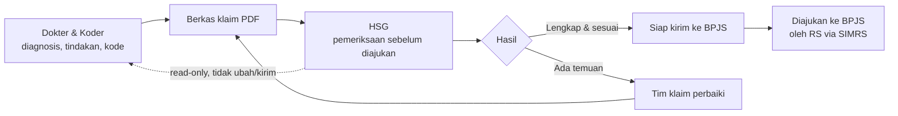
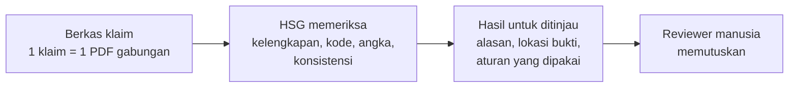
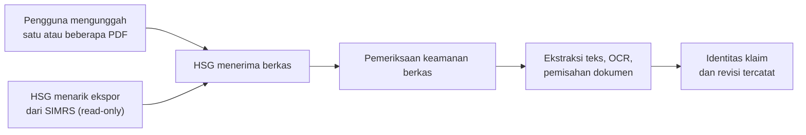
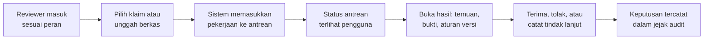
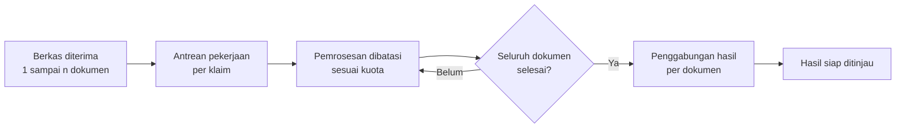
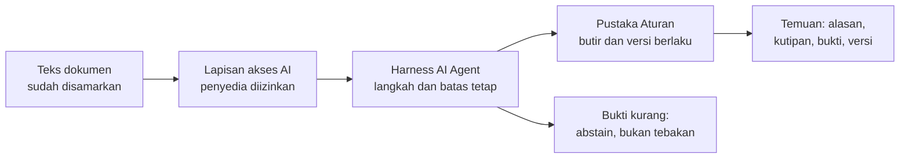
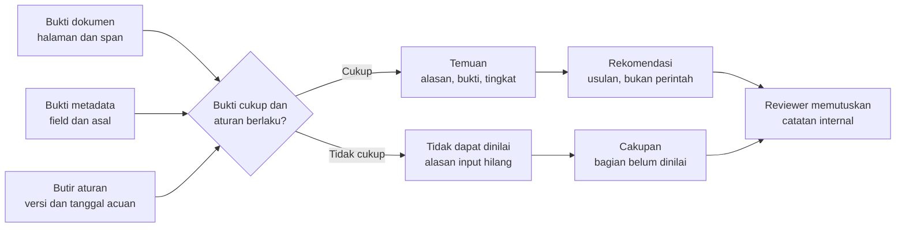

# PRD HSG — Versi 1.0

- **Status**: Disetujui
- **Versi**: 1.0
- **Tanggal**: 2026-10-28

Dokumen ini adalah PRD (Product Requirements Document, dokumen kebutuhan produk) yang menetapkan kebutuhan pengembangan aplikasi HSG, mencakup pemeriksaan klaim, kerja reviewer, pustaka dan tata kelola aturan, integrasi, serta kontrol data dan operasi. Seluruh kemampuan dan kontrol dalam ruang lingkup menjadi kebutuhan implementasi. Aktivasi dan penerimaan mengikuti input, persetujuan, serta gate yang relevan.

HSG difokuskan pada satu titik dalam alur klaim rumah sakit: pemeriksaan berkas sebelum klaim diajukan ke BPJS Kesehatan. Rumah sakit mengumpulkan dokumen dari beberapa sistem, mengodekan diagnosis dan tindakan, lalu mengajukan klaim. HSG membantu menemukan dokumen yang kurang dan kode yang tidak sesuai lebih awal, sehingga klaim tidak tertunda atau diperdebatkan. Aplikasi ini tidak menggantikan keputusan manusia, melainkan memberi alasan dan bukti yang dapat ditelusuri agar tim klaim dapat memutuskan dengan lebih cepat dan yakin.

PRD ini ditujukan bagi pembaca dari sisi rumah sakit (direksi, kepala casemix atau klaim, dan tim TI) maupun sisi penyedia aplikasi (produk, bisnis, domain, privasi, keamanan, operasi, dan pemasaran). Tiap bagian ditulis agar dapat dipahami oleh ketiga kelompok pembaca rumah sakit tersebut. Dokumen ini juga dapat dipakai sebagai bahan penawaran ke calon pelanggan, dengan bahasa klaim yang dijelaskan pada Lampiran E.

Cara membaca dokumen ini: bagian 1 sampai 9 memberi gambaran umum, masalah, sasaran, pengguna, ruang lingkup, prinsip, dan alur kerja; bagian 10 sampai 18 menjabarkan modul, kebutuhan, ukuran keberhasilan, data, keamanan, akses, dan keluaran; bagian 19 sampai 24 mencakup pilot, jaminan mutu, asumsi, risiko, roadmap, serta syarat penerimaan. Singkatan dijelaskan pada bagian "Singkatan yang dipakai di dokumen ini" di atas, sedangkan istilah lengkap ada di Lampiran A (Glosarium). Kebutuhan fungsional dirujuk sebagai FR dan kebutuhan non-fungsional sebagai NFR, sedangkan rujukan antarbagian ditulis dengan kata "bagian" diikuti nomornya.

## Singkatan yang dipakai di dokumen ini

Berikut arti singkatan yang muncul di bagian-bagian berikutnya. Istilah bisnis dan teknis lain dijelaskan pada Lampiran A (Glosarium).

| Singkatan | Kepanjangan dan arti |
|---|---|
| BPJS Kesehatan | Badan Penyelenggara Jaminan Sosial Kesehatan, pihak yang memverifikasi dan membayar klaim rumah sakit |
| INA-CBG | Indonesian Case Base Groups, sistem pengelompokan diagnosis dan tindakan yang menentukan tarif klaim |
| CMG | Case Mix Group, kelompok kasus pada INA-CBG; Special CMG adalah kelompok khusus dengan tarif tambahan (topup) |
| ICD-10 / ICD-9-CM | International Classification of Diseases, daftar kode internasional untuk diagnosis (ICD-10) dan tindakan (ICD-9-CM) |
| IGD | Instalasi Gawat Darurat |
| Permenkes | Peraturan Menteri Kesehatan |
| UU PDP | Undang-Undang Pelindungan Data Pribadi |
| PDF | Portable Document Format, format berkas dokumen digital |
| OCR | Optical Character Recognition, pembacaan teks otomatis dari gambar atau hasil pindai |
| AI | Artificial Intelligence, kecerdasan buatan |
| LLM | Large Language Model, model bahasa AI yang memahami dan menyusun teks |
| SaaS | Software as a Service, aplikasi yang disediakan sebagai layanan dari infrastruktur penyedia |
| API | Application Programming Interface, jalur pertukaran data antar aplikasi |
| KMS | Key Management Service, layanan pengelola kunci enkripsi |
| RLS | Row-Level Security, pembatasan akses data di tingkat baris pada basis data |
| FR | Functional Requirement, kebutuhan fungsional: apa yang harus bisa dilakukan aplikasi (bagian 11) |
| NFR | Non-Functional Requirement, kebutuhan non-fungsional: seberapa baik aplikasi bekerja, seperti keamanan dan keandalan (bagian 14) |
| KPI | Key Performance Indicator, ukuran yang dipakai untuk menilai mutu dan manfaat aplikasi (bagian 12) |
| SLO / SLA | Service Level Objective / Agreement, target dan perjanjian mutu layanan, misalnya ketersediaan dan waktu respons |
| RPO / RTO | Recovery Point Objective / Recovery Time Objective, batas kehilangan data dan batas waktu pemulihan setelah gangguan |

## Kontrol dokumen dan peta struktur

| Elemen | Keterangan |
|---|---|
| Pemilik dan pembaca utama | Pembaca utama adalah direksi, kepala casemix/klaim, dan TI rumah sakit, sehingga setiap bagian ditulis agar dapat dipahami ketiganya. Dokumen ini juga dapat dipakai sebagai bahan penawaran ke calon pelanggan, dengan bahasa klaim mengikuti Lampiran E. Pihak produk, bisnis, domain, privasi, keamanan, operasi, dan pemasaran terlibat sesuai kebutuhan |
| Tujuan | Menjadi dasar implementasi seluruh ruang lingkup solusi, evaluasi, dan penerimaan |
| Status kebutuhan | Seluruh kebutuhan fungsional (FR), kebutuhan non-fungsional (NFR), kriteria, gate (syarat sebelum tahap dilanjutkan), dan rancangan dalam dokumen ini disetujui sebagai baseline implementasi; asumsi dan ketergantungan yang masih terbuka ada pada bagian 21 |
| Cakupan dan jadwal | Seluruh kemampuan dan kontrol dalam ruang lingkup diimplementasikan; urutan kerja, jadwal, dan target numerik ditetapkan pada perencanaan terpisah |
| Peta isi | Bagian 1–9: ringkasan, konteks, masalah, sasaran, persona, scope, prinsip, skenario, serta alur dan perjalanan pengguna; 10–18: modul, kebutuhan fungsional, ukuran keberhasilan (KPI), data, kebutuhan non-fungsional, keamanan, akses dan keluaran; 19–24: pilot, QA, asumsi dan ketergantungan, risiko, roadmap, dan gate; lampiran: glosarium, traceability, inventori dan komunikasi. |

Kebutuhan, batas rancangan, dan ketergantungan dijelaskan dalam dokumen ini. Rujukan ke bagian, kebutuhan fungsional (FR), dan kebutuhan non-fungsional (NFR) mengarah ke isi PRD ini; referensi publik mendukung konteks dan tidak menggantikan persetujuan domain, hukum, keamanan, atau operasi.

## 1. Ringkasan eksekutif

**HSG adalah aplikasi yang memeriksa berkas klaim BPJS Kesehatan rumah sakit sebelum klaim diajukan.** Pengguna mengunggah satu atau beberapa berkas PDF, atau HSG menarik hasil ekspor dari sistem rumah sakit dengan akses baca saja. HSG membaca berkas itu, memeriksa kelengkapan dokumen dan kesesuaian kode diagnosis serta tindakan, lalu menampilkan hasil beserta alasan dan bukti yang dapat ditelusuri. Tim klaim rumah sakit yang memutuskan.

| Pertanyaan | Jawaban singkat |
|---|---|
| Aplikasi apa? | Pemeriksa berkas klaim BPJS berbasis aturan dan AI, dengan antrean kerja dan pustaka aturan |
| Untuk siapa? | Tim casemix, koder, dan koordinator klaim rumah sakit |
| Masalah yang diatasi? | Klaim ditunda atau diperdebatkan karena dokumen kurang atau kode tidak sesuai |
| Nilai utama? | Kekurangan ditemukan lebih awal, dengan alasan dan bukti yang bisa ditelusuri |
| Yang bukan HSG? | Bukan sistem pengajuan, pembayaran, billing, atau pengganti keputusan koder dan dokter |

Pernyataan posisi produk: *"HSG membantu tim klaim rumah sakit menemukan kekurangan berkas dan ketidaksesuaian kode sebelum klaim BPJS diajukan, dengan alasan dan bukti yang bisa ditelusuri. Keputusan tetap di tangan manusia."*

## 2. Latar belakang dan prinsip produk

HSG berfokus pada pemeriksaan berkas klaim BPJS Kesehatan sebelum pengajuan. Konteks masalah dan keterbatasan bukti ada di bagian 3; keputusan manusia, bukti yang dapat ditelusuri, dan batas read-only mengikat semua kemampuan. Kebutuhan yang tidak memiliki dasar ditandai belum ditetapkan, bukan dijadikan keputusan.

### Mengapa HSG ada

Klaim BPJS Kesehatan melewati beberapa pihak sebelum dibayar. Rumah sakit menyiapkan dokumen dan mengodekan diagnosis serta tindakan, lalu mengajukan klaim. BPJS Kesehatan memverifikasi dan membayar. HSG berada di titik paling depan di sisi rumah sakit: memeriksa berkas sebelum ia diajukan, sehingga kesalahan ditemukan oleh tim klaim sendiri, bukan oleh BPJS Kesehatan setelah klaim tertunda atau diperdebatkan. Posisi ini menyebabkan tiga batas desain yang mengikat seluruh kemampuan aplikasi:

- **Keputusan di tangan manusia.** HSG hanya memberi temuan, alasan, dan bukti. Ia tidak mengubah kode, tidak mengirim klaim, dan tidak menggantikan koder atau dokter.
- **Bukti dapat ditelusuri.** Setiap temuan menyertakan lokasi bukti di berkas asli dan aturan versi yang dipakai, sehingga dapat diperiksa kembali.
- **Batas baca saja (read-only).** HSG mengambil data dari sistem rumah sakit dengan akses baca, tidak mengubah data sumber dan tidak menjadi sistem billing atau pengajuan.

### Prinsip produk

Enam prinsip di bawah ini menjadi pegangan saat kebutuhan bertentangan atau saat ada pilihan rancangan.

| Prinsip | Artinya dalam produk |
|---|---|
| Keputusan manusia | Manusia yang memutuskan; HSG memberi masukan yang dapat diperiksa, bukan keputusan otomatis |
| Bukti tertelusuri | Setiap temuan membawa alasan, lokasi bukti, dan aturan versi; tidak ada hasil tanpa jejak |
| Privasi dahulu | Data pasien terpisah per rumah sakit dan dilindungi sejak awal, bukan ditambal kemudian |
| Aturan transparan | Aturan tersimpan sebagai teks berversi dengan kutipan sumber dan disetujui dua orang |
| Read-only | HSG membaca data rumah sakit, tidak mengubah atau mengirim apa pun |
| Terukur | Setiap klaim bisa dijelaskan, dihitung, dan diaudit, termasuk saat HSG tidak yakin (abstain) |

Diagram di atas menunjukkan posisi HSG dalam alur klaim. HSG hanya berada di kotak pemeriksaan: ia menerima berkas, memberikan hasil, dan mengembalikan hasil itu ke tim klaim rumah sakit. HSG tidak mengirim klaim dan tidak mengajukan apa pun ke BPJS Kesehatan. Pengiriman berkas yang sudah siap ke BPJS Kesehatan dilakukan oleh pihak rumah sakit melalui SIMRS-nya sendiri, di luar ruang lingkup HSG (kotak terakhir). Garis putus-putus menunjukkan bahwa HSG hanya membaca data dari sistem rumah sakit dan tidak mengubah atau mengirimkannya.

## 3. Pernyataan masalah

Di rumah sakit, dokter menulis diagnosis dan tindakan, koder mengubahnya menjadi kode, lalu berkas diajukan dan diverifikasi BPJS Kesehatan. Pembagian tugas ini diatur dalam Permenkes 26/2021 [P4]. Bila dokumen kurang atau kode tidak sesuai, klaim menjadi *pending* (ditunda) atau *dispute* (diperdebatkan). Kementerian Kesehatan dan BPJS Kesehatan menyepakati pedoman khusus untuk menyelesaikan keduanya [P5].

Satu studi kasus di satu rumah sakit pada Maret 2022 memberi gambaran skala masalahnya [P6]:

- Dari 420 berkas rawat inap yang diajukan, 326 (78%) diterima dan 94 (22%) pending.
- Dari 94 berkas pending yang diajukan ulang, 67 (71%) diterima dan 27 (29%) kembali ditolak sebagai dispute.
- Penyebab yang dicatat: kode diagnosis utama tidak sesuai diagnosis dan pemeriksaan penunjang, serta lampiran yang kurang atau tidak terbaca (hasil penunjang, laporan tindakan, surat rujukan, jadwal pemberian obat).

Angka ini berasal dari satu rumah sakit, bukan angka nasional, dan **tidak boleh dipakai sebagai klaim pemasaran** tentang seberapa besar HSG akan menurunkan pending. Ia hanya menunjukkan jenis masalah yang dituju. Data pembanding dari calon pelanggan dikumpulkan lebih dulu (bagian 21).

## 4. Tujuan bisnis dan ukuran keberhasilan

Tujuan produk:

1. Berkas klaim yang bermasalah ditemukan sebelum diajukan oleh rumah sakit, bukan setelah ditunda BPJS Kesehatan.
2. Setiap temuan bisa dijelaskan: apa temuannya, kenapa, lokasi bukti yang sesuai, dan memakai aturan versi berapa.
3. Data pasien terlindungi dan terpisah antar rumah sakit.
4. Keputusan akhir tetap pada manusia. HSG tidak mengubah atau mengirim klaim; pengiriman ke BPJS Kesehatan dilakukan rumah sakit melalui SIMRS-nya.

Ukuran keberhasilan di bawah ini sengaja belum diberi target angka. Pemilik bisnis, domain, privasi, dan operasi menetapkan target serta ambang penerimaan sebelum penggunaan operasional.

| Ukuran | Arti bagi bisnis | Cara mengukur | Target |
|---|---|---|---|
| Ketepatan temuan | Proporsi temuan HSG yang benar menurut penilai independen | Dinilai per jenis temuan dan jenis input pada data acuan | Belum ditetapkan |
| Cakupan temuan | Proporsi masalah yang benar-benar ada dan berhasil ditemukan | Dibandingkan dengan seluruh kasus positif pada data acuan | Belum ditetapkan |
| Kasus berisiko yang terlewat | Masalah yang tidak ditemukan, terutama bila klaim keliru tampil Lengkap | Dilaporkan terpisah menurut jenis dan dampaknya | Belum ditetapkan |
| Pemeriksaan yang dapat disimpulkan | Proporsi pemeriksaan yang menghasilkan kesimpulan dan yang tidak dapat dinilai beserta penyebabnya | Dilaporkan per jenis input, kualitas berkas, dan ketersediaan data | Belum ditetapkan |
| Ketepatan bukti dan perlindungan data | Bukti benar-benar mendukung temuan dan pengujian tidak menemukan kebocoran atribut atau data lintas rumah sakit | Diuji pada bukti halaman/metadata dan skenario keamanan yang disetujui | Belum ditetapkan |
| Waktu proses dan biaya | Waktu antre, waktu proses, kapasitas, dan biaya untuk setiap jenis input | Diukur per tahap serta ukuran dan jenis berkas | Belum ditetapkan |
| Dampak pada klaim pending | Perubahan proporsi klaim pending dibanding kondisi awal | Dibandingkan pada rumah sakit, jenis klaim, dan periode yang sebanding | Diukur, tidak dijanjikan |
| Beban kerja reviewer | Waktu tinjauan, jumlah kasus yang ditangani, dan pekerjaan ulang | Dibandingkan dengan kondisi awal untuk kelompok pengguna yang sebanding | Belum ditetapkan |
| Kepuasan pengguna | Penilaian reviewer dan pengelola klaim terhadap kegunaan dan kejelasan hasil | Survei dan wawancara dengan pertanyaan yang sama antarperiode | Belum ditetapkan |

Setiap laporan harus menyebut jumlah kasus, periode, kelompok pembanding, sumber data, kasus yang belum selesai, serta perubahan komposisi klaim. Mutu deteksi dan dampak bisnis dilaporkan terpisah agar perubahan pending tidak langsung dianggap sebagai akibat HSG. Penilaian reviewer sehari-hari tidak menggantikan data acuan yang dinilai secara independen. Pemilik setiap ukuran dan rumus final ditetapkan bersama pemilik bisnis dan domain sebelum pengukuran dimulai (bagian 21).

## 5. Pengguna, persona dan peran

HSG mewakili peran-peran yang sudah ada di rumah sakit ke dalam sistem. Peran dan hak aksesnya sudah diatur di dalam aplikasi, sehingga pengguna tidak memilih atau mengubah perannya sendiri dan cukup mengikuti peran yang diberikan. Ada lima peran: tiga di rumah sakit dan dua di sisi penyedia aplikasi. Jabatan di rumah sakit seperti koder, verifikator internal, koordinator klaim, direktur, dan auditor dipetakan ke salah satu peran tersebut (lihat bagian 16); Admin Tenant menetapkan pemetaan ini saat pengguna didaftarkan.

| Peran | Tugas sehari-hari | Batas bawaan |
|---|---|---|
| Reviewer Klaim (rumah sakit) | Mengunggah dan meninjau klaim, membuka bukti, mencatat anotasi, memegang tugas tindak lanjut | Tidak mengubah data sistem sumber dan tidak menerbitkan aturan |
| Pembaca (rumah sakit) | Melihat dashboard ringkasan dan pustaka aturan | Tidak melihat PDF mentah, identitas pasien, atau mengekspor rincian |
| Admin Tenant (rumah sakit) | Mengatur siapa yang boleh masuk dan hak aksesnya | Tidak otomatis membaca data pasien atau mereview klaim |
| Admin Platform (penyedia) | Menyiapkan rumah sakit baru, mengatur layanan dan kuota | Tidak membaca data pasien atau hasil klaim |
| Kurator Aturan (penyedia) | Mengelola naskah dan butir aturan nasional | Tidak membaca klaim rumah sakit; pengujian memakai data sintetis |

Admin Platform adalah peran tertinggi di sisi penyedia aplikasi, tetapi bukan super admin: perannya mengelola layanan, bukan membaca data pasien rumah sakit, dan tidak ada peran yang otomatis membuka semua data. Akses darurat ke data rumah sakit hanya dapat diberikan terbatas waktu, objek, dan tujuan, dengan persetujuan dan audit; itu bukan hak tetap. Pihak yang berkepentingan tetapi tidak memakai aplikasi sehari-hari: direksi, keuangan, rekam medis, komite medik, serta bagian hukum dan privasi rumah sakit.

Akses sensitif diberikan sebagai izin tambahan, bukan otomatis karena jabatan atau peran:

| Tindakan sensitif | Syarat bisnis |
|---|---|
| Membuka identitas, PDF asli, atau hasil ekstraksi lengkap | Izin akses identitas, dibatasi pada rumah sakit, unit, dan objek yang ditugaskan; seluruh akses dicatat |
| Mengekspor rincian klaim | Izin ekspor dan persetujuan orang kedua sesuai kebijakan risiko; isi tetap dibatasi dan dilindungi |
| Mengelola atau menyetujui aturan lokal | Izin terpisah untuk membuat dan menyetujui; orang yang sama tidak boleh melakukan keduanya |
| Membaca audit | Izin audit dengan tampilan teredaksi; bukan akses otomatis ke dokumen pasien |
| Akses darurat | Terbatas waktu, objek, dan tujuan; memerlukan persetujuan serta audit dan tidak menjadi hak tetap admin |

Pemberi izin harus berwenang dan berbeda dari penerima. Admin Tenant tidak boleh menaikkan akses sensitif miliknya sendiri. Izin tidak pernah memperluas akses ke rumah sakit atau unit lain. Matriks peran dan izin ada pada bagian 16.

Peran merupakan paket izin yang sudah ditetapkan di sistem, bukan pengganti otorisasi objek. Keanggotaan pengguna pada beberapa rumah sakit tetap terpisah; peran platform tidak diwariskan ke rumah sakit. Akun layanan adapter/worker adalah akun teknis dengan cakupan terbatas, bukan peran pengguna tambahan. Izin sensitif ialah `identity.read`, `export.detail`, `rules.manage`, `rules.approve`, dan `audit.read`; bukti klinis untuk reviewer dimasking secara default. Pembaca tidak mendapat kewenangan mutasi hanya karena memperoleh izin baca tambahan. Penunjukan pemberi izin pertama saat onboarding diverifikasi dan dicatat melalui pemilik tenant. Dua akun milik orang yang sama tidak memenuhi aturan dua orang (penyusun dan penyetuju berbeda); tanpa penyetuju kedua, revisi tetap draf dan versi disetujui terakhir tetap digunakan.

## 6. Ruang lingkup dan batas produk

**Termasuk dalam rancangan:**

- Dua jalur masuk berkas: unggah manual dan tarik otomatis dari sistem rumah sakit (akses baca saja).
- Pemeriksaan kelengkapan, persyaratan klinis, kode ICD-10 dan ICD-9-CM, koding terlewat, aturan lintas diagnosis, dan konsistensi (bagian 11.1).
- Antrean, penugasan, anotasi, dan tindak lanjut reviewer (bagian 11.2).
- Pustaka aturan dan simulasi dampak perubahan aturan (bagian 11.3).
- Lima peran dengan hak akses terpisah (bagian 5).

**Tidak dilakukan HSG:**

- Mengirim, mengubah, atau menutup klaim di sistem rumah sakit.
- Menyetujui pengajuan, menandatangani dokumen klinis, mengajukan dispute, atau membayar klaim.
- Mengirim pesan ke dokter atas nama pengguna.
- Menetapkan diagnosis atau mengubah kode secara otomatis.
- Menyatakan kecurangan. Dugaan duplikasi atau penggelembungan kode hanya hipotesis berbukti.
- Menjadi sistem billing atau aplikasi koding lengkap.

**Bukan kapabilitas yang dapat diasumsikan dari solusi PDF ini; memerlukan keputusan scope dan data tambahan:**

- Rekonsiliasi billing terhadap katalog tindakan dan analisis tren lintas episode, karena membutuhkan data terstruktur dari sistem rumah sakit.
- Skor prediksi klaim pending atau ditolak, karena membutuhkan data hasil klaim dan evaluasi tersendiri.
- Menu di luar dua kelompok (Operasional Klaim dan Pustaka Aturan), misalnya kelompok Dokter dan Mutu.
- Format berkas selain PDF gabungan per klaim.

## 7. Prinsip dan aturan bisnis

1. **Manusia memutuskan.** HSG menandai dan menjelaskan. Reviewer menerima, menolak, atau mengusulkan alternatif sebagai catatan internal.
2. **Tidak menebak.** Bila bukti tidak cukup, hasilnya "tidak dapat dinilai". Kegagalan membaca berkas bukan bukti dokumen hilang.
3. **Daftar dokumen wajib ada tingkat nasional.** Daftar nasional berlaku untuk semua rumah sakit sesuai jenis klaim dan kondisi pemicunya. Rumah sakit boleh menambah kebutuhan sah, tetapi tidak mengurangi kewajiban nasional.
4. **Aturan berversi dan bersumber.** Setiap aturan punya sumber, cakupan, dan versi. Aturan lokal seperti kesepakatan rumah sakit dengan BPJS tidak otomatis menjadi kewajiban nasional.
5. **Perubahan aturan tidak menimpa hasil lama.** Aturan baru menghasilkan review baru. Audit menggunakan manifest dan artefak tersimpan sesuai izin dan retensi; replay bergantung pada ketersediaan artefak serta tidak menjamin keluaran model identik.
6. **Dua orang untuk aturan baru.** Pembuat dan penyetuju aturan harus orang berbeda.
7. **Hasil mesin, catatan manusia, dan status dari sistem rumah sakit dipisahkan.** Catatan reviewer tidak mengubah hasil mesin atau data sumber.
8. **Nilai klaim tidak digabung.** Nilai tagihan, pengajuan, hasil grouping, topup, dan non-INA-CBG tetap dibedakan. Tenggat enam bulan dan pengecualian dispute yang muncul di demo awal tidak ditanam sebelum ditelaah terhadap sumber yang berlaku.

9. **Deterministik lebih dulu.** Pemeriksaan wajib ditentukan aturan di luar model. AI hanya membantu interpretasi narasi ambigu dalam batas tool, bukti, dan kebijakan yang diizinkan; AI tidak mengubah scope pemeriksaan atau policy.
10. **Taksonomi bukan daftar wajib.** Klasifikasi dokumen bersama digunakan untuk pemetaan input, sedangkan kewajiban per klaim ditentukan matriks domain yang disetujui (bagian 11.1).

Asumsi dan ketergantungan yang perlu dikonfirmasi pemilik bisnis dan domain ada di bagian 21.

## 8. Skenario penggunaan utama

| Skenario | Pelaku dan hasil yang diharapkan | Kebutuhan |
|---|---|---|
| Memeriksa klaim sebelum diajukan | Reviewer menerima hasil berbukti atau ketidakcukupan data, bukan jaminan pembayaran | FR-01–06 |
| Menindaklanjuti hasil | Reviewer/koordinator menugaskan dan menganotasi tanpa menimpa hasil mesin atau menulis ke sumber | FR-07–09 |
| Memakai dan memelihara aturan | Pengguna mencari sumber sesuai periode; kurator dan penyetuju mengelola revisi serta simulasi sesuai izin | FR-10–12 |
| Menjaga operasi dan data | Peran berizin mengendalikan akses, audit dan pemulihan tanpa akses pasien otomatis | FR-13–15 |

Semua skenario termasuk dalam cakupan implementasi dan mengacu pada rincian bagian 9 sampai bagian 11, kontrak data bagian 13, kontrol bagian 15, dan pengujian bagian 20; urutan pengerjaan dan peserta evaluasi belum ditetapkan.

## 9. Alur end-to-end dan perjalanan pengguna

Berkas masuk lewat dua jalur: **unggah manual** oleh pengguna, atau **tarik otomatis** dari sistem rumah sakit dengan akses baca saja. Dokumen yang digabung dalam satu PDF disegmentasi setelah ekstraksi halaman berdasarkan bukti struktur dan isi; batas yang tidak pasti dinyatakan demikian.

Hasil per klaim memakai tiga kategori. Artinya harus dijelaskan sama persis kepada pelanggan:

| Kategori | Artinya | Yang tidak boleh dikatakan |
|---|---|---|
| **Lengkap** | Semua kondisi penerapan pemeriksaan wajib dan kondisional sudah dapat ditentukan; seluruh pemeriksaan yang berlaku selesai dan terpenuhi; dokumen wajib ada dan terbaca; tidak ada konflik atau temuan yang menghalangi | "Klaim pasti dibayar" |
| **Potensi tidak lengkap** | Ada dokumen wajib yang terkonfirmasi tidak ditemukan atau tidak terbaca | "Dokumen pasti hilang" bila sebabnya gagal baca |
| **Potensi tidak layak** | Ada temuan koding, angka, atau konsistensi yang didukung bukti | "Klaim pasti ditolak" atau tuduhan kecurangan |

Bila beberapa kondisi terjadi bersama, aturan agregasi berversi memprioritaskan **Potensi tidak layak**, lalu **Potensi tidak lengkap**, lalu **Lengkap**; semua temuan dan cakupan tetap terlihat. Kategori berbukti dapat muncul pada hasil parsial. Tanpa dasar kategori, tampilkan **Belum dapat disimpulkan** (`status_review = null`): ini bukan kategori keempat. Status proses, cakupan pemeriksaan wajib dan kategori ditampilkan terpisah; tidak adanya temuan tidak sama dengan semua pemeriksaan lolos. Temuan informasional saja tidak otomatis menentukan kategori. Ketidakadaan dokumen harus dibuktikan manifest pemeriksaan seluruh halaman dan versi aturan; bila segmentasi tidak memadai, abstain.

Status proses yang ditetapkan ialah `antre`, `berjalan`, `selesai`, `selesai_parsial`, `gagal`, atau `dibatalkan`. `selesai` berarti pipeline mencapai akhir, bukan semua pemeriksaan lolos. Setiap check mencatat aturan/versi, kondisi penerapan dan dasarnya, status terpenuhi/temuan/tidak dapat dinilai, alasan, input yang hilang, dan bukti. Kondisi yang terbukti tidak berlaku dicatat sebagai tidak berlaku, bukan lolos; kondisi pemicu yang belum diketahui menjadi tidak dapat dinilai. Cakupan memuat daftar pemeriksaan wajib yang berlaku, selesai, dan belum dapat dinilai, bukan hanya persentase. Tingkat temuan Menghambat/Klarifikasi/Catatan mengikuti policy berversi dan tidak disamakan dengan kategori hasil.

### 9.1 Dua jalur masuk berkas

Berkas klaim dapat masuk melalui dua jalur, dan keduanya menghasilkan jenis data yang sama bagi pemeriksaan:

- **Unggah manual.** Pengguna memilih satu berkas atau beberapa berkas sekaligus. Setiap berkas menjadi revisi tersendiri; unggahan berikutnya untuk klaim yang sama tidak menimpa revisi sebelumnya.
- **Tarik dari SIMRS.** HSG membaca hasil ekspor yang disediakan SIMRS. Jalur ini hanya membaca; HSG tidak menulis balik ke SIMRS dan tidak memicu pengiriman apa pun.
- Kedua jalur melewati pemeriksaan keamanan berkas yang sama. Berkas yang tidak lolos ditolak atau ditahan dengan status yang terlihat, bukan diproses diam-diam.

### 9.2 Perjalanan pengguna dan sistem

Pengguna tidak perlu menunggu di halaman unggah. Setelah berkas diterima, pekerjaan berjalan di latar belakang dan pengguna dapat menutup halaman lalu kembali melihat statusnya. Setiap perubahan status tercatat dengan waktu, sehingga pengguna tahu apakah pekerjaan masih berjalan, selesai, selesai sebagian, atau gagal.

### 9.3 Antrean dan pemrosesan banyak dokumen

Satu klaim dapat berisi beberapa dokumen, dan satu unggahan dapat berisi beberapa klaim. Pekerjaan dipecah per klaim agar satu klaim yang gagal tidak menahan klaim lain. Pemrosesan berjalan paralel dengan batas kuota, sehingga beban besar tidak menghabiskan kapasitas bagi pengguna lain.

Bila sebagian dokumen gagal dibaca, hasil tetap dapat ditampilkan sebagai **selesai parsial**. Dokumen yang gagal tidak dianggap tidak ada; ia ditandai gagal dengan alasannya. Penggabungan hasil menampilkan per dokumen dan per pemeriksaan, sehingga reviewer tahu bagian mana yang belum dapat dinilai.

### 9.4 Keterkaitan AI Agent dan Pustaka Aturan

Pustaka Aturan adalah sumber acuan, bukan bahan pelatihan bebas. Agen AI hanya boleh memakai butir aturan yang sudah disetujui, sesuai rumah sakit, cakupan, dan tanggal acuan episode klaim. Setiap jawaban atau temuan harus menunjuk butir yang dipakai beserta versinya, sehingga dapat diperiksa ulang.

Agen bekerja dalam batas tetap: langkah yang diizinkan, data yang boleh dilihat, dan bentuk keluaran yang diterima. Data pasien disamarkan sebelum diproses, dan jalur AI hanya dapat memakai penyedia yang ada dalam daftar izin. Bila bukti tidak cukup, agen menyatakan tidak dapat dinilai. Agen tidak boleh menyimpulkan diagnosis, mengubah kode, atau menulis ke sistem sumber.

## 10. Arsitektur modul dan area produk

| Area | Pengguna dan isi/keluaran | Batas |
|---|---|---|
| Operasional Klaim | Reviewer/koordinator: antrean, detail, tugas, pending/dispute, kelompok tinjauan; dashboard dan laporan sesuai izin | Review internal; bukan pengajuan atau perubahan sumber |
| Pustaka Aturan | Pengguna berizin dan kurator: sumber, butir, pencarian, tanya berbukti, rule dan simulasi | Sumber, rule dan simulasi dipisah; berlaku berdasarkan otorisasi dan tanggal |
| Administrasi | Admin tenant/platform dan pemilik izin: identitas, konfigurasi dan akses | Tidak otomatis memperoleh akses pasien; izin sensitif mengikuti bagian 5 |

Entitas konseptual utama ialah tenant, klaim, revisi input, review/check/temuan/bukti, tugas dan anotasi, snapshot status sumber, naskah/butir/rule/pack, serta simulasi. Kontrak identitas, provenance, relasi dan retensi dijelaskan pada bagian 13 dan bagian 15; skema API final belum ditetapkan. Keluaran yang berisi data sensitif tunduk pada bagian 15.

## 11. Kebutuhan fungsional

Setiap temuan menunjukkan alasan, versi aturan, dan bukti yang sesuai: halaman/span dokumen atau field snapshot metadata beserta asalnya, tanpa halaman fiktif. Ketidakadaan dokumen didukung manifest pemeriksaan, bukan kutipan palsu. Referensi aturan menjelaskan persyaratan, bukan menggantikan bukti kasus. Bila bukti tidak cukup, HSG menyatakan tidak dapat dinilai dan tidak menebak.

### 11.1 Pemeriksaan klaim

| Kemampuan | Contoh kejadian | Input dan batas bisnis |
|---|---|---|
| Kelengkapan berkas | Surat rujukan atau laporan tindakan tidak ada dalam berkas | Mengikuti matriks dokumen wajib yang telah disetujui, termasuk jenis klaim, kondisi penerapan, dan masa berlaku |
| Persyaratan klinis per diagnosis | Diagnosis tertentu mensyaratkan hasil penunjang yang tidak terlampir | Hanya untuk diagnosis, populasi, dan periode yang aturannya sudah disetujui; tidak menetapkan diagnosis baru |
| Diagnosis dan kode ICD-10 | Kode diagnosis utama tidak didukung isi resume medis | Memerlukan diagnosis/kode yang diklaim dan dokumentasi pendukung; hasil berupa kandidat tinjauan |
| Tindakan dan kode ICD-9-CM | Tindakan di laporan operasi tidak didukung kode klaim | Memerlukan tindakan/kode yang diklaim dan dokumentasi pendukung; tidak mengubah kode |
| Koding yang mungkin terlewat | Diagnosis atau tindakan terdokumentasi jelas tetapi tidak tampak pada kode klaim | Hanya kandidat dengan bukti dan aturan yang berlaku, bukan kepastian |
| Aturan koding lintas diagnosis | Urutan diagnosis utama dan sekunder tidak sesuai aturan | Hanya aturan berversi yang berlaku untuk episode dan telah disetujui |
| Konsistensi antar dokumen | Identitas episode, diagnosis, tindakan, atau tanggal berbeda antarsumber | Setiap nilai mempertahankan sumbernya; konflik ditampilkan dan tidak diselesaikan dengan tebakan |
| Konsistensi dan rekonsiliasi angka | Komponen tagihan, nilai pengajuan, hasil grouping, topup, atau komponen non-INA-CBG tidak konsisten | Hanya aktif jika semua input, arti komponen, konteks tarif, sumber, periode, pembulatan, dan toleransi yang diwajibkan aturan tersedia |

Kebutuhan data berbeda untuk setiap pemeriksaan dan ditetapkan dalam matriks aturan bisnis. Nilai tagihan rumah sakit, nilai pengajuan, tarif hasil grouping, topup Special CMG, dan komponen non-INA-CBG tidak dianggap setara atau digabung otomatis. HSG tidak menggantikan grouper resmi dan tidak menyimpulkan topup dari selisih. Jika input wajib, arti komponen, konteks tarif, atau bukti tidak tersedia atau saling bertentangan, pemeriksaan dinyatakan tidak dapat dinilai.

### 11.2 Kerja harian reviewer

- **Antrean klaim**: cari, saring, dan tugaskan klaim; prioritas, umur kasus, periode data, dan alasan pengurutan dijelaskan. Data yang tidak tersedia atau sudah lama ditandai, bukan dianggap nol atau terbaru.
- **Detail validasi**: lihat temuan, bukti, cakupan pemeriksaan, dan kandidat kode; terima, tolak, atau usulkan alternatif sebagai catatan internal. Koreksi menjadi catatan baru dan tidak menimpa hasil mesin atau keputusan terdahulu.
- **Tugas tindak lanjut**: mengikat klaim, versi berkas, dan hasil pemeriksaan yang ditinjau. Bila berkas atau hasil berubah, tugas dan keputusan lama ditandai perlu ditinjau ulang, bukan dipindahkan otomatis ke versi baru.
- **Kerja bersama**: dua reviewer tidak boleh saling menimpa keputusan. Konflik perubahan harus ditampilkan dan diselesaikan melalui penyegaran atau rekonsiliasi yang tercatat.
- **Pending dan dispute**: catat umpan balik dari sumber, tugas perbaikan, dan tindak lanjut. Status eksternal menyebut sumber dan waktu pembaruan; ketiadaan status tidak berarti klaim belum diajukan atau belum dibayar. Tombol ajukan dispute atau kirim pesan ke dokter tidak ada di HSG.
- **Kelompok tinjauan**: kumpulkan snapshot beberapa klaim untuk ditinjau bersama. Perubahan berkas, hasil, atau aturan menandai anggota yang perlu divalidasi ulang. Operasi massal melaporkan hasil per klaim dan tidak menyatakan semua berhasil bila ada konflik atau kegagalan. Kelompok bukan pengajuan resmi ke BPJS Kesehatan.
- **Dashboard dan laporan**: ringkasan volume, antrean, umur kasus, dan hasil hanya ditampilkan bila dasar datanya tersedia. Setiap agregat menyebut filter, periode, waktu pembaruan, jumlah kasus, dan data yang tidak tersedia. Laporan atau ekspor rincian hanya tersedia sesuai izin dan menggunakan pelindungan data yang sama dengan tampilan.

### 11.3 Pustaka dan tata kelola aturan

- Mencari nomor, judul, dan butir aturan; membuka naskah asli pada bagian yang tepat. Pengguna dapat memilih tanggal acuan untuk menemukan versi yang berlaku pada episode lama maupun saat ini.
- Tanya jawab dengan kutipan: jawaban selalu menunjuk butir aturan yang disetujui, sesuai rumah sakit, cakupan, dan tanggal acuan; bukan jawaban bebas.
- Naskah sumber, butir rujukan, dan aturan yang dapat dijalankan merupakan artefak berbeda. Unggahan naskah tidak otomatis menjadi aturan aktif.
- Naskah dan aturan mengikuti alur draf, tinjauan, persetujuan orang kedua, aktivasi, dan bila perlu penarikan. Pembuat dan penyetuju harus orang berbeda.
- Aturan nasional dikelola pihak global yang berwenang. Aturan lokal dikelola anggota rumah sakit yang memiliki izin, hanya berlaku untuk rumah sakit tersebut, dan tidak boleh mengurangi kewajiban nasional. Konflik prioritas diselesaikan sebelum aturan diaktifkan.
- Konflik sumber, masa berlaku, dan prioritas aturan harus diputuskan pemilik domain sebelum aktivasi. Jika sumber ditarik, pemeriksaan yang bergantung padanya diblokir sampai ada keputusan tervalidasi.
- Simulasi membandingkan aturan yang sedang berlaku dengan calon perubahan pada snapshot klaim. Hasilnya memisahkan kasus terdampak, tidak terdampak, gagal, dan tidak dapat dinilai; hasil lama tidak diubah.
- Simulasi tidak mengaktifkan aturan, tidak masuk ukuran produksi, dan tidak mengubah workflow otomatis. Setelah persetujuan, hasilnya dapat menjadi dasar pembuatan tugas pemeriksaan ulang yang berizin.

### 11.4 Kriteria penerimaan per kemampuan

| Kemampuan | Diterima bila | Kondisi yang harus ditangani |
|---|---|---|
| Penerimaan dan pemrosesan berkas | Berkas aman dapat diproses per halaman; status dan kegagalan terlihat tanpa menghasilkan kesimpulan palsu | Berkas rusak, kosong, duplikat, hasil pindai, batas dokumen ambigu, dan metadata konflik |
| Pemeriksaan klaim | Pemeriksaan yang berlaku mengikuti aturan disetujui dan menghasilkan terpenuhi, temuan, atau tidak dapat dinilai dengan alasan serta bukti | Input hilang, kondisi penerapan belum diketahui, periode aturan tidak cocok, konflik, dan ketergantungan gagal |
| Kategori hasil | Kategori mengikuti prioritas pada bagian 9 dan selalu dipisahkan dari status proses serta cakupan | Hasil parsial, pemeriksaan wajib tidak dapat dinilai, temuan bersamaan, dan kegagalan teknis |
| Antrean dan tugas | Pengguna berwenang dapat mencari, menyaring, mengambil, mengalihkan, dan menyelesaikan tugas sesuai cakupan; seluruh perubahan tercatat | Dua reviewer mengubah bersamaan, revisi input, data lama, dan tindakan tanpa izin |
| Kelompok tinjauan | Keanggotaan dan versi klaim tersimpan; perubahan ditandai dan hasil operasi massal dilaporkan per klaim | Anggota stale, konflik, gagal sebagian, dan upaya menjadikannya pengajuan resmi |
| Pending dan dispute | Status dan catatan menyebut sumber, waktu, serta tingkat verifikasi tanpa menulis kembali ke sistem sumber | Status hilang, terlambat, tidak terverifikasi, atau berubah setelah impor |
| Dashboard, laporan, dan ekspor | Agregat konsisten dengan filter dan detail; periode, jumlah kasus, data tidak tersedia, masking, dan izin terlihat | Data terlambat, akses ditolak, hasil kosong, ekspor sensitif, dan perpindahan filter |
| Pustaka aturan | Hanya sumber yang disetujui serta sesuai cakupan dan tanggal acuan digunakan; kutipan membuka versi dan lokasi yang benar | Versi historis, sumber lokal, sumber ditarik, jawaban tanpa dasar, dan layanan AI tidak tersedia |
| Publikasi dan simulasi aturan | Pemisahan pembuat–penyetuju berlaku; dependensi diperiksa; simulasi tidak mengubah hasil atau ukuran produksi | Konflik sumber, aturan lokal versus nasional, calon aturan belum disetujui, dan klaim berubah setelah snapshot |
| Keamanan dan privasi | Akses, pemrosesan AI, ekspor, audit, retensi, dan penghapusan mengikuti kebijakan serta dapat dibuktikan | Akses lintas rumah sakit/unit, peningkatan izin sendiri, akses identitas tanpa izin, dan dokumen berisi perintah tersembunyi |

Pemilik bisnis menerima alur dan keluaran; pemilik domain menerima aturan serta hasil pemeriksaan; privasi dan keamanan menerima kontrol data; operasi menerima kesiapan layanan. Bukti penerimaan dan persetujuan dicatat sebelum kemampuan digunakan secara operasional.

### 11.5 Kriteria penerimaan lintas kemampuan

- Setiap klaim mencatat rumah sakit pemilik, asal data, dan versi berkas serta informasi pendukung. Perubahan data atau aturan memerlukan pemeriksaan baru tanpa menimpa hasil lama. Perbedaan antarsumber ditampilkan beserta asal dan dasar pemilihan data.
- Berkas diperiksa keamanannya sebelum diproses. Pengguna dapat melihat kemajuan, kegagalan, dan pemeriksaan yang belum selesai. Kegagalan membaca tidak dianggap sebagai bukti dokumen hilang.
- Pemeriksaan wajib dijalankan sesuai aturan yang disetujui. Hasil menunjukkan pemeriksaan yang telah dan belum dilakukan, versi aturan, dan bukti yang sesuai. Jika data atau bukti tidak memadai, pemeriksaan dinyatakan tidak dapat dinilai; kategori mengikuti bagian 9.
- Pencarian dan tanya jawab aturan hanya menggunakan sumber yang disetujui dan sesuai rumah sakit, cakupan, serta tanggal acuan, termasuk versi historis untuk episode lama. Jawaban tanpa dasar rujukan tidak diberikan. Penerbitan aturan memerlukan persetujuan; simulasi dan pemeriksaan ulang tidak mengubah hasil lama.
- Pengguna yang berwenang dapat membuka bukti, mencatat hasil tinjauan, dan menugaskan tindak lanjut. Aktivitas tercatat dan data setiap rumah sakit tetap terpisah; hasil mesin dan sistem sumber tidak diubah.
- Data yang dikirim ke AI dibatasi dan diperiksa sesuai kebijakan privasi. Usulan AI harus didukung bukti dan aturan; isi dokumen tidak boleh mengubah pemeriksaan, hak akses, atau aturan.
- Layanan menyediakan pemantauan, jejak audit, penyimpanan dan penghapusan sesuai kebijakan, pemulihan data, serta kemampuan menghentikan fitur atau kembali ke versi yang telah diuji. Penerimaan memerlukan bukti pengujian dan persetujuan pada bagian 20.

Matriks kelengkapan sebelum aktivasi harus mencantumkan jenis dokumen dan pelayanan/klaim, kondisi pemicu dan input penentu, dasar serta pasal/halaman, masa berlaku, tingkat kewajiban, reviewer dan persetujuan. Dokumen episode dibedakan dari administrasi pengajuan kolektif; dasar atau pemicu yang belum terverifikasi menghasilkan tidak dapat dinilai.

Rule klinis, koding, dan pembayaran dipisahkan menurut tujuan, populasi, konteks pelayanan, jendela observasi, satuan, input, pengecualian dan masa berlaku. Kamus mencatat sistem, edisi, lisensi, asal dan versi mapping; edisi serta precedence harus disetujui berdasarkan aturan untuk episode, bukan otomatis versi terbaru. Pack yang belum disetujui atau tidak cocok periode memblokir check terkait. Data skor yang hilang bukan nol dan indikator keparahan tidak sendiri membatalkan diagnosis.

### 11.6 Katalog kebutuhan fungsional dan acceptance criteria

Seluruh ID berikut termasuk dalam cakupan implementasi dan disetujui sebagai kebutuhan baseline; detail dan kriteria yang memerlukan persetujuan domain ditandai pada kolom penelusuran. Urutan pelaksanaan ditetapkan pada perencanaan. Kriteria ini melengkapi, bukan menggantikan, rincian dan kondisi pada bagian 9 sampai bagian 11.5.

| ID | Kebutuhan | Acceptance criteria | Penelusuran |
|---|---|---|---|
| FR-01 | Penerimaan manual dan integrasi read-only | Satu PDF gabungan dan metadata sesuai jalur tercatat sebagai revisi; sumber tidak ditulis; berkas tidak aman ditolak/ditahan dan status terlihat | bagian 13, bagian 6, bagian 15 |
| FR-02 | Ekstraksi, OCR, segmentasi dan identitas klaim | Hasil per halaman dan kegagalan terlihat; batas ambigu tidak dipaksakan; hash mendukung integritas, bukan identitas klaim | bagian 9, bagian 13 |
| FR-03 | Validasi kelengkapan dan persyaratan klinis | Matriks disetujui, kondisi dan periode berlaku digunakan; bukti tidak cukup menghasilkan tidak dapat dinilai; kegagalan OCR tidak menjadi bukti hilang | bagian 11.1, bagian 7 |
| FR-04 | Kesesuaian kode dan koding terlewat | Diagnosis/tindakan dan kode yang tersedia dibandingkan dengan bukti serta kamus yang berlaku; kandidat tidak mengubah kode, dan input/bukti tidak memadai menghasilkan abstain | bagian 11.1 |
| FR-05 | Validasi angka dan konsistensi | Sumber konflik terlihat; komponen nominal tidak disamakan atau diinferensikan; perbandingan berjalan hanya jika input, konteks, dan rule terpenuhi | bagian 11.1, bagian 7, bagian 13 |
| FR-06 | Hasil dan agregasi review | Per check tersedia status, alasan, bukti dan versi; status proses, cakupan dan kategori terpisah; tanpa dasar kategori tampil Belum dapat disimpulkan; prioritas agregasi mengikuti aturan berversi | bagian 9 dan bagian 11 |
| FR-07 | Antrean, tugas dan keputusan manusia | Pengguna berizin mencari, menugaskan dan menganotasi temuan; perubahan bersamaan tidak menimpa, revisi menandai keputusan lama untuk ditinjau ulang | bagian 11.2, bagian 11.4 |
| FR-08 | Pending/dispute dan kelompok tinjauan | Status eksternal menampilkan asal dan waktu atau ketidaktersediaan; kelompok menyimpan snapshot dan melaporkan hasil per anggota, tanpa aksi pengajuan/dispute eksternal | bagian 11.2 |
| FR-09 | Dashboard, laporan dan ekspor | Filter, periode, as-of, denominator, keterbatasan dan izin dipertahankan; detail dan agregat konsisten; data tidak tersedia tidak dianggap nol | bagian 11.2, bagian 13 |
| FR-10 | Pencarian dan tanya pustaka | Hanya sumber disetujui, terotorisasi, sesuai scope dan tanggal acuan digunakan; kutipan membuka lokasi benar; jawaban tanpa dukungan abstain | bagian 11.3, bagian 15 |
| FR-11 | Tata kelola sumber dan rule | Naskah, butir dan rule berbeda; maker-checker dan dependensi sumber ditegakkan; konflik atau penarikan memblokir check terdampak sampai keputusan domain | bagian 11.3, bagian 7 |
| FR-12 | Simulasi dampak dan review ulang | Baseline dan kandidat dibandingkan pada snapshot; hasil gagal/tidak dapat dinilai terpisah; simulasi tidak mengubah hasil atau KPI produksi; tindak lanjut memerlukan izin dan persetujuan | bagian 11.3 |
| FR-13 | Hak akses, privasi dan AI terbatas | Otorisasi tenant/objek dan izin sensitif ditegakkan; jalur AI lolos minimisasi dan persetujuan atau diblokir tanpa fallback mentah; dokumen tidak dapat mengubah policy | bagian 5, bagian 15 |
| FR-14 | Versi, audit dan operasi | Revisi/review baru tidak menimpa hasil lama; akses dan aksi tercatat tanpa isi pasien dalam log umum; pemulihan, pemantauan dan rollback diuji sesuai gate | bagian 11.5, bagian 13, bagian 20 |
| FR-15 | Halaman Kebijakan Privasi dan Syarat Ketentuan | Aplikasi menyajikan Kebijakan Privasi dan Syarat Ketentuan sebagai halaman yang dapat dibaca di dalam produk; pengguna dan tenant wajib menyetujuinya dengan catatan waktu dan versi sebelum aktivasi atau sebelum akses data nyata; penyetujuan dapat ditarik dan dicatat | bagian 19, bagian 15 |

## 12. Kamus KPI dan metodologi

Definisi berikut adalah rancangan pengukuran, bukan target atau bukti kinerja. Pemilik, sumber, periode, ambang, metode sampling dan formula final seluruhnya ditetapkan bersama pemilik bisnis dan domain sebelum pengukuran dimulai (bagian 21); denominator nol atau tidak tersedia dilaporkan sebagai tidak dapat dihitung, bukan nol persen.

| KPI | Pembilang / denominator atau pengukuran awal | Batas interpretasi dan rujukan |
|---|---|---|
| Ketepatan temuan | Temuan benar menurut label independen / seluruh temuan yang dinilai | Per jenis dan slice; tidak menyatakan hasil klaim akhir. bagian 4, bagian 20 |
| Cakupan temuan | Masalah yang ditemukan / seluruh masalah positif pada data acuan | Recall; label dan cohort perlu validasi domain. bagian 4, bagian 20 |
| False negative berisiko | Masalah berisiko yang terlewat / kasus positif terkait | Laporkan khusus Lengkap palsu dan dampak; definisi kasus berisiko belum ditetapkan. bagian 20 |
| Cakupan dan abstain | Check yang dapat disimpulkan atau tidak dapat dinilai / check berlaku dalam populasi terukur | Applicability belum diketahui dilaporkan terpisah, tidak dianggap lolos. bagian 9, bagian 11 |
| Validitas bukti | Bukti yang valid dan mendukung / bukti yang dinilai | Pisahkan dokumen, metadata dan manifest; uji lokasi serta dukungan interpretasi. bagian 11.4 |
| Kebocoran atribut/tenant | Kejadian kebocoran teramati / percobaan uji relevan | Jumlah percobaan dan keterbatasan wajib dicatat; tidak membuktikan nol risiko. bagian 15, bagian 20 |
| Latensi dan biaya | Distribusi durasi antre/proses serta biaya per tahap dan jenis input | Ukuran berkas, kegagalan, volume dan satuan dilaporkan; SLO belum ditetapkan. bagian 4, bagian 20 |
| Proporsi pending | Klaim pending / klaim yang memenuhi definisi dan periode pengukuran | Baseline, status akhir, kasus belum selesai dan pembanding diperlukan; bukan bukti kausal tanpa evaluasi. bagian 4, bagian 21 |
| Beban kerja dan kepuasan | Waktu/volume/kerja ulang serta hasil survei pada kelompok yang sebanding | Instrumen dan populasi belum ditetapkan; perubahan komposisi harus dicatat. bagian 4 |

## 13. Data, integrasi dan kontrak input/keluaran

**Unggah manual** memerlukan satu PDF gabungan, rumah sakit pemilik, jenis dan periode episode, serta referensi klaim bila tersedia. Sistem memberi identitas internal dan mencatat siapa yang mengunggah, waktu, asal berkas, serta versi input.

**Penarikan otomatis** memerlukan satu PDF gabungan per klaim dan metadata minimum: identitas klaim pada sistem sumber, penyedia/episode, asal berkas, versi ekspor, dan waktu pengambilan. Daftar dokumen, kode, status, grouping, tarif, dan komponen nilai digunakan hanya jika tersedia dan asalnya dapat ditelusuri.

Berkas yang sama dapat dideteksi untuk membantu deduplikasi, tetapi kesamaan berkas tidak otomatis berarti klaim yang sama. Bila PDF dan metadata berbeda, kedua sumber tetap ditampilkan dan konflik mengikuti aturan pemilihan data yang berversi. Nilai tanpa sumber dinyatakan tidak tersedia. Input baru menghasilkan revisi dan pemeriksaan baru; hasil lama tetap dipertahankan.

Keluaran bisnis mencakup status proses, cakupan pemeriksaan, kategori bila dapat disimpulkan, temuan, bukti, versi aturan, catatan reviewer, serta status eksternal beserta waktu pembaruannya bila tersedia. Dashboard, laporan, dan ekspor harus mempertahankan arti, sumber, periode, batas data, dan izin yang sama; tidak boleh menyederhanakan hasil parsial menjadi kepastian.

**Identitas, provenance dan versi.** Klaim terintegrasi diidentifikasi oleh tenant, sistem sumber dan ID klaim sumber; unggah manual memakai ID internal serta referensi eksternal bila ada. Revisi mengikat hash PDF dan snapshot metadata serta versi mapping adapter. Hasil immutable memiliki ID review/revisi, status dan cakupan, check, temuan, bukti, versi agregasi dan korelasi; anotasi manusia append-only dan tidak mengubah hasil mesin. Setiap review menyimpan manifest versi input, adapter, ekstraktor/OCR, redaktor, rule/kamus/referensi, model/prompt dan agregasi yang relevan. Replay deterministik memakai snapshot yang sama; OCR atau LLM tidak dijanjikan identik.

**Job dan kegagalan.** Berkas tersimpan aman dan revisi serta job tercatat secara durable sebelum penerimaan; karantina harus lolos sebelum pemrosesan. Registry job persisten menjadi sumber kebenaran untuk pengiriman at-least-once; jika queue terpisah digunakan, outbox/dispatcher mencegah hilangnya publikasi. Idempotency key dibatasi tenant/operasi dan terikat fingerprint payload; key sama dengan payload berbeda ditolak. Worker menggunakan lease dan fencing untuk menolak hasil usang; retry sementara memakai backoff, pembatalan kooperatif dan re-drive berizin diaudit. Re-run dengan input atau konfigurasi berbeda menghasilkan review baru tanpa menimpa hasil lama. Engine queue dan bentuk job re-drive belum diputuskan.

## 14. Kebutuhan non-fungsional

Seluruh NFR berikut disetujui sebagai kebutuhan baseline. Target availability, latensi, kapasitas, biaya, aksesibilitas dan pemulihan ditetapkan pada perencanaan operasi, bukan diambil dari dokumen referensi. Bukti uji mengikuti bagian 20.

| ID | Kategori dan kebutuhan | Verifikasi / hal yang belum ditetapkan |
|---|---|---|
| NFR-01 | Keamanan, isolasi dan enkripsi tenant di seluruh jalur | Uji lintas tenant/unit, API, database, cache, queue, storage, ekspor, kunci/envelope; rancangan belum teruji. bagian 15 |
| NFR-02 | Privasi dan minimisasi, fail-closed untuk AI eksternal | Uji payload aktual termasuk OCR rusak dan quasi-identifier; policy residual dan region penyimpanan ditetapkan setelah tinjauan hukum; model bahasa dihosting sendiri. bagian 15 |
| NFR-03 | Keandalan job dan integritas hasil | Uji duplikasi, retry, lease usang, crash, pembatalan dan pemulihan; jangan menimpa hasil lama atau mengklaim exactly-once. bagian 13 |
| NFR-04 | Performa, kapasitas dan isolasi beban | Ukur latensi/biaya per tahap dan kelas PDF serta beban lintas tenant; SLO, kuota, batas dan kapasitas ditetapkan bersama tim operasi sebelum go-live; bagian 20 |
| NFR-05 | Pemulihan dan lifecycle data | Restore terpadu data, objek, envelope dan kunci; retensi mengikuti kebijakan rumah sakit dan hukum yang berlaku (PRD tidak menetapkan angka), penghapusan, legal hold serta tombstone diuji; RPO/RTO ditetapkan sebelum go-live |
| NFR-06 | Auditability dan reproducibility | Manifest dan audit terbatas tersedia; replay deterministik sesuai input/versi, tanpa menjanjikan keluaran OCR/LLM identik; log umum tanpa konten pasien. bagian 7; bagian 11.5 |
| NFR-07 | Observabilitas dan operasi | Pantau antrean, kegagalan, cakupan, privacy block dan biaya tanpa payload pasien; runbook, on-call, ambang alert dan pemilik ditetapkan bersama tim operasi sebelum go-live; penanggung jawab insiden ditunjuk pada saat yang sama |
| NFR-08 | Usability dan konsistensi workspace/API | Uji normal, loading, empty, error, izin ditolak, stale, filter/paging dan respons terlambat; hasil klaim lain tidak tertukar. Standar aksesibilitas, perangkat/browser, viewport dan bahasa belum ditetapkan; bukan adopsi target referensi |
| NFR-09 | Versioning dan maintainability | Perubahan adapter, extractor, rule, prompt/model dan redactor melewati evaluasi relevan; kontrak final, kompatibilitas dan teknologi indeks belum ditetapkan. bagian 11.5, bagian 20 |

## 15. Keamanan, privasi dan governance

**Siapa yang bisa melihat data pasien?** Akses dibatasi per rumah sakit dan per peran. Admin tidak otomatis membaca data pasien. Membuka identitas pasien membutuhkan izin khusus dan dicatat.

**Apakah data rumah sakit lain bisa terbaca?** Data tiap rumah sakit dipisah di setiap lapisan, dan setiap rumah sakit punya kunci enkripsi sendiri. Pemisahan ini harus dibuktikan melalui pengujian.

**Apa yang dikirim ke AI?** Secara default, pengenal langsung termasuk nama, NIK, nomor rekam medis, kontak, alamat dan nomor klaim dihapus; hanya konteks minimum yang diperlukan dan lolos kebijakan tugas dikirim. PDF utuh dan OCR mentah tidak dikirim melalui jalur default. Redaksi atau risiko identifikasi ulang yang tidak memenuhi kebijakan memblokir pengiriman tanpa fallback mentah; pemeriksaan deterministik tetap berjalan jika dapat. Redaksi tidak menjamin anonim atau nol kebocoran. Pengecualian bila tugas benar-benar membutuhkan pengenal langsung memerlukan dasar pemrosesan, persetujuan tata kelola, deployment/provider yang disetujui, kontrol kontraktual dan retensi, serta pencatatan keputusan.

**Di mana data diproses?** Penyebaran menggunakan SaaS multi-tenant terpusat: PDF asli dan data klinis berada di infrastruktur platform, bukan di rumah sakit. Penyedia cloud dan region belum dipilih. PDF, OCR lengkap dan turunannya tetap dapat berisi identitas meskipun identity vault dipisahkan; reviewer memerlukan `identity.read` untuk PDF asli atau OCR lengkap.

**Apakah data dipakai melatih AI?** Model bahasa dihosting sendiri oleh penyedia aplikasi, sehingga teks klaim tidak dikirim ke penyedia AI pihak ketiga. Penggunaan data klaim untuk melatih atau menyempurnakan model tidak diizinkan tanpa persetujuan tata kelola dan dasar pemrosesan yang sah.

**Bagaimana dengan dokumen berisi perintah tersembunyi?** Isi berkas diperlakukan sebagai data, bukan perintah. AI tidak bisa mengubah aturan, melewatkan pemeriksaan wajib, atau menentukan status akhir sendiri.

**Apakah ada jejak audit?** Ya. Jejak audit mencatat siapa melakukan apa, kapan, dan hasilnya, tanpa menyimpan isi data pasien di catatan itu.

**Apa yang tetap menjadi tanggung jawab rumah sakit?** Rumah sakit tetap pengendali data. Dasar pemrosesan dan pemberitahuan kepada pemilik data bila pelindungan gagal dibagi antara rumah sakit dan penyedia aplikasi [P7][P8]. Kewajiban hukum rinci ditetapkan penasihat hukum.

**Yang tidak boleh dikatakan:** "aman 100%", "patuh UU PDP", "bebas kebocoran", atau "data tidak pernah meninggalkan rumah sakit". Enkripsi dan penyamaran adalah kontrol teknis, bukan bukti kepatuhan hukum.

**Kontrol teknis**: otorisasi tenant dan objek diterapkan berlapis pada API, database, cache, antrean, storage, ekspor dan akses kunci; tenant berasal dari konteks autentikasi, bukan input yang dipercaya. Enkripsi envelope menyimpan ciphertext dan wrapped DEK, dengan KEK per tenant dikelola KMS dan akses unwrap melalui broker berotorisasi; konteks tenant/objek divalidasi, dan pemisahan kunci tidak menggantikan otorisasi. Backup mencakup objek, metadata, envelope, registry dan konfigurasi pemulihan kunci, serta diuji restore terpadu dan penerapan penghapusan/legal hold.

Penerimaan berkas menerapkan karantina dan pemeriksaan format, ukuran serta keamanan; parsing/OCR berjalan terisolasi dengan batas sumber daya dan tanpa akses umum ke database, jaringan atau provider. Referensi input berumur dan scope terbatas; log umum dan queue tidak memuat PDF, OCR, prompt atau isi pasien. Audit akses, aksi dan kegagalan berisi metadata minimum dan terlindungi.

Gateway AI hanya mengizinkan kombinasi provider/model/endpoint/fitur/region yang disetujui. Gate juga mencakup query, embedding, reranking dan kutipan sumber privat; konteks tersunting dan peta balik bukti dilindungi sesuai izin dan retensi. Tool AI dibatasi read-only dan tervalidasi, tanpa SQL bebas atau akses mutasi; referensi aturan bukan bukti klinis. Kandidat diperiksa terhadap schema, kutipan dan bukti kasus yang benar; kegagalan gate, bukti atau provider menghasilkan abstain untuk check terdampak tanpa fallback data mentah.

## 16. Matriks role dan permission

Peran rumah sakit sudah direpresentasikan ke dalam sistem dan diatur di atas aplikasi. Pengguna tidak mengatur peran sendiri; mereka mengikuti peran yang diberikan Admin Tenant saat didaftarkan.

**Pemetaan jabatan rumah sakit ke peran di HSG.** Pemetaan berikut adalah bawaan dan dapat disesuaikan rumah sakit saat onboarding oleh Admin Tenant.

| Jabatan di rumah sakit | Peran di HSG | Catatan |
|---|---|---|
| Koder, verifikator internal, koordinator klaim | Reviewer Klaim | Memeriksa klaim, bukti, dan tindak lanjut |
| Direksi, keuangan, rekam medis, komite medik | Pembaca | Melihat dashboard ringkasan dan pustaka aturan |
| Auditor | Pembaca + izin audit | Audit hanya dengan tampilan teredaksi |
| Pengelola akun rumah sakit (TI atau unit yang ditunjuk) | Admin Tenant | Mengatur pengguna dan hak akses |
| Tim penyedia aplikasi | Admin Platform dan Kurator Aturan | Tidak membaca data pasien rumah sakit |

**Matriks peran dan izin.** ✔ = boleh, — = tidak boleh, * = hanya dengan izin tambahan (bagian 5).

| Kemampuan | Reviewer Klaim | Pembaca | Admin Tenant | Admin Platform | Kurator Aturan |
|---|---|---|---|---|---|
| Mengunggah klaim | ✔ | — | — | — | — |
| Melihat hasil, temuan, dan bukti (dimasking) | ✔ | — | — | — | — |
| Mencatat anotasi, keputusan, dan tugas tindak lanjut | ✔ | — | — | — | — |
| Melihat dashboard ringkasan | ✔ | ✔ | — | — | — |
| Melihat pustaka aturan | ✔ | ✔ | — | — | ✔ |
| Mengekspor ringkasan | ✔ | ✔ | — | — | — |
| Mengekspor rincian klaim | * | — | — | — | — |
| Membuka identitas pasien, PDF asli, atau hasil ekstraksi lengkap | * | — | — | — | — |
| Menyusun aturan lokal rumah sakit (`rules.manage`) | * | — | * | — | — |
| Menyetujui aturan lokal rumah sakit (`rules.approve`) | * | — | * | — | — |
| Membaca audit (`audit.read`) | — | * | * | — | — |
| Mengatur pengguna dan peran rumah sakit | — | — | ✔ | — | — |
| Mengatur integrasi dan retensi rumah sakit dalam batas kebijakan platform | — | — | ✔ | — | — |
| Menyiapkan rumah sakit baru, layanan, dan kuota | — | — | — | ✔ | — |
| Mengelola naskah dan butir aturan nasional | — | — | — | — | ✔ |

Peran tidak memberi akses ke rumah sakit atau unit lain. Admin Platform mengelola layanan tetapi tidak membaca data pasien, dan tidak ada peran yang membuka semua data. Aturan dua orang berlaku untuk aturan lokal: penyusun dan penyetuju harus dua orang berbeda dari rumah sakit yang sama, dan dua akun milik orang yang sama tidak memenuhi syarat. Hasil, ekspor, dan bukti tidak boleh memperluas kewenangan peran.

## 17. Spesifikasi output dan reporting

Bagian ini menetapkan bentuk keluaran yang dilihat pengguna. Kontrak data dan kategori hasil mengikuti bagian 13 dan bagian 9; izin ekspor mengikuti bagian 5.

### 17.1 Keluaran di dalam aplikasi

| Keluaran | Isi | Pengguna |
|---|---|---|
| Ringkasan klaim | Kategori hasil, jumlah temuan per tingkat, cakupan pemeriksaan, versi aturan, waktu proses | Reviewer, koordinator |
| Daftar temuan | Alasan, lokasi bukti di berkas asli, aturan dan versinya, status terpenuhi/temuan/tidak dapat dinilai | Reviewer |
| Riwayat revisi | Setiap unggahan atau penarikan berkas sebagai revisi, dengan waktu dan sumber | Reviewer, auditor |
| Dashboard | Jumlah klaim per status, temuan per jenis, tren periode, denominator dan batasannya | Koordinator, manajemen |
| Laporan berkala | Ringkasan operasional harian, kinerja mingguan, dan ikhtisar bulanan | Manajemen, direksi |
| Log audit | Aktor, waktu, objek, aksi, dan ringkasan sebelum-sesudah | Auditor, admin tenant |

Setiap angka pada dashboard dan laporan menyertakan periode, tanggal acuan (as-of), penyebut, dan keterbatasannya. Angka tanpa penyebut tidak ditampilkan sebagai persentase.

### 17.2 Isi minimum laporan

Laporan berkala memuat, minimal:

1. Periode yang dicakup dan waktu pembuatan laporan.
2. Jumlah klaim diperiksa, dibagi menurut status proses dan kategori hasil.
3. Jumlah temuan per tingkat (Menghambat, Klarifikasi, Catatan) beserta jenis pemeriksaan.
4. Cakupan pemeriksaan: berapa pemeriksaan wajib yang selesai dan berapa yang belum dapat dinilai.
5. Catatan mutu data: berkas gagal baca, dokumen tidak ditemukan, dan hasil parsial.
6. Catatan metodologi: versi aturan yang berlaku, definisi tiap kategori, dan batasan tafsir.
7. Rekomendasi tindak lanjut, hanya yang dapat ditelusuri ke temuan dan aturan.

Laporan tidak boleh menyajikan angka tanpa catatan metodologi yang relevan. Rekomendasi yang tidak punya dasar pada temuan dan aturan tidak dicantumkan.

### 17.3 Ekspor dan penjadwalan

- **Format ekspor.** Ringkasan dan daftar temuan dapat diekspor ke PDF dan Excel. Ekspor rincian klaim memerlukan izin `export.detail` dan dicatat dalam audit.
- **Pemrosesan asinkron.** Ekspor berukuran besar diproses di latar belakang dengan indikator kemajuan; pengguna tidak perlu menunggu di halaman.
- **Laporan terjadwal.** Laporan berkala dapat dikirim otomatis sesuai jadwal, penerima, dan zona waktu yang ditetapkan. Setiap pengiriman mencatat status berhasil atau gagal, dan snapshot data yang dipakai konsisten dengan periode laporan.
- **Identitas visual.** Laporan dapat memakai logo dan warna rumah sakit. Cakupan penyesuaian dinyatakan eksplisit, termasuk hal yang tidak termasuk seperti domain kustom.

### 17.4 Batas keluaran

- Keluaran HSG adalah hasil pemeriksaan internal rumah sakit, bukan dokumen resmi pengajuan klaim.
- HSG tidak membuat berkas klaim baru, tidak mengirim klaim, dan tidak melakukan pengajuan ke BPJS Kesehatan. Pengajuan dilakukan rumah sakit melalui SIMRS.
- Ekspor tidak boleh memuat data pasien melebihi izin pengguna yang mengekspornya.
- Simulasi dampak aturan ditampilkan terpisah dan tidak dihitung dalam KPI produksi.

Format berkas, susunan template, jadwal distribusi, dan daftar penerima belum ditetapkan dan menjadi asumsi pada bagian 21.

## 18. Temuan dan rekomendasi berbukti

Temuan adalah hasil satu pemeriksaan terhadap satu klaim: pernyataan bahwa suatu kondisi wajib belum terpenuhi, disertai alasan, bukti, dan aturan yang dipakai. Temuan bukan penilaian atas mutu pelayanan, bukan tuduhan, dan bukan perintah mengubah kode atau klaim. Rekomendasi adalah usulan tindak lanjut yang boleh dipakai atau diabaikan reviewer. Jenis pemeriksaan dan batas masukannya ada pada bagian 11.1; kriteria penerimaan per kemampuan pada bagian 11.4; kaitan temuan dengan kategori hasil pada bagian 9.

### 18.1 Anatomi satu temuan

Setiap temuan wajib dapat dijelaskan ulang oleh orang yang tidak menjalankan pemeriksaan. Karena itu satu temuan memuat bagian berikut, dan bagian yang tidak tersedia dinyatakan tidak tersedia, bukan dikosongkan.

| Bagian | Isi minimum | Batas yang berlaku |
|---|---|---|
| Pemeriksaan | Nama pemeriksaan, kategori wajib atau kondisional, dan kondisi penerapannya | Pemeriksaan yang kondisinya tidak diketahui tidak dijalankan, bukan dianggap lolos |
| Aturan | Butir aturan, versi, dan tanggal acuan episode | Hanya aturan yang disetujui, sesuai cakupan rumah sakit, dan berlaku pada tanggal acuan |
| Bukti | Halaman dan span dokumen, atau field snapshot metadata beserta asalnya | Tidak ada halaman fiktif; ketidakadaan dokumen dibuktikan manifest pemeriksaan |
| Alasan | Kalimat yang menjelaskan kondisi mana yang belum terpenuhi | Alasan menjelaskan persyaratan, bukan menggantikan bukti kasus |
| Tingkat | Menghambat, Klarifikasi, atau Catatan sesuai policy berversi | Tingkat tidak disamakan dengan kategori hasil dan tidak menentukan pembayaran |
| Ketidakpastian | Alasan data atau bukti tidak memadai bila hasilnya tidak dapat dinilai | Kegagalan membaca berkas bukan bukti dokumen hilang |
| Usulan | Rekomendasi tindak lanjut yang bersifat usulan | Usulan tidak mengubah hasil mesin, kode, atau data sumber |
| Jejak | Waktu pemeriksaan, versi berkas, dan siapa yang meninjau | Catatan reviewer menjadi catatan baru, tidak menimpa hasil terdahulu |

Karena satu klaim dapat memuat banyak pemeriksaan, satu klaim juga dapat memuat banyak temuan sekaligus temuan yang tidak dapat dinilai. Keduanya ditampilkan terpisah. Cakupan pemeriksaan wajib yang berlaku, yang selesai, dan yang belum dapat dinilai selalu ikut ditampilkan, sehingga jumlah temuan yang sedikit tidak dapat disalahartikan sebagai klaim yang bersih. Prioritas tampil antartemuan mengikuti aturan agregasi berversi; urutan tampil tidak boleh dibaca sebagai tingkat keparahan klaim.

### 18.2 Jenis rekomendasi

Rekomendasi disusun menurut apa yang perlu diperiksa manusia, bukan menurut apa yang bisa diubah mesin. HSG tidak mengubah kode, tidak menyunting berkas, dan tidak mengirim apa pun ke pihak luar.

| Jenis | Bentuk usulan | Yang tidak dilakukan HSG |
|---|---|---|
| Melengkapi dokumen | Menunjuk dokumen yang terkonfirmasi tidak ditemukan atau tidak terbaca, beserta persyaratannya | Menyatakan dokumen pasti hilang bila penyebabnya kegagalan baca |
| Meninjau kode | Menunjukkan kandidat diagnosis atau tindakan yang terdokumentasi tetapi tidak tampak pada kode klaim, atau pasangan kode yang tidak didukung isi dokumen | Mengubah kode, menetapkan diagnosis baru, atau menyatakan kode lama salah |
| Merekonsiliasi angka | Menunjukkan komponen tagihan, nilai pengajuan, hasil grouping, topup, atau nilai non-INA-CBG yang tidak konsisten antarsumber | Menggabungkan nilai, menginferensikan komponen yang hilang, atau menghitung ulang tarif |
| Menjelaskan konflik | Menampilkan nilai berbeda antardokumen beserta asal masing-masing | Memilih salah satu nilai sebagai benar tanpa keputusan reviewer |
| Meninjau ulang | Menandai klaim yang keputusan atau tugasnya perlu ditinjau karena berkas, hasil, atau aturan berubah | Memindahkan keputusan lama ke versi baru secara otomatis |

### 18.3 Bahasa dan batas rekomendasi

Rekomendasi ditulis sebagai usulan yang dapat diperiksa, bukan sebagai instruksi atau kesimpulan. Beberapa batas berikut berlaku pada seluruh keluaran:

- Rekomendasi tidak pernah menyatakan klaim pasti dibayar, pasti ditolak, atau terbukti curang. Kategori hasil mengikuti definisi pada bagian 9 dan tidak boleh diperhalus dalam penyajian.
- Rekomendasi tidak menyebut nama, dugaan, atau penilaian atas perorangan. Temuan menyebut kondisi dokumen dan aturan, bukan menilai orang yang mengerjakan klaim.
- Rekomendasi selalu dapat ditelusuri ke bukti yang dapat dibuka. Usulan tanpa bukti tidak ditampilkan sebagai temuan; bila dasarnya lemah, hasilnya tidak dapat dinilai.
- Usulan tidak menjadi perintah eksekusi. Tidak ada tindakan otomatis yang mengubah berkas, kode, status klaim, atau data di sistem rumah sakit.
- Rekomendasi tidak menetapkan tenggat, pemilik, atau konsekuensi. Penetapan tenggat dan pembagian kerja adalah keputusan operasional rumah sakit.

### 18.4 Penelusuran dan pembuktian ulang

Temuan harus dapat diuji kembali setelah kejadian, termasuk ketika aturan sudah berganti. Audit memakai manifest pemeriksaan dan artefak tersimpan sesuai izin dan retensi. Pemeriksaan ulang tidak menjamin keluaran model identik dengan hasil sebelumnya, sehingga kesimpulan tidak boleh bergantung pada reproduksi keluaran. Yang dijamin adalah keterlacakan: bukti yang dikutip membuka lokasi yang benar pada versi berkas yang disebut, aturan yang dipakai dapat dibuka pada versi dan tanggal acuannya, dan setiap keputusan reviewer tercatat sebagai catatan terpisah.

Karena itu perubahan aturan tidak menimpa hasil lama. Aturan baru menghasilkan review baru atas berkas yang sama, dan hasil lama tetap terbaca sebagai riwayat. Bila artefak bukti tidak lagi tersedia karena retensi, temuan lama ditandai buktinya tidak dapat dibuka, bukan dihapus dan bukan dinyatakan tetap berlaku.

### 18.5 Bagian yang belum ditetapkan

Bagian ini menetapkan bentuk dan batas temuan, bukan mekanisme pemberitahuan. Belum ada library alert, kanal notifikasi, aturan eskalasi, SLA penanganan, atau ambang prioritas bawaan yang ditetapkan. Yang tersedia dalam rancangan hanyalah tugas tindak lanjut internal per klaim seperti pada bagian 11.2: tugas dapat dicatat, ditugaskan, dan diselesaikan oleh pengguna berizin, dan setiap perubahannya masuk jejak audit. Ini bukan siklus hidup alert dengan acknowledge, eskalasi berjenjang, dan penutupan otomatis.

Mekanisme pemberitahuan, ambang prioritas, jalur eskalasi, dan kanal di luar aplikasi memerlukan dasar penggunaan, pemilik, dan persetujuan tersendiri, lalu dicatat sebagai asumsi pada bagian 21. Sebelum itu ditetapkan, temuan hanya terlihat di dalam aplikasi oleh pengguna yang berizin.

## 19. Rencana pilot dan rollout

HSG adalah layanan SaaS multi-tenant: satu instalasi melayani banyak rumah sakit dengan data yang terpisah. Karena itu bagian ini menjawab pertanyaan operasional yang paling awal muncul dari calon pengguna, yaitu bagaimana sebuah rumah sakit mulai memakai HSG, apa yang harus siap sebelum bisa dipakai, dan bagaimana urutan masuknya. Bagian ini tidak menetapkan tanggal, durasi, atau ambang numerik; yang ditetapkan adalah urutan, syarat, dan pembatasnya.

Evaluasi mencakup klaim rawat inap serta rawat jalan/IGD; rumah sakit peserta belum ditentukan. Metodologi dan pembanding mengikuti bagian 4, bagian 20 dan bagian 21. Gate pada bagian 24 berlaku sebelum data nyata. Pilot tidak mempersempit cakupan solusi, tidak menjanjikan hasil, dan tetap memakai keputusan reviewer manusia.

### 19.1 Aktivasi dilakukan bersama tim Nusantech

Rumah sakit tidak mendaftar sendiri. Aktivasi dijalankan sebagai proses terpandu oleh Admin Platform bersama pihak rumah sakit, karena tiga hal tidak dapat diselesaikan tanpa keterlibatan manusia: pemetaan peran ke orang yang benar, persetujuan aturan dan matriks dokumen, serta penyambungan jalur data. Pendaftaran mandiri tanpa proses ini berisiko menghasilkan tenant yang aktif tetapi tidak dapat dipakai dengan benar.

| Tahap | Yang terjadi | Siapa yang terlibat | Keluaran yang terlihat |
|---|---|---|---|
| 1. Pengajuan | Kebutuhan, jenis klaim yang akan diperiksa, dan volume awal dibahas | Calon pengguna, tim Nusantech | Kesepakatan lingkup pilot dan pembagian tanggung jawab |
| 2. Penyiapan tenant | Rumah sakit dibuat sebagai tenant terpisah dengan kunci enkripsi sendiri | Admin Platform | Tenant aktif, tanpa data pasien |
| 3. Persetujuan legal | Kebijakan Privasi dan Syarat Ketentuan dibaca dan disetujui di dalam aplikasi | Perwakilan rumah sakit berwenang | Persetujuan tercatat dengan waktu dan versi dokumen |
| 4. Penetapan pengguna | Admin Tenant rumah sakit memetakan jabatan ke peran dan menunjuk orangnya | Admin Tenant, Admin Platform | Daftar pengguna aktif per peran |
| 5. Persetujuan aturan | Matriks dokumen wajib dan aturan lokal disetujui pemilik domain | Kurator Aturan, pemilik domain rumah sakit | Aturan berversi berstatus disetujui |
| 6. Jalur data | Sambungan baca ke SIMRS diuji, atau disepakati memakai unggah manual lebih dulu | TI rumah sakit, tim Nusantech | Satu klaim uji berhasil diperiksa dari ujung ke ujung |
| 7. Uji terima | Hasil diperiksa bersama pada beberapa klaim contoh | Reviewer Klaim, pemilik bisnis, tim Nusantech | Persetujuan mulai pemakaian terbatas |

Tahap 3 sampai 6 dapat berjalan sebagian bersamaan, tetapi tahap 7 tidak dimulai sebelum seluruhnya selesai. Selama tahap 2 sampai 6, tenant belum boleh memproses klaim pasien nyata.

### 19.2 Syarat sebelum satu rumah sakit diaktifkan

Syarat berikut bersifat wajib. Bila salah satu belum terpenuhi, aktivasi ditunda, bukan dijalankan dengan pengecualian lisan.

| Syarat | Arti dalam praktik | Bila belum siap |
|---|---|---|
| Jalur data siap | Sambungan baca ke SIMRS sudah diuji, atau rumah sakit memilih unggah manual untuk tahap awal | Aktivasi ditunda sampai salah satu jalur disepakati dan diuji |
| Aturan dan matriks disetujui | Matriks dokumen wajib, aturan lokal, cakupan, dan tanggal berlaku sudah disetujui pemilik domain | Pemeriksaan yang bergantung pada aturan tersebut berstatus tidak dapat dinilai, bukan dianggap lolos |
| Pengguna dan peran ditetapkan | Reviewer, koder, koordinator, admin, dan pembaca sudah ditunjuk namanya | Antrean tidak dapat dipakai karena tidak ada pemilik tugas |
| Kebijakan Privasi dan Syarat Ketentuan disetujui | Perwakilan rumah sakit menyetujui kedua dokumen di dalam aplikasi, tercatat dengan waktu dan versi | Akses ke data nyata diblokir sampai persetujuan tercatat |
| Perjanjian pemrosesan data | Perjanjian tertulis antara rumah sakit dan penyedia aplikasi berlaku | Aktivasi tidak dijalankan |

Kebijakan Privasi dan Syarat Ketentuan bukan lampiran di luar produk. Keduanya adalah halaman di dalam aplikasi yang dapat dibuka kapan saja oleh pengguna, ditautkan pada layar masuk dan pada menu bantuan, serta wajib disetujui sebelum aktivasi. Karena isinya dapat berubah, setiap versi baru dicatat dan persetujuan lama tidak otomatis dianggap berlaku untuk versi baru. Ini menjadi FR-15 dan tunduk pada batas bagian 15 bahwa enkripsi dan penyamaran adalah kontrol teknis, bukan bukti kepatuhan hukum.

### 19.3 Urutan rollout

Rollout berjalan bertahap dan setiap gelombang baru dibuka hanya setelah gelombang sebelumnya memenuhi gate pada bagian 24.

| Gelombang | Cakupan | Tujuan | Syarat masuk gelombang berikutnya |
|---|---|---|---|
| 0. Uji internal | Data sintetis di lingkungan nonproduksi | Memastikan alur, hak akses, dan audit berjalan tanpa data pasien | Bukti uji alur dan isolasi tersedia |
| 1. Rumah sakit percontohan | Satu rumah sakit, jenis klaim terbatas, jumlah reviewer terbatas | Memvalidasi kecocokan aturan, kegunaan antrean, dan mutu temuan pada praktik nyata | Umpan balik pengguna, hasil mutu per jenis temuan, dan tidak ada temuan kritis yang terbuka |
| 2. Perluasan di rumah sakit yang sama | Jenis klaim dan jumlah pengguna ditambah | Memastikan hasil tetap konsisten saat volume dan variasi bertambah | Stabilitas layanan dan ketepatan temuan tidak menurun |
| 3. Rumah sakit berikutnya | Ditambahkan satu per satu dengan proses aktivasi yang sama | Menguji variasi praktik koding dan kelengkapan dokumen antarrumah sakit | Setiap rumah sakit memenuhi seluruh syarat bagian 19.2 |

Pilot pertama dirancang untuk satu rumah sakit percontohan, bukan beberapa sekaligus. Alasannya bukan kapasitas teknis, melainkan supaya masalah aturan dan alur dapat diperbaiki sebelum menular ke banyak tenant. Menambah rumah sakit pada gelombang berikutnya memakai jalur aktivasi dan uji terima yang sama, bukan jalur khusus.

### 19.4 Model komersial tahap pilot

Pilot dijalankan tanpa biaya lisensi, tetapi bersyarat. Syaratnya bukan formalitas: tanpa data evaluasi, klaim manfaat pada bagian 4 tidak dapat diuji.

| Aspek | Ketentuan rancangan |
|---|---|
| Biaya lisensi | Tidak ada biaya lisensi selama masa pilot |
| Kewajiban rumah sakit | Menyediakan pengguna yang ditunjuk, berbagi data evaluasi mutu, dan memberi umpan balik tertulis |
| Batas pilot | Jumlah klaim, jenis klaim, jumlah pengguna, dan lama pilot dibatasi dan disepakati tertulis |
| Data evaluasi | Dipakai untuk mengukur ketepatan, cakupan, dan dampak kerja; bukan untuk melatih model tanpa persetujuan tata kelola bagian 15 |
| Setelah pilot | Kelanjutan, cakupan, dan harga mengikuti evaluasi gate bagian 24; tidak ada kewajiban rumah sakit untuk melanjutkan |
| Bila pilot dihentikan | Data dikembalikan atau dihapus sesuai kebijakan retensi dan perjanjian pemrosesan data |

Pilot gratis bukan janji hasil. Tidak ada jaminan penurunan klaim pending, percepatan pembayaran, atau pengurangan nilai dispute sampai evaluasi pada bagian 20 menghasilkan bukti.

### 19.5 Exit criteria yang harus disepakati sebelum pilot mulai

Angka dan tenggat belum ditetapkan. Yang ditetapkan sekarang adalah jenis kriteria yang harus disepakati tertulis sebelum pilot dimulai, supaya keberhasilan tidak dinilai setelah hasilnya diketahui.

| Dimensi | Yang harus disepakati | Rujukan |
|---|---|---|
| Mutu temuan | Ketepatan dan cakupan per jenis temuan, termasuk batas false negative berisiko yang dapat diterima | bagian 12, bagian 20 |
| Validitas bukti | Porsi temuan yang buktinya dapat dibuka dan mendukung kesimpulan | bagian 11.4, bagian 12 |
| Kebergunaan | Umpan balik reviewer terhadap kejelasan temuan dan alur kerja | bagian 20 |
| Keandalan | Ketersediaan layanan, waktu proses, dan penanganan kegagalan | bagian 14 |
| Keamanan dan privasi | Hasil uji isolasi tenant, uji kebocoran, dan audit akses | bagian 15, bagian 20 |
| Biaya operasi | Biaya per klaim yang diperiksa dan perkiraan biaya pada volume penuh | bagian 21 |

Bila kriteria ini belum disepakati, pilot tidak dimulai. Menjalankan pilot tanpa kriteria keluar membuat keputusan kelanjutan bergantung pada kesan, bukan bukti.

## 20. Validasi mutu dan QA

Kata "akurat" atau "aman" tidak dipakai sebelum ada bukti. Bukti yang akan disiapkan:

- **Uji di lingkungan nonproduksi dengan data sintetis atau terdeidentifikasi** yang disetujui dan dilabeli koder serta klinisi kompeten; penggunaan data nyata memerlukan gate dan dasar pemrosesan yang berlaku.
- **Laporan mutu per jenis temuan dan slice input** dengan precision, recall, false negative berisiko, cakupan, abstain, validitas bukti, kebocoran dan latensi; ukur pada dataset berlabel independen dan laporkan denominator serta ketidakpastian.
- **Uji pemisahan data antar rumah sakit**, termasuk upaya mengakses data rumah sakit lain dengan identitas yang sah.
- **Uji dokumen berisi perintah tersembunyi** untuk memastikan AI tidak bisa dibujuk melewatkan pemeriksaan.
- **Evaluasi bersama reviewer manusia**, tanpa keputusan pembayaran otomatis.

Daftar periksa sebelum data nyata dipakai:

| Syarat | Pemilik | Status |
|---|---|---|
| Matriks dokumen dan aturan berversi disetujui, termasuk kondisi penerapan, sumber, masa berlaku, dan pihak yang berwenang | Pemilik domain | Belum |
| Kebijakan data yang dikirim ke AI, penyedia dan lokasi pemrosesan, dasar pemrosesan, kontrak, serta penyimpanan disetujui | Privasi dan hukum | Belum |
| Risiko keamanan serta aspek hukum lokasi, transfer, pemrosesan data kesehatan, dan tujuan penggunaan ditinjau | Keamanan dan hukum | Belum |
| Ambang mutu dan syarat peluncuran atau pengembalian versi ditetapkan; hasil evaluasi dan penilaian reviewer memenuhi ambang | Domain, privasi dan operasi | Belum |
| Pemisahan data rumah sakit dan keamanan penerimaan serta pemrosesan berkas teruji | Tim keamanan | Belum |
| Pemulihan data, berkas, dan kunci enkripsi dari cadangan teruji | Operasi | Belum |
| Masa penyimpanan, penahanan data untuk keperluan hukum, penghapusan dan penanganan cadangan ditetapkan | Hukum dan privasi | Belum |
| Prosedur insiden dan pemantauan tersedia; target layanan, waktu pemulihan, batas kehilangan data, dan penanggung jawab ditetapkan | Operasi | Belum |

Kemampuan hanya diaktifkan setelah persyaratan yang berlaku terpenuhi; reviewer manusia tetap memutuskan. Kemampuan dapat dinonaktifkan atau dikembalikan ke versi yang telah diuji tanpa menghapus jejak audit.

## 21. Asumsi dan ketergantungan

**Asumsi bisnis yang mendasari dokumen ini:**

- Rumah sakit sasaran mengajukan klaim BPJS Kesehatan dengan INA-CBG dan sudah memiliki alur casemix atau koder.
- Rumah sakit bisa menyediakan berkas klaim sebagai satu PDF gabungan per klaim.
- Calon pelanggan bersedia berbagi data pembanding awal: jumlah klaim pending dan dispute, penyebabnya, dan waktu penyelesaiannya. Tanpa data ini target pada bagian 4 tidak bisa ditetapkan.
- Jenis klaim dan rumah sakit untuk evaluasi awal disepakati dengan pemilik bisnis; pilihan peserta evaluasi tidak mempersempit cakupan solusi yang ditetapkan PRD.
- Rumah sakit bersedia menjalani aktivasi terpandu dan menyetujui Kebijakan Privasi serta Syarat Ketentuan di dalam aplikasi sebelum data nyata diproses (bagian 19).
- Pilot dijalankan tanpa biaya lisensi dengan kewajiban berbagi data evaluasi dan umpan balik; kelanjutan setelah pilot tidak dijanjikan (bagian 19.4).

**Ketergantungan:**

- Persetujuan matriks dokumen wajib, aturan klinis/koding/pembayaran, sumber, dan masa berlakunya oleh pemilik domain (pakar koding/casemix) dan peninjau hukum untuk hak penggunaan sumber, melalui proses dua orang (penyusun dan penyetuju berbeda). Penunjukan orangnya dilakukan oleh pemilik produk.
- Hak penggunaan dan pemeliharaan naskah sumber, kamus ICD, serta referensi tarif yang berlaku.
- Pemilihan model bahasa yang dihosting sendiri, wilayah pemrosesan, dasar pemrosesan, dan kebijakan data yang dapat dikirim.
- Tinjauan hukum soal lokasi data, pemrosesan data kesehatan, dan pengaturan rumah sakit sebagai pengendali data.
- Untuk penarikan otomatis: jalur akses baca saja dan mutu data yang disepakati bersama TI rumah sakit.
- Untuk pemeriksaan angka: seluruh komponen nilai, konteks tarif, sumber, dan periode yang disyaratkan aturan; data grouping dan tarif saja tidak selalu cukup.
- Untuk pengukuran dampak bisnis: data awal, definisi hasil klaim, serta periode dan kelompok pembanding yang sebanding.

## 22. Register risiko

**Register risiko awal** berikut memuat risiko yang perlu diputuskan pemilik terkait; status mitigasi belum berarti pengendalian telah teruji.

| Risiko | Dampak bisnis | Mitigasi yang harus dibuktikan | Pemilik |
|---|---|---|---|
| Dokumen atau data sumber tidak tersedia, usang, atau ambigu | Hasil tidak dapat dinilai atau temuan keliru | Tampilkan sumber, waktu, konflik, dan cakupan; uji dengan berkas representatif | Bisnis rumah sakit dan domain |
| Aturan atau referensi tidak berlisensi, tidak berlaku, atau berubah | Pemeriksaan salah atau tidak boleh diaktifkan | Periksa hak penggunaan, tanggal berlaku, persetujuan, dan penarikan sumber | Domain dan hukum |
| Masalah klaim terlewat atau hasil Lengkap palsu | Reviewer keliru mengandalkan hasil | Uji kasus positif independen, tetapkan ambang per jenis temuan, dan pertahankan keputusan manusia | Domain dan bisnis |
| Data pasien atau data rumah sakit lain terungkap | Kerugian pasien, pelanggan, dan kewajiban hukum | Uji isolasi, izin, ekspor, dan data yang benar-benar dikirim ke AI sebelum data nyata dipakai | Privasi dan keamanan |
| Ketergantungan penyedia AI atau integrasi rumah sakit gagal | Pemeriksaan tertunda atau sebagian tidak tersedia | Tampilkan status parsial, sediakan jalur tanpa AI bila memungkinkan, dan uji pemulihan | Operasi dan TI rumah sakit |
| Manfaat bisnis tidak dapat diatribusikan | Klaim nilai produk tidak dapat dipertanggungjawabkan | Sepakati baseline, kelompok pembanding, rumus, dan penanganan kasus yang belum selesai | Pemilik bisnis |

Pemilik risiko menilai tingkat dampak dan kemungkinan, menyetujui mitigasi atau penerimaan risiko, dan meninjau ulang statusnya sebelum penggunaan data nyata.

Penilaian kemungkinan, tingkat dampak, prioritas, pemilik individual, tenggat dan risiko residual belum ditetapkan. Peran pada tabel menunjukkan pihak terkait, bukan bukti penunjukan personal atau penerimaan risiko; mitigasi ditelusuri ke FR-01–15, NFR-01–09 dan gate bagian 24.

## 23. Roadmap produk

Seluruh kemampuan dalam ruang lingkup dikembangkan. Pengembangan berjalan dalam tujuh tahap yang diurutkan menurut ketergantungan: fondasi keamanan dan data lebih dulu, lalu bahan baku pemeriksaan (berkas dan aturan), lalu pemeriksaan itu sendiri, lalu alat kerja reviewer, dan terakhir kemampuan lanjutan serta pembuktian mutu. Tahap yang tidak saling bergantung boleh dikerjakan bersamaan; tahap berikutnya baru dianggap selesai bila keluarannya memenuhi gate pada bagian 24.

| Tahap | Yang dikembangkan | Hasil yang bisa dilihat pengguna | Kebutuhan terkait |
|---|---|---|---|
| 1. Fondasi | Pemisahan data antar rumah sakit, lima peran dan hak aksesnya, enkripsi, pencatatan audit, halaman Kebijakan Privasi dan Syarat Ketentuan beserta pencatatan persetujuannya, penyimpanan berkas, serta mesin antrean pekerjaan yang aman diulang | Pengguna masuk sesuai perannya dan hanya melihat data rumah sakitnya sendiri; syarat pemakaian terbaca dan persetujuannya tercatat; setiap akses tercatat | FR-13, FR-14, FR-15, NFR-01, NFR-03, NFR-05, NFR-06 |
| 2. Penerimaan dan pembacaan berkas | Unggah manual, penarikan otomatis dari sistem rumah sakit (hanya baca), pemeriksaan keamanan berkas, ekstraksi teks dan OCR, pemisahan dokumen dalam satu PDF, penentuan identitas klaim | Satu PDF gabungan diterima, dipecah per dokumen dan halaman, dengan status dan kegagalan yang terlihat | FR-01, FR-02 |
| 3. Pustaka dan tata kelola aturan | Penyimpanan regulasi dan pedoman, pemecahan menjadi butir dan aturan pemeriksaan, versi dan masa berlaku, persetujuan dua orang (pembuat dan penyetuju), pencarian pustaka dengan kutipan | Kurator dan reviewer dapat mencari aturan, membuka kutipan sumbernya, dan melihat aturan mana yang aktif | FR-10, FR-11 |
| 4. Mesin pemeriksaan klaim | Pemeriksaan kelengkapan dokumen dan persyaratan klinis, kesesuaian kode diagnosis dan tindakan, validasi angka dan konsistensi antardokumen, penggabungan hasil menjadi tiga kategori klaim | Setiap klaim memiliki hasil per pemeriksaan lengkap dengan alasan, lokasi bukti, dan aturan yang dipakai | FR-03, FR-04, FR-05, FR-06 |
| 5. Ruang kerja reviewer | Antrean klaim, penugasan, anotasi dan keputusan manusia, klaim pending atau dispute, kelompok tinjauan, dashboard, laporan dan ekspor | Reviewer bekerja dari antrean sampai keputusan; manajemen melihat ringkasan dan dapat mengekspor sesuai izin | FR-07, FR-08, FR-09 |
| 6. Kemampuan lanjutan | Simulasi dampak perubahan aturan terhadap klaim yang sudah ada, peninjauan ulang, tanya jawab pustaka, serta penggunaan AI terbatas dengan penyamaran data | Kurator melihat dampak sebuah aturan baru sebelum diaktifkan; reviewer dapat bertanya ke pustaka dengan jawaban berkutipan | FR-12, FR-10, FR-13 |
| 7. Pembuktian mutu dan kesiapan operasi | Uji ketepatan pada dataset berlabel independen, uji keamanan dan isolasi, uji pemulihan, pemantauan, panduan operasi, uji kinerja dan kegunaan | Bukti mutu per jenis temuan, keputusan penerimaan oleh pemilik bisnis, dan kesiapan operasional sebelum dipakai pada data nyata | NFR-02, NFR-04, NFR-07, NFR-08, NFR-09, gate bagian 24 |

Tahap 1 menjadi syarat tahap lainnya karena semua data dan aksi bergantung pada pemisahan data, hak akses, dan audit. Tahap 2 dan 3 dapat berjalan paralel karena berkas dan aturan berasal dari sumber yang berbeda; keduanya harus siap sebelum tahap 4 dapat diuji secara bermakna. Tahap 5 dapat mulai begitu tahap 4 menghasilkan keluaran. Tahap 7 berlangsung di sepanjang pengembangan, dan penerimaannya selesai setelah tahap lain selesai. Kemampuan yang belum memenuhi gate tetap nonaktif.

## 24. Acceptance, readiness gate dan definition of done

Gate berikut disetujui sebagai syarat kelulusan tahap. Status pada tabel menunjukkan posisi faktual saat dokumen ini diterbitkan, bukan pernyataan bahwa gate sudah dilewati. Peserta, jadwal, dan ambang numerik ditetapkan pada perencanaan; seluruh kemampuan dalam ruang lingkup diimplementasikan. Checklist rinci bagian 20 tetap berlaku.

| Gate | Bukti dan keputusan yang diperlukan | Status |
|---|---|---|
| Kesiapan kebutuhan dan domain | Pemilik berwenang menyetujui kebutuhan yang relevan, matriks sumber/rule, applicability, periode dan akses; dependensi rule tervalidasi | Belum |
| Verifikasi mutu dan keamanan | Dataset berlabel independen dan holdout; hasil evaluasi per slice serta uji workflow, isolasi, privasi, AI, sandbox dan pemulihan terhadap ambang yang disetujui | Belum; ambang belum ditetapkan |
| Sebelum data nyata/pilot | Seluruh syarat bagian 20 terpenuhi, termasuk dasar pemrosesan, lokasi/provider bila digunakan, retensi, prosedur insiden dan restore; intended use ditinjau hukum; Kebijakan Privasi dan Syarat Ketentuan sudah disetujui dan tercatat, dan seluruh syarat aktivasi bagian 19.2 terpenuhi | Belum |
| Penerimaan penggunaan operasional | Pemilik bisnis, domain, privasi/keamanan dan operasi menerima bukti sesuai kewenangan; fitur yang belum memenuhi syarat tetap nonaktif | Belum |
| Perubahan dan rollback | Evaluasi regresi dan rencana rollback terdokumentasi; penonaktifan/pemulihan versi menjaga audit dan hasil historis; re-review berizin bila diperlukan | Belum |

Pilot memakai reviewer manusia, populasi dan pembanding yang disepakati, tanpa keputusan pembayaran otomatis. Definisi selesai per fitur membutuhkan kebutuhan dan acceptance criteria yang disetujui, pengujian relevan termasuk kondisi gagal/akses, bukti keamanan dan operasi, serta penerimaan pemilik terkait; detail dan ambang belum ditetapkan. Ini tidak menjadikan pemilihan pilot sebagai pembatasan scope solusi.

## Lampiran A — Glosarium

| Istilah | Arti dalam dokumen ini |
|---|---|
| Klaim | Permintaan pembayaran rumah sakit kepada BPJS Kesehatan untuk layanan pasien |
| INA-CBG | Sistem pengelompokan diagnosis dan tindakan yang menentukan tarif klaim |
| ICD-10 | Daftar kode diagnosis |
| ICD-9-CM | Daftar kode tindakan atau prosedur |
| Koder | Petugas yang menerjemahkan diagnosis dan tindakan dokter menjadi kode |
| Verifikator | Petugas BPJS Kesehatan yang memeriksa klaim |
| Pending | Klaim ditunda karena ada yang perlu dilengkapi atau diperbaiki |
| Dispute | Klaim diperdebatkan karena rumah sakit dan verifikator berbeda pendapat |
| Rumah sakit (tenant) | Satu rumah sakit pelanggan HSG dengan data yang terpisah dari yang lain |
| Pustaka aturan | Kumpulan naskah dan butir aturan yang dipakai HSG untuk memeriksa |
| Reviewer | Pengguna rumah sakit yang meninjau hasil HSG dan memutuskan |
| Pseudonimisasi | Mengganti pengenal pasien dengan kode yang dapat dihubungkan kembali oleh pihak berwenang; data tetap sensitif dan bukan anonim |
| Redaksi data | Menghapus atau menyamarkan pengenal dalam teks yang akan dipakai untuk tugas tertentu; tidak menjamin data menjadi anonim |
| Tidak dapat dinilai | Pemeriksaan belum memiliki data atau bukti cukup untuk menyimpulkan terpenuhi ataupun bermasalah |
| Kasus terlewat (false negative) | Masalah yang memang ada tetapi tidak ditemukan HSG |
| Cakupan temuan (recall) | Bagian dari seluruh masalah yang benar-benar ada dan berhasil ditemukan |
| Ketepatan temuan (precision) | Bagian dari temuan HSG yang benar menurut penilaian acuan independen |
| Bukti berprovenance | Bukti yang asal, waktu, sumber, dan versinya dapat ditelusuri |
| Versi historis | Versi aturan yang berlaku pada tanggal acuan episode lama, meskipun bukan versi terbaru |
| FR (Functional Requirement) | Kebutuhan fungsional: apa yang harus bisa dilakukan aplikasi, misalnya FR-03 validasi kelengkapan. Daftarnya ada pada bagian 11 |
| NFR (Non-Functional Requirement) | Kebutuhan non-fungsional: seberapa baik aplikasi harus bekerja, misalnya keamanan, keandalan, performa, dan pemulihan data. Contohnya NFR-01 untuk keamanan dan isolasi data. Daftarnya ada pada bagian 14 |
| KPI | Ukuran yang dipakai untuk menilai mutu dan manfaat aplikasi. Definisinya ada pada bagian 12 |
| Gate | Syarat yang harus terpenuhi sebelum suatu tahap dilanjutkan, misalnya sebelum memakai data nyata. Daftarnya ada pada bagian 24 |
| Acceptance criteria | Kondisi yang harus terbukti agar sebuah kebutuhan dianggap diterima |
| Check | Satu pemeriksaan yang dijalankan HSG pada berkas klaim, misalnya satu persyaratan dokumen atau satu kesesuaian kode |
| Abstain | HSG sengaja tidak menyimpulkan karena bukti atau data tidak cukup |
| Maker-checker | Aturan dua orang: satu menyusun atau mengubah, orang lain menyetujui sebelum berlaku |
| Slice | Kelompok data untuk mengukur mutu secara terpisah, misalnya per jenis temuan atau per jenis input |
| Gate | Syarat yang harus dipenuhi sebelum tahap berikutnya dijalankan atau sebelum data nyata dipakai |
| Kebijakan Privasi | Halaman di dalam aplikasi yang menjelaskan data apa yang diproses, untuk apa, dan hak pengguna; wajib disetujui sebelum data nyata dipakai |
| Syarat Ketentuan | Halaman di dalam aplikasi yang memuat ketentuan pemakaian layanan; wajib disetujui bersama Kebijakan Privasi |
| Aktivasi tenant | Proses terpandu penyiapan satu rumah sakit sebagai tenant baru sampai layak memakai data nyata (bagian 19.1) |
| Gelombang rollout | Tahap penambahan cakupan atau rumah sakit yang dibuka setelah gelombang sebelumnya memenuhi gate (bagian 19.3) |

## Lampiran B — Traceability

| Masalah/tujuan | Kebutuhan dan kriteria | Pengukuran / pembuktian | Ketergantungan dan keputusan |
|---|---|---|---|
| Berkas kurang/tidak terbaca terlambat ditemukan | FR-01–03, FR-06; bagian 11.1, bagian 11.4 | Cakupan, false negative, validitas bukti; bagian 12, bagian 20 | Matriks dan sumber domain yang disetujui; ambang mutu bagian 20 |
| Kode dan komponen klaim tidak konsisten | FR-04–06; bagian 11.1, bagian 7 | Ketepatan, recall dan bukti per tipe/slice; bagian 20 | Kamus, konteks tarif dan rule yang berlaku dan disetujui; input bagian 21 |
| Reviewer perlu tindak lanjut dan hasil yang dapat dipercaya | FR-06–09, FR-14; bagian 11.2, bagian 11.5 | Validitas bukti, waktu/kerja ulang; uji konkurensi, ekspor, perubahan revisi | Matriks hak akses yang disetujui; definisi pengukuran bagian 12 |
| Sumber dan aturan berubah atau konflik | FR-10–12; bagian 11.3 | Uji versi, citation, maker-checker dan simulasi terisolasi | Hak sumber dan persetujuan domain |
| Pelindungan pasien dan tenant | FR-13–15, NFR-01–02, NFR-05–07; bagian 15, bagian 19.2 | Uji isolasi, payload, audit, pemulihan dan kebocoran bagian 20; uji pemblokiran akses sebelum persetujuan Kebijakan Privasi dan Syarat Ketentuan | Model bahasa dihosting sendiri; region setelah tinjauan hukum; matriks akses disetujui |
| Mutu, keandalan, biaya dan manfaat belum terbukti | NFR-03–09; bagian 4, bagian 20 | Dataset independen, benchmark dan pembanding; gate bagian 24 | Ambang mutu bagian 20, target layanan sebelum go-live, metodologi bagian 12 |

## Lampiran C — Inventori area dan perencanaan

| Area konseptual | Fungsi dan rujukan | Status |
|---|---|---|
| Operasional Klaim | Antrean, detail, bukti, tugas, kelompok, pending/dispute, dashboard dan ekspor; bagian 11.2 | Rancangan; inventori layar, navigasi detail dan fase belum ditetapkan |
| Pustaka Aturan | Cari/baca/tanya, sumber dan rule, penerbitan, simulasi; bagian 11.3 | Rancangan; bentuk layar dan prioritas belum ditetapkan |
| Administrasi dan audit | Identitas, izin, konfigurasi, akses audit sesuai otorisasi; bagian 5, bagian 15 | Rancangan; bukan izin otomatis atas data pasien |

Seluruh ruang lingkup diimplementasikan; urutan pengerjaan dan tanggal ditetapkan pada perencanaan, sedangkan urutan rollout mengikuti bagian 19.3. Setiap perubahan keputusan dicatat dengan pemilik, dasar, tanggal dan persetujuan.

## Lampiran D — Definition of done

Definition of done dan syarat penerimaan ada pada bagian 24. Pemilik, bukti, tanggal dan pihak penyetuju dicatat pada saat keputusan penerimaan dibuat.

## Lampiran E — Panduan klaim pemasaran dan penjualan

Panduan ini menjaga agar komunikasi kepada pelanggan sesuai dengan kemampuan dan bukti yang tersedia.

**Kemampuan rancangan yang dapat disampaikan sebagai rencana, bukan klaim telah tersedia atau teruji:**

- HSG dirancang membantu tim klaim menemukan kekurangan berkas dan ketidaksesuaian kode sebelum klaim diajukan.
- Temuan menyertakan alasan, bukti sesuai jenisnya, dan versi aturan.
- Integrasi sumber dirancang hanya membaca dan tidak mengubah atau mengirim klaim.
- Jalur AI default dirancang menghapus pengenal langsung dan membatasi konteks; redaksi bukan jaminan anonim atau nol kebocoran, dan pengecualian memerlukan persetujuan.
- Isolasi dan kunci enkripsi per rumah sakit merupakan kontrol rancangan yang harus dibuktikan melalui pengujian.
- Keputusan akhir ada pada reviewer manusia.

**Tidak boleh dikatakan:**

- Angka penurunan klaim pending, penghematan, atau tingkat akurasi apa pun.
- "Klaim pasti diterima" atau "bebas dispute".
- "Aman 100%", "patuh UU PDP", atau "data tidak pernah keluar dari rumah sakit".
- Tanggal rilis, daftar rumah sakit pengguna, atau kerja sama dengan BPJS Kesehatan atau Kementerian Kesehatan.
- Kemampuan di luar bagian 6, misalnya mengajukan klaim, memantau kecurangan, atau memprediksi penolakan.

**Status kontrol keamanan** (diperbarui setelah ada hasil uji):

| Kontrol | Status |
|---|---|
| Pemisahan data antar rumah sakit | Dirancang, belum diuji |
| Kunci enkripsi per rumah sakit | Dirancang, belum diuji |
| Penghapusan pengenal langsung pada jalur AI default | Dirancang, belum diuji; bukan jaminan anonim |
| Pertahanan terhadap dokumen berisi perintah tersembunyi | Dirancang, belum diuji |
| Jejak audit | Dirancang, belum diuji |
| Pemeriksaan keamanan berkas unggahan | Dirancang, belum diuji |
| Penyedia model bahasa yang disetujui | Belum dipilih; ditetapkan saat implementasi |
| Lokasi data dan tinjauan hukum | Belum dipilih; ditetapkan saat implementasi |
| Sertifikasi keamanan pihak ketiga | Tidak ada, belum direncanakan |

Sertifikasi atau label kepatuhan baru boleh disebut setelah benar-benar dimiliki. Contoh halaman kepercayaan di industri sejenis memuat sertifikasi, lokasi data, dan komitmen data secara terbuka [P9], tetapi isinya harus berasal dari bukti HSG sendiri.

## Lampiran F — Pertanyaan calon pelanggan

| Pertanyaan | Jawaban yang aman | Jangan jawab |
|---|---|---|
| Apakah HSG menggantikan koder? | Tidak. HSG menandai untuk ditinjau; koder dan verifikator tetap memutuskan | "Mengurangi jumlah koder" |
| Apakah bisa menjamin klaim tidak pending? | Tidak ada jaminan. Tujuannya menemukan masalah lebih awal | Angka persentase penurunan |
| Apakah perlu mengganti SIMRS kami? | Tidak. Berkas bisa diunggah manual; penarikan otomatis butuh jalur akses baca saja yang disepakati | "Bisa terhubung ke semua SIMRS" |
| Apakah HSG mengubah data di SIMRS? | Tidak. Hanya membaca | Kemampuan menulis balik |
| Data pasien dikirim ke luar negeri? | Model bahasa dihosting sendiri, sehingga teks klaim tidak dikirim ke penyedia AI pihak ketiga. Region penyimpanan data belum dipilih dan menunggu tinjauan hukum | Menyebut lokasi tertentu sebelum region dipilih |
| Apakah data kami dipakai melatih AI? | Tidak diizinkan tanpa persetujuan tata kelola dan dasar pemrosesan yang sah | "Tidak pernah dipakai" |
| Apakah sudah sesuai UU PDP? | Rancangan mempertimbangkan UU PDP; kepatuhan menunggu tinjauan hukum dan peran rumah sakit sebagai pengendali data | "Patuh UU PDP" |
| Bagaimana jika AI salah? | Setiap temuan menunjukkan bukti; bila bukti kurang, hasilnya tidak dapat dinilai; manusia memutuskan | "AI tidak pernah salah" |
| Kapan bisa dipakai? | Belum ada jadwal | Tanggal apa pun |
| Berapa biayanya? | Belum ditetapkan | Harga apa pun |

## Referensi

- **[P4]** [Permenkes 26/2021 — Pedoman INA-CBG](https://jdih.djsn.go.id/assets/file/permenkes%20nomor%2026%20tahun%202021.pdf): tugas dokter, koder, dan verifikator BPJS Kesehatan.
- **[P5]** [BKPK Kemenkes — Sosialisasi penatalaksanaan klaim INA-CBG](https://www.badankebijakan.kemkes.go.id/kemenkes-dan-bpjs-kesehatan-gelar-sosialisasi-penatalaksanaan-klaim-ina-cbg/): pedoman penyelesaian klaim pending dan dispute (2024).
- **[P6]** [Keskom 9(2) — Pending dan dispute klaim BPJS di RS Imelda, Medan](https://doi.org/10.25311/keskom.vol9.iss2.1397): studi kasus satu rumah sakit; bukan angka nasional.
- **[P7]** [UU 27/2022 — Pelindungan Data Pribadi](https://peraturan.bpk.go.id/Details/229798/uu-no-27-tahun-2022): pelindungan data pribadi; penerapan ditinjau penasihat hukum.
- **[P8]** [Tilleke & Gibbins — Personal data protection and healthcare services in Indonesia](https://www.tilleke.com/insights/personal-data-protection-and-healthcare-services-in-indonesia/): ikhtisar sekunder UU Kesehatan 17/2023 dan UU PDP.
- **[P9]** [Micromeet — Trust Center](https://trust.micromeet.ai/): contoh cara produk AI kesehatan menyajikan sertifikasi, kepemilikan data, dan komitmen tanpa pelatihan model pada data beridentitas; hanya contoh format, bukan bukti untuk HSG.
